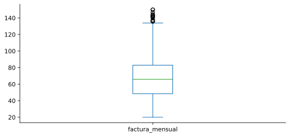

# 4. Estadísticos

> Versión web, con demos interactivas: <https://alberpro.com/temas/variables-aleatorias/estadisticos/>

> ℹ️ **Antes de empezar**
>
> Esta página usa la idea de **variable aleatoria** y su **función de probabilidad** $f(x)$ ([página 2](variables.md)), y algunas distribuciones con nombre propio como la Poisson y la normal ([página 3](distribuciones.md)).

Una distribución lo dice todo sobre una variable aleatoria, pero casi nunca necesitamos *todo*. Un director comercial no quiere ver una tabla con la probabilidad de cada importe posible de una factura. Quiere saber cuánto factura un cliente **en promedio**, si los clientes se parecen entre sí o son muy distintos, y a partir de qué importe un cliente está entre el 10 % que más gasta. Cada una de esas preguntas se responde con un número que resume una propiedad de la distribución: un **estadístico**.

En esta página veremos los tres tipos de resumen que más se usan: el **centro** (media y mediana), la **dispersión** (varianza y desviación típica) y la **posición** (cuantiles). Después veremos cómo se comportan cuando combinamos variables. Por último distinguiremos entre los estadísticos de una distribución, que casi nunca conocemos, y los de una muestra, que sí podemos calcular.

## El centro: la esperanza

### Qué pregunta responde

Una cadena de supermercados quiere regalar un **rasca y gana** a cada cliente. El 90 % de las tarjetas no tiene premio, el 8 % tiene un premio de 10 € y el 2 % tiene un premio de 100 €. Antes de lanzar la promoción, el director financiero pregunta: **¿cuánto nos cuesta en premios cada tarjeta que regalamos?**

Ninguna tarjeta concreta cuesta "lo típico": cuesta 0, 10 o 100 €. Pero si se regalan 100 000 tarjetas, unas 90 000 no tendrán premio, unas 8 000 costarán 10 € y unas 2 000 costarán 100 €. El coste total será aproximadamente $8000 \cdot 10 + 2000 \cdot 100 = 280\,000$ €, es decir, **2.80 € por tarjeta**. Ese número es la esperanza de la variable "premio de una tarjeta".

> 📘 **Definición: esperanza (media) de una variable aleatoria**
>
> La **esperanza** o **media** de $X$, que se escribe $\mathbb{E}[X]$ o $\mu$, es la suma de los valores posibles ponderados por su probabilidad:
>
> $$\mathbb{E}[X] = \sum_x x\, f(x) \quad \text{(discreta)} \qquad\qquad \mathbb{E}[X] = \int_{-\infty}^{\infty} x\, f(x)\, dx \quad \text{(continua)}$$
>
> Aquí $f(x)$ es la función de probabilidad (PMF) o de densidad (PDF) de $X$. La integral es la versión continua de la suma.

**Interpretación.** La esperanza es el **promedio a largo plazo**: si repetimos el experimento muchísimas veces, la media de los resultados se acerca a $\mathbb{E}[X]$. Por eso es la cifra relevante para decisiones que se repiten muchas veces (promociones, seguros, inventario). También se puede ver como el **precio justo** de un juego: pagar más de 2.80 € por una tarjeta sería perder dinero a la larga.

Fíjate en que la esperanza **no tiene por qué ser un valor posible**: ninguna tarjeta tiene un premio de 2.80 €, igual que ningún dado saca 3.5. La esperanza es el centro de gravedad de la distribución, no "el resultado más probable" (eso es la moda).

### Ejemplo resuelto: calcular la esperanza a mano

La forma más segura de calcular una esperanza a mano es con una tabla: una fila por valor y una columna con el producto $x \cdot f(x)$.

| Premio $x$ (€) | $f(x)$ | $x \cdot f(x)$ |
|---:|---:|---:|
| 0 | 0.90 | 0.00 |
| 10 | 0.08 | 0.80 |
| 100 | 0.02 | 2.00 |
| **Total** | **1.00** | $\mathbb{E}[X] = $ **2.80** |

Comprueba siempre que la columna $f(x)$ suma 1. Si no, falta algún valor o hay un error en las probabilidades.

## La dispersión: varianza y desviación típica

### Qué pregunta responde

Dos proveedores tardan **de media 5 días** en entregar. Con el proveedor A, la entrega llega en 4, 5 o 6 días, con la misma probabilidad. Con el proveedor B, llega en 1, 5 o 9 días, también con la misma probabilidad. Si solo miras la media, son iguales. Si tienes que planificar un almacén, B es mucho peor: con B a veces te quedas una semana sin material. Necesitamos un número que mida **cuánto se alejan los valores de la media**.

La idea natural sería promediar las distancias a la media, $X - \mu$, pero ese promedio **siempre vale cero**: las desviaciones positivas y las negativas se compensan exactamente. Hay que quitarles el signo, y la opción estándar es **elevarlas al cuadrado**. El cuadrado tiene dos ventajas frente al valor absoluto. Penaliza más las desviaciones grandes, que suelen ser las caras en un negocio. Y tiene propiedades matemáticas muy cómodas, como que la varianza de una suma de variables independientes es la suma de las varianzas, como veremos más abajo.

> 📘 **Definición: varianza y desviación típica**
>
> La **varianza** de $X$ es la esperanza de la desviación al cuadrado respecto a la media $\mu = \mathbb{E}[X]$:
>
> $$\mathbb{V}[X] = \sigma^2 = \mathbb{E}\big[(X - \mu)^2\big] = \sum_x (x - \mu)^2 f(x) \quad\text{(discreta)}$$
>
> La **desviación típica** es su raíz cuadrada: $\sigma = \sqrt{\mathbb{V}[X]}$.
>
> Para calcularla a mano suele ser más rápida esta fórmula equivalente: $\mathbb{V}[X] = \mathbb{E}[X^2] - \mathbb{E}[X]^2$.

**Interpretación.** La varianza está en **unidades al cuadrado** (días², €²), que no tienen sentido intuitivo. Por eso, para comunicar la dispersión se usa la **desviación típica**, que está en las mismas unidades que la variable: "las entregas de B se desvían típicamente unos 3 días de la media".

> ✏️ **Ejemplo resuelto: los dos proveedores**
>
> **Proveedor A.** Con $\mu = 5$, las desviaciones son $-1, 0, 1$, y sus cuadrados son $1, 0, 1$, cada uno con probabilidad $1/3$:
>
> $$\mathbb{V}[A] = \tfrac{1}{3}(1 + 0 + 1) = 0.67 \text{ días}^2, \qquad \sigma_A = 0.82 \text{ días}$$
>
> **Proveedor B.** Las desviaciones son $-4, 0, 4$ y sus cuadrados $16, 0, 16$:
>
> $$\mathbb{V}[B] = \tfrac{1}{3}(16 + 0 + 16) = 10.67 \text{ días}^2, \qquad \sigma_B = 3.27 \text{ días}$$
>
> B tiene la misma media que A pero **cuatro veces su desviación típica**. Para el almacén eso significa más stock de seguridad.

> ✏️ **Ejemplo resuelto: el riesgo del rasca y gana**
>
> Volvamos a la promoción, con $\mu = 2.80$ €. Añadimos a la tabla la columna $(x - \mu)^2 f(x)$:
>
> | $x$ | $f(x)$ | $(x - \mu)^2$ | $(x - \mu)^2 f(x)$ |
> |---:|---:|---:|---:|
> | 0 | 0.90 | 7.84 | 7.06 |
> | 10 | 0.08 | 51.84 | 4.15 |
> | 100 | 0.02 | 9447.84 | 188.96 |
> | | | **Total** | $\mathbb{V}[X] = $ **200.16** |
>
> $\sigma = \sqrt{200.16} \approx 14.15$ €. Con el atajo sale lo mismo: $\mathbb{E}[X^2] = 0.08 \cdot 100 + 0.02 \cdot 10\,000 = 208$ y $208 - 2.8^2 = 200.16$.
>
> La desviación típica es cinco veces la media. Casi toda la varianza la produce el premio de 100 €, que es raro pero enorme. Una tarjeta concreta es muy impredecible. En el [teorema del límite central](inferencia.md) veremos por qué, aun así, el coste **total** de 100 000 tarjetas es muy predecible.

## Media o mediana: elegir el centro adecuado

La esperanza no es la única forma de medir el centro. La **mediana** es el valor que deja la mitad de la probabilidad a cada lado, y la **moda** es el valor más probable. En una distribución simétrica, como la normal, las tres coinciden. En una **asimétrica**, que es lo habitual con importes, salarios o tiempos de espera, se separan, y la media se desplaza hacia la cola larga.

> ✏️ **Ejemplo: el salario «medio»**
>
> En una pequeña empresa, nueve empleados cobran 25, 27, 28, 29, 30, 31, 32, 33 y 35 mil € al año. Su media y su mediana son 30 000 €. Si añadimos al CEO, que cobra 400 000 €, la **media sube a 67 000 €**, una cifra que no describe a nadie de la empresa. La **mediana apenas se mueve: 30 500 €**.

La mediana es **robusta**: un valor extremo solo cuenta como "un dato más por encima". La media, en cambio, suma el valor entero. ¿Cuál usar? Depende de la pregunta:

- Para describir al **individuo típico** (el cliente típico, el salario típico), usa la **mediana**.
- Para **totales y presupuestos**, usa la **media**, porque total = media × número de casos. Si la empresa quiere saber cuánto paga en salarios, necesita la media de 67 000 €, por poco representativa que sea.

Usa la demo para ver cómo reaccionan la media y la mediana a la asimetría y a un valor extremo:

▶️ [Demo interactiva: estadisticos](https://alberpro.com/temas/variables-aleatorias/demo_estadisticos.html) (en alberpro.com)

## Posición: cuantiles y percentiles

### Qué pregunta responde

Un equipo de tecnología se compromete a que su API responda en menos de 300 ms "en el 95 % de las peticiones". Esa frase no habla de la media: habla de un **cuantil**. En muchos contratos de servicio (SLA) se pactan percentiles en lugar de medias, porque lo que molesta al cliente es la **cola**: las pocas peticiones lentas.

> 📘 **Definición: cuantil**
>
> El **cuantil** $q_p$ de $X$, con $0 < p < 1$, es el valor que deja una probabilidad $p$ por debajo:
>
> $$P(X \le q_p) = p \qquad\Longleftrightarrow\qquad q_p = F^{-1}(p)$$
>
> Es la **inversa de la función de distribución** $F$. En `scipy.stats` se calcula con `.ppf(p)`.

Algunos cuantiles tienen nombre propio:

- **Mediana:** $q_{0.5}$.
- **Cuartiles:** $Q_1 = q_{0.25}$, $Q_2 = q_{0.5}$ y $Q_3 = q_{0.75}$.
- **Percentiles:** $q_{0.01}, \ldots, q_{0.99}$. En ingeniería se escriben p50, p95 y p99.

El **rango intercuartílico** $\text{IQR} = Q_3 - Q_1$ es la anchura del 50 % central. Es una medida de dispersión robusta, como la mediana.

> ✏️ **Ejemplo resuelto: tiempos de respuesta de una API**
>
> Los tiempos de respuesta siguen una distribución exponencial con media 120 ms. Sus percentiles son `stats.expon(scale=120).ppf([0.5, 0.95, 0.99])`:
>
> - **p50 ≈ 83 ms:** la mitad de las peticiones tarda menos de 83 ms.
> - **p95 ≈ 359 ms:** el compromiso de 300 ms **no se cumple**.
> - **p99 ≈ 553 ms:** 1 de cada 100 peticiones tarda más de medio segundo.
>
> La media de 120 ms parecía tranquilizadora, pero no dice nada de la cola. Además, la mediana es menor que la media, la señal típica de una distribución asimétrica a la derecha.

### Detectar valores atípicos con el IQR

Una regla muy usada (es la que dibujan los diagramas de caja) marca como **posible outlier** cualquier valor que se aleje más de $1.5 \cdot \text{IQR}$ de la caja central:

$$x < Q_1 - 1.5\,\text{IQR} \qquad\text{o}\qquad x > Q_3 + 1.5\,\text{IQR}$$

> ✏️ **Ejemplo resuelto: días de entrega**
>
> Los últimos 11 pedidos tardaron 2, 3, 3, 4, 4, 4, 5, 5, 6, 7 y 15 días. Con el método de pandas (`Series.quantile`), $Q_1 = 3.5$ y $Q_3 = 5.5$, así que $\text{IQR} = 2$. Los límites son:
>
> $$3.5 - 1.5 \cdot 2 = 0.5 \qquad\qquad 5.5 + 1.5 \cdot 2 = 8.5$$
>
> El pedido de **15 días** queda fuera y merece investigarse: ¿una incidencia de transporte? ¿un error al registrar la fecha?
>
> "Outlier" no significa "error que hay que borrar". Significa **valor que hay que mirar**. A veces es el dato más importante del conjunto.

> 📝 **Distintas formas de calcular cuartiles**
>
> Con muestras pequeñas, los cuartiles dependen del método de interpolación, y Excel, pandas y otros programas pueden dar resultados algo distintos. Con muestras grandes la diferencia desaparece.

## Comparar valores de escalas distintas: la tipificación

Ana vende 120 000 € al trimestre en una región donde la media es 100 000 € y la desviación típica 10 000 €. Luis vende 150 000 € en una región con media 130 000 € y desviación típica 25 000 €. Luis vende más en valor absoluto, pero ¿quién destaca más **dentro de su región**?

Para compararlos expresamos cada valor como **número de desviaciones típicas por encima o por debajo de su media**:

> 📘 **Definición: valor tipificado (z-score)**
>
> $$z = \frac{x - \mu}{\sigma}$$
>
> $z = 2$ significa "dos desviaciones típicas por encima de la media" y $z = -0.5$, "media desviación típica por debajo". $z$ no tiene unidades.

Ana tiene $z = (120 - 100)/10 = 2$ y Luis $z = (150 - 130)/25 = 0.8$. **Ana destaca mucho más.** Si las ventas son aproximadamente normales, un $z = 2$ deja por encima solo al 2.3 % de los vendedores. Es la misma operación que en la [normal estándar](distribuciones.md#normal-estándar).

## Combinar variables: propiedades de la media y la varianza

En los negocios rara vez trabajamos con una variable aislada. Los ingresos son precio × unidades más un fijo, el beneficio es ingresos menos costes, y las ventas totales son la suma de varias tiendas. Estas propiedades permiten calcular la media y la varianza del resultado sin tener que recalcular su distribución:

| Propiedad | Fórmula | En palabras |
|---|---|---|
| Linealidad | $\mathbb{E}[aX + b] = a\,\mathbb{E}[X] + b$ | la media sigue a la transformación |
| Suma | $\mathbb{E}[X + Y] = \mathbb{E}[X] + \mathbb{E}[Y]$ | siempre, sean o no independientes |
| Escala | $\mathbb{V}[aX + b] = a^2\, \mathbb{V}[X]$ | sumar una constante no añade dispersión |
| Suma de variables | $\mathbb{V}[X \pm Y] = \mathbb{V}[X] + \mathbb{V}[Y] \pm 2\,\text{Cov}[X, Y]$ | depende de cómo se muevan juntas |

La **covarianza** $\text{Cov}[X, Y] = \mathbb{E}\big[(X - \mu_X)(Y - \mu_Y)\big]$ mide si dos variables tienden a estar por encima de su media a la vez (positiva) o una arriba cuando la otra está abajo (negativa). Si son **independientes**, la covarianza es 0 y las varianzas simplemente se suman. La estudiaremos con detalle en [regresión lineal](../regresion-lineal-simple/index.md).

> ✏️ **Ejemplo resuelto: ingresos por hora**
>
> Entran de media 4 clientes por hora, con $X \sim \text{Poisson}(4)$, así que $\mathbb{E}[X] = \mathbb{V}[X] = 4$. Cada cliente gasta 25 € y hay un ingreso fijo de 100 € por hora. Los ingresos son $I = 25X + 100$:
>
> $$\mathbb{E}[I] = 25 \cdot 4 + 100 = 200 \text{ €}, \qquad \mathbb{V}[I] = 25^2 \cdot 4 = 2500 \text{ €}^2, \qquad \sigma_I = 50 \text{ €}$$
>
> El fijo de 100 € mueve la media pero no añade incertidumbre.

> ✏️ **Ejemplo resuelto: por qué importa la covarianza**
>
> Una empresa tiene una heladería ($X$, $\sigma_X = 30$ unidades/día) y una tienda de paraguas ($Y$, $\sigma_Y = 40$). ¿Cuánto varían las ventas totales $X + Y$?
>
> - Si fueran **independientes**: $\sigma = \sqrt{30^2 + 40^2} = 50$.
> - En realidad, los días de lluvia se venden paraguas y no helados: la covarianza es negativa, por ejemplo $-600$. Entonces $\sigma = \sqrt{900 + 1600 - 1200} \approx 36$. Las dos tiendas se **compensan**.
> - Si fueran dos heladerías, con covarianza $+600$, las malas rachas coincidirían: $\sigma = \sqrt{3700} \approx 61$.
>
> Es la idea de la **diversificación**: combinar actividades que no se mueven juntas reduce el riesgo total. Observa también que sumar desviaciones típicas ($30 + 40 = 70$) es incorrecto incluso en el caso independiente: lo que se suma son las **varianzas**.

## De la distribución a los datos: población y muestra

Todo lo anterior describe la **distribución** de una variable aleatoria, que en la práctica **no conocemos**. Lo que tenemos son **datos**: una **muestra** $x_1, \ldots, x_n$ de una **población** mucho mayor (los clientes encuestados frente a todos los clientes, los pedidos de este mes frente a todos los pedidos posibles). Con la muestra calculamos los **estadísticos muestrales**, que imitan a los de la población:

| | Población (desconocida) | Muestra (calculable) |
|---|---|---|
| Media | $\mu = \mathbb{E}[X]$ | $\bar{x} = \dfrac{1}{n}\displaystyle\sum_{i=1}^{n} x_i$ |
| Varianza | $\sigma^2 = \mathbb{V}[X]$ | $s^2 = \dfrac{1}{n - 1}\displaystyle\sum_{i=1}^{n} (x_i - \bar{x})^2$ |
| Desviación típica | $\sigma$ | $s = \sqrt{s^2}$ |
| Proporción | $p$ | $\hat{p} = $ proporción de unos en la muestra |
| Mediana, cuantiles | $q_p$ | los de la muestra ordenada |

La convención de notación es útil: **letras griegas** ($\mu$, $\sigma$, $p$) para los parámetros de la población y **letras latinas o con acento circunflejo** ($\bar{x}$, $s$, $\hat{p}$) para lo que calculamos con datos.

### ¿Por qué dividir entre n − 1?

La fórmula "natural" de la varianza muestral dividiría entre $n$. Pero la media muestral $\bar{x}$ se calcula con los mismos datos, y es justo el punto que **minimiza** la suma de distancias al cuadrado a esos datos. Por eso los datos siempre están, en conjunto, más cerca de $\bar{x}$ que de la verdadera $\mu$, y dividir entre $n$ **subestima** sistemáticamente $\sigma^2$.

Dividir entre $n - 1$ corrige exactamente ese sesgo. La idea intuitiva es que, una vez fijada $\bar{x}$, solo $n - 1$ desviaciones son libres: la última queda determinada, porque todas deben sumar cero. Por eso se habla de **$n - 1$ grados de libertad**.

El efecto se puede medir: con muestras de solo 3 datos de una normal con $\sigma^2 = 1$, la fórmula con $n$ da de media unos 0.67, es decir, $(n-1)/n$ del valor real. La fórmula con $n - 1$ da de media 1.00. Con muestras grandes, $n$ y $n - 1$ apenas se distinguen.

> ⚠️ **Cada herramienta usa una convención**
>
> - **pandas:** `serie.var()` y `serie.std()` dividen entre **n − 1** (`ddof=1`).
> - **NumPy:** `np.var(x)` y `np.std(x)` dividen entre **n** (`ddof=0`).
>
> Si dos personas obtienen varianzas distintas con los mismos datos, casi siempre es esto.

## Estimar parámetros: método de los momentos

Muchas veces suponemos que los datos siguen una distribución concreta (Poisson, normal…) pero no conocemos sus parámetros. El **método de los momentos** es la forma más directa de estimarlos: igualar la media (y si hace falta la varianza) teórica de la distribución a la de la muestra, y despejar.

$$\mathbb{E}[X] \approx \bar{x}, \qquad \mathbb{V}[X] \approx s^2$$

Los parámetros estimados se marcan con un acento circunflejo ($\hat{\lambda}$, $\hat{\mu}$, $\hat{p}$) para recordar que son **estimaciones con incertidumbre**, no los valores reales.

> ✏️ **Ejemplo resuelto: llamadas por hora (Poisson)**
>
> En 10 horas, un call center recibió 3, 5, 2, 4, 6, 3, 4, 1, 5 y 7 llamadas. Si suponemos una Poisson, como $\mathbb{E}[X] = \lambda$, estimamos $\hat{\lambda} = \bar{x} = 40/10 = 4$ llamadas por hora.
>
> **Comprobación de la suposición:** en una Poisson la media y la varianza coinciden. Aquí $s^2 = 3.33$, que es razonablemente cercano a 4 para solo 10 datos. Con el modelo estimado podemos responder preguntas nuevas: la probabilidad de recibir 8 o más llamadas en una hora es `stats.poisson(4).sf(7)` $\approx 0.051$, más o menos 1 hora de cada 20.

> ✏️ **Ejemplo resuelto: tiempos de entrega (normal)**
>
> Ocho entregas tardaron 46, 51, 49, 55, 44, 50, 47 y 53 horas. Si suponemos que son normales, estimamos $\hat{\mu} = \bar{x} = 49.4$ h y $\hat{\sigma} = s = 3.66$ h. La probabilidad estimada de que una entrega supere las 56 h es `stats.norm(49.4, 3.66).sf(56)` $\approx 0.035$.
>
> Con solo 8 datos, estas estimaciones son bastante inseguras. En la [siguiente página](inferencia.md) veremos cómo cuantificar esa incertidumbre.

Este método es exactamente lo que haremos en la [práctica guiada](practica.md): estimar la probabilidad $p$ de aceptar las cookies con la proporción observada $\hat{p}$.

> ⛔ **Errores frecuentes**
>
> - **Sumar desviaciones típicas.** Se suman las varianzas (y solo directamente si hay independencia).
> - **Usar la media para describir lo «típico»** en datos asimétricos, como salarios, importes o tiempos. Usa la mediana.
> - **Leer la desviación típica en la escala de la varianza.** σ = 14 € no significa que «la varianza es 14».
> - **Borrar outliers automáticamente.** Primero entiende de dónde vienen.
> - **Mezclar $n$ y $n - 1$** entre herramientas sin darse cuenta.

## En Python

```python
import numpy as np
import pandas as pd
import matplotlib.pyplot as plt
from scipy import stats

# Esperanza y varianza a partir de una tabla de probabilidades
x = np.array([0, 10, 100])
f = np.array([0.90, 0.08, 0.02])
mu = (x * f).sum()                       # 2.8
var = ((x - mu) ** 2 * f).sum()          # 200.16

# Estadísticos de una muestra
df = pd.read_csv("https://raw.githubusercontent.com/ami232/nebrija-mpan/main/data/telco_churn.csv")
factura = df["factura_mensual"]          # factura mensual de 5000 clientes de una operadora
factura.describe()                       # n, media, desv. típica (n−1), mín, Q1, mediana, Q3, máx
```

```text
count    5000.0000
mean       66.0819
std        24.4076
min        20.0000
25%        48.4900
50%        65.8450
75%        82.9025
max       150.0000
Name: factura_mensual, dtype: float64
```

```python
factura.quantile([0.1, 0.5, 0.9])        # percentiles 10, 50 y 90
```

```text
0.1    33.746
0.5    65.845
0.9    98.260
Name: factura_mensual, dtype: float64
```

```python
iqr = factura.quantile(0.75) - factura.quantile(0.25)
z = (factura - factura.mean()) / factura.std()   # valores tipificados
factura.plot.box()                       # diagrama de caja
plt.show()
```



```python
# Método de los momentos para una Poisson
llamadas = pd.Series([3, 5, 2, 4, 6, 3, 4, 1, 5, 7])
lam_hat = llamadas.mean()                # 4.0
print(llamadas.var())                    # 3.33: ¿parecido a la media?
```

```text
3.3333333333333335
```

```python
print(stats.poisson(lam_hat).sf(7))      # P(X ≥ 8) ≈ 0.051
```

```text
0.0511336157928473
```

> ✅ **Lo esencial**
>
> - La **esperanza** es el promedio a largo plazo, $\sum x f(x)$. Es la cifra para totales, presupuestos y decisiones repetidas, aunque no sea un valor posible.
> - La **desviación típica** mide cuánto se alejan los valores de la media, en las unidades de la variable. La varianza es su cuadrado.
> - Con datos asimétricos o con outliers, la **mediana** describe mejor lo típico que la media. Los **cuantiles** describen las colas (p95, p99), que es lo que suele importar en un SLA.
> - El **z-score** $z = (x - \mu)/\sigma$ compara valores de escalas distintas.
> - Las medias se suman siempre. Las **varianzas** se suman si hay independencia, y si no hay que añadir la covarianza.
> - Con datos solo podemos calcular **estadísticos muestrales** ($\bar{x}$, $s$, $\hat{p}$). Estimar parámetros igualándolos a los teóricos es el **método de los momentos**.

## Ejercicios

**1.** El número de productos por pedido en una tienda online vale 1 con probabilidad 0.5, 2 con probabilidad 0.3 y 3 con probabilidad 0.2. Calcula la media, la varianza y la desviación típica.

<details>
<summary>✅ <b>Solución</b></summary>

$\mathbb{E}[X] = 1 \cdot 0.5 + 2 \cdot 0.3 + 3 \cdot 0.2 = 1.7$ productos.

$\mathbb{E}[X^2] = 1 \cdot 0.5 + 4 \cdot 0.3 + 9 \cdot 0.2 = 3.5$, así que $\mathbb{V}[X] = 3.5 - 1.7^2 = 0.61$ y $\sigma = \sqrt{0.61} \approx 0.78$ productos.

Si se esperan 1000 pedidos, hay que preparar unos 1700 productos.

</details>

**2.** Los tiempos de resolución de 10 incidencias (horas) son 1, 2, 2, 3, 3, 3, 4, 4, 5 y 30. Calcula la media y la mediana. ¿Es el 30 un outlier según la regla del IQR? ¿Qué cifra darías como "tiempo típico de resolución"?

<details>
<summary>✅ <b>Solución</b></summary>

La media es 57/10 = 5.7 h y la mediana 3 h. Con pandas, $Q_1 = 2.25$ y $Q_3 = 4$, así que $\text{IQR} = 1.75$ y el límite superior es $4 + 1.5 \cdot 1.75 = 6.625$. **El 30 es un outlier.**

Como tiempo típico, la **mediana (3 h)**. La media está inflada por un único caso: sin él, la media sería 3 h. Aun así, la incidencia de 30 h merece análisis aparte, por ejemplo para ver si es un tipo de incidencia distinto.

</details>

**3.** Un cliente gasta 180 € al mes en una tienda donde el gasto mensual tiene media 120 € y desviación típica 40 €. Otro cliente gasta 45 € en una tienda donde la media es 30 € y la desviación típica 5 €. ¿Cuál de los dos es más excepcional en su tienda?

<details>
<summary>✅ <b>Solución</b></summary>

El primero tiene $z = (180 - 120)/40 = 1.5$ y el segundo $z = (45 - 30)/5 = 3$. **El segundo es mucho más excepcional**: está a 3 desviaciones típicas de la media de su tienda, aunque gaste mucho menos en euros.

</details>

**4.** El coste diario de un almacén es $C = 2X + 50$ (€), donde $X$ es el número de palés movidos, con media 100 y desviación típica 15. Calcula la media y la desviación típica del coste. Si el almacén tiene dos turnos independientes con ese mismo coste, ¿cuál es la desviación típica del coste total?

<details>
<summary>✅ <b>Solución</b></summary>

$\mathbb{E}[C] = 2 \cdot 100 + 50 = 250$ € y $\sigma_C = |2| \cdot 15 = 30$ €. El fijo de 50 € no cambia la dispersión.

Para los dos turnos independientes: $\mathbb{V}[C_1 + C_2] = 30^2 + 30^2 = 1800$, así que $\sigma = \sqrt{1800} \approx 42.4$ €, **no** 60 €.

</details>

**5.** Con la muestra 4, 8, 6, 2, calcula la varianza dividiendo entre $n$ y entre $n - 1$. ¿Qué daría `np.var` y qué daría `pd.Series.var`?

<details>
<summary>✅ <b>Solución</b></summary>

$\bar{x} = 5$. Las desviaciones son $-1, 3, 1, -3$, y sus cuadrados suman $1 + 9 + 1 + 9 = 20$. Dividiendo entre $n = 4$ sale **5**, que es lo que da `np.var(x)`. Dividiendo entre $n - 1 = 3$ sale **6.67**, que es lo que da `pd.Series(x).var()`. Con solo 4 datos la diferencia es notable.

</details>

**6.** *(Más difícil)* Una aseguradora vende un seguro de móvil. En un año, cada cliente tiene un 5 % de probabilidad de un siniestro de 300 € y un 95 % de no tener ninguno. (a) ¿Cuál es la prima "justa", es decir, el coste esperado por cliente? (b) ¿Cuál es la desviación típica del coste de un cliente? (c) Si la aseguradora tiene 10 000 clientes independientes, ¿cuál es la media y la desviación típica del coste total, y del coste **por cliente**?

<details>
<summary>✅ <b>Solución</b></summary>

(a) $\mathbb{E}[X] = 0.05 \cdot 300 = 15$ € por cliente y año.

(b) $\mathbb{E}[X^2] = 0.05 \cdot 300^2 = 4500$, así que $\mathbb{V}[X] = 4500 - 15^2 = 4275$ y $\sigma \approx 65.4$ €. Un cliente concreto es muy impredecible.

(c) Para el total $T = X_1 + \cdots + X_{10\,000}$: $\mathbb{E}[T] = 150\,000$ € y $\mathbb{V}[T] = 10\,000 \cdot 4275$, así que $\sigma_T \approx 6538$ €. Por cliente, $\bar{X} = T/10\,000$ tiene media 15 € y desviación típica $65.4/\sqrt{10\,000} = 0.65$ €. **El coste medio por cliente es muy predecible**, aunque cada cliente no lo sea. Es el principio de un seguro, y lo formaliza la [siguiente página](inferencia.md).

</details>

[← Distribuciones](distribuciones.md) [Siguiente: Inferencia →](inferencia.md)
