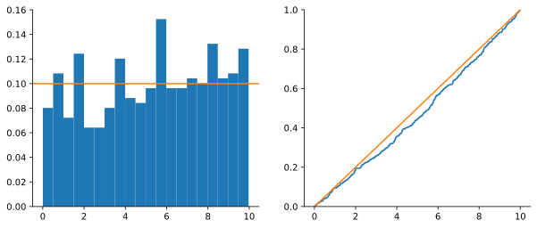

# 2. Variables aleatorias

> Versión web, con demos interactivas: <https://alberpro.com/temas/variables-aleatorias/variables/>

> ℹ️ **Lo que necesitas antes**
>
> Qué es un experimento aleatorio, un suceso y cómo se calcula su probabilidad. Lo tienes en [1. Probabilidad](probabilidad.md).

## Por qué necesitamos números

Imagina que gestionas una tienda online y quieres planificar el embalaje: cuántas cajas de cada tamaño pedir, cuánto tiempo de preparación reservar por pedido. Cada pedido es el resultado de un experimento aleatorio: no sabes de antemano qué comprará el próximo cliente. Con lo visto en la página anterior podrías describir sucesos como "el pedido tiene más de tres artículos" y calcular su probabilidad, pero en cuanto quieras responder preguntas como **"¿cuántos artículos tiene un pedido en promedio?"** o **"¿cuánto varía ese número?"** necesitas algo más: necesitas que el resultado del experimento sea un **número** con el que se pueda sumar, promediar y comparar.

Eso es exactamente una variable aleatoria: una regla que convierte cada resultado del experimento en un número. El pedido "dos camisetas y un pantalón" se convierte en el número 3; el cliente que deja cuatro estrellas, en un 4; el usuario que acepta las cookies, en un 1.

> 📘 **Definición: variable aleatoria**
>
> Una **variable aleatoria** $X$ es una función que asigna un número real a cada resultado de un experimento aleatorio.
>
> Se escribe con **mayúscula** ($X$, $Y$, $Z$) cuando hablamos de la variable en abstracto —"el número de artículos del próximo pedido", que aún no conocemos— y con **minúscula** ($x$, $y$, $z$) para un valor concreto ya observado. La expresión $P(X = 3)$ se lee "probabilidad de que el próximo pedido tenga 3 artículos".

La misma situación admite varias variables aleatorias según lo que nos interese medir. De un pedido podemos extraer el número de artículos, el importe total en euros o el tiempo que tarda en llegar. Elegir la variable es la primera decisión de modelado: debe responder a la pregunta de negocio.

### Discretas y continuas

Las variables aleatorias se dividen en dos grandes familias, y la distinción importa porque cambia la forma de calcular probabilidades:

- Una variable es **discreta** si sus valores posibles se pueden enumerar uno a uno: $0, 1, 2, \ldots$ Son discretos los **conteos** (artículos, clientes, reclamaciones) y las categorías codificadas con números (acepta = 1, rechaza = 0).
- Una variable es **continua** si puede tomar cualquier valor dentro de un intervalo: el tiempo de entrega, la altura, un importe. Entre 2.5 y 2.6 días caben infinitos valores posibles.

Una regla práctica: si la pregunta natural es "¿cuántos?", la variable es discreta; si es "¿cuánto mide?" o "¿cuánto tarda?", continua. Los importes en euros se redondean a céntimos y técnicamente son discretos, pero hay tantos valores posibles que se modelan como continuos.

## Variables discretas: la función de masa de probabilidad

Volvamos a los pedidos. Para describir completamente el comportamiento de "número de artículos por pedido" basta con decir qué probabilidad tiene cada valor posible. Supongamos que revisamos 200 pedidos recientes y contamos:

| Artículos por pedido $x$ | 1 | 2 | 3 | 4 | 5 |
|---|---|---|---|---|---|
| Nº de pedidos | 80 | 60 | 36 | 16 | 8 |
| Proporción $f(x)$ | 0.40 | 0.30 | 0.18 | 0.08 | 0.04 |

Si suponemos que estas proporciones reflejan bien el comportamiento de los clientes, la última fila es la **función de masa de probabilidad** (PMF, del inglés *probability mass function*) de $X$: a cada valor le asigna su probabilidad.

> 📘 **Definición: función de masa de probabilidad (PMF)**
>
> Para una variable discreta $X$, la función de masa de probabilidad es
> $$f(x) = P(X = x)$$
> y cumple dos condiciones: $f(x) \ge 0$ para todo $x$, y la suma sobre todos los valores posibles es $\sum_x f(x) = 1$.

Con la PMF se calcula la probabilidad de cualquier suceso **sumando** las probabilidades de los valores que lo forman. Por ejemplo, la probabilidad de que un pedido necesite una caja grande (3 artículos o más) es

$$P(X \ge 3) = f(3) + f(4) + f(5) = 0.18 + 0.08 + 0.04 = 0.30.$$

Un valor que la variable no puede tomar tiene probabilidad cero: $P(X = 2.5) = 0$, porque ningún pedido tiene dos artículos y medio.

### Un adelanto: el valor esperado

La PMF también responde a "¿cuántos artículos tiene un pedido en promedio?". Si recibiéramos muchísimos pedidos, el 40 % tendría 1 artículo, el 30 % tendría 2, etc. El promedio a largo plazo es, por tanto, la media de los valores **ponderada por su probabilidad**:

$$\mathbb{E}[X] = 1 \cdot 0.40 + 2 \cdot 0.30 + 3 \cdot 0.18 + 4 \cdot 0.08 + 5 \cdot 0.04 = 2.06 \text{ artículos}.$$

A este número se le llama **valor esperado** o **esperanza** de $X$. Observa que 2.06 no es un valor que un pedido concreto pueda tomar: es el centro de gravedad de la distribución, lo que esperas por pedido cuando promedias sobre muchos. Si mañana llegan 1000 pedidos, deberías preparar material para unos 2060 artículos. Estudiaremos la esperanza y la varianza con detalle en [4. Estadísticos](estadisticos.md).

## Variables continuas: la función de densidad

Con una variable continua el enfoque anterior no funciona. Piensa en el tiempo de entrega de los pedidos medido con precisión de segundos: la probabilidad de que un pedido tarde **exactamente** 2.500000… días es cero, porque hay infinitos valores posibles y ninguno concreto puede acumular probabilidad positiva. Por eso en las variables continuas nunca preguntamos por un valor exacto, sino por **intervalos**: "¿qué probabilidad hay de que tarde entre 2 y 3 días?".

Para entender cómo se describe una variable continua, imagina el histograma de miles de tiempos de entrega, dibujado de forma que el **área** de cada barra sea la proporción de pedidos en ese intervalo (lo que en Python se consigue con `density=True`). Si las barras miden un día de ancho, el histograma es tosco. Si las estrechas a medio día, a una hora, a un minuto —y tienes datos suficientes para llenarlas—, el contorno de las barras se va suavizando hasta convertirse en una curva. Esa curva límite es la **función de densidad**.

> 📘 **Definición: función de densidad de probabilidad (PDF)**
>
> Una variable continua $X$ se describe con una función de densidad $f(x) \ge 0$ tal que la probabilidad de cualquier intervalo es el **área bajo la curva** en ese intervalo:
> $$P(a < X \le b) = \int_a^b f(x)\, dx, \qquad \text{con} \qquad \int_{-\infty}^{\infty} f(x)\, dx = 1.$$

Como la probabilidad es un área, $f(x)$ en sí misma **no es una probabilidad**: es una densidad, "probabilidad por unidad de $x$". Sus unidades lo delatan: si $x$ se mide en días, $f(x)$ se mide en "probabilidad por día". Por eso una densidad puede valer más que 1 sin ningún problema, siempre que el área total sea 1. Y por eso, en una variable continua, da igual escribir $<$ o $\le$: el área sobre un único punto es cero.

> ✏️ **Ejemplo resuelto: esperar al metro**
>
> Un metro pasa cada 10 minutos exactos y llegas al andén sin mirar el horario. Tu tiempo de espera $X$ puede ser cualquier valor entre 0 y 10 minutos, y ninguno es más probable que otro. La densidad es constante en ese intervalo: un rectángulo de base 10 y área 1, así que su altura es $f(x) = 1/10$ para $0 \le x \le 10$ (y 0 fuera).
>
> - **Probabilidad de esperar más de 7 minutos:** es el área del rectángulo entre 7 y 10, es decir, $(10 - 7) \cdot \frac{1}{10} = 0.3$.
> - **Probabilidad de esperar exactamente 5 minutos:** el área sobre un punto es cero, $P(X = 5) = 0$.
> - **¿Y si el metro pasara cada 30 segundos?** La espera iría de 0 a 0.5 minutos y la altura del rectángulo sería $f(x) = 2$: mayor que 1, y perfectamente válida.

## La función de distribución: una herramienta para todo

Hasta ahora tenemos dos herramientas distintas: sumar la PMF en el caso discreto, calcular áreas bajo la PDF en el continuo. La **función de distribución** unifica ambos casos y es, en la práctica, la herramienta que más usarás (también es lo que calculan las funciones `cdf` de Python).

> 📘 **Definición: función de distribución (CDF)**
>
> La función de distribución o función de distribución acumulada de $X$ da, para cada valor $x$, la probabilidad de observar un valor **menor o igual**:
> $$F(x) = P(X \le x) = \begin{cases} \displaystyle\sum_{k \le x} f(k) & \text{si } X \text{ es discreta} \\[2ex] \displaystyle\int_{-\infty}^{x} f(t)\, dt & \text{si } X \text{ es continua} \end{cases}$$

Su gran ventaja es que, conocida $F$, cualquier probabilidad de un intervalo sale con una resta:

$$P(a < X \le b) = F(b) - F(a), \qquad P(X > a) = 1 - F(a).$$

En los pedidos, acumulando la tabla de la PMF se obtiene $F(1) = 0.40$, $F(2) = 0.70$, $F(3) = 0.88$, $F(4) = 0.96$ y $F(5) = 1$. En el metro, el área desde 0 hasta $x$ es $F(x) = x/10$.

Toda función de distribución empieza en 0 (muy a la izquierda no hay probabilidad acumulada), nunca baja y termina en 1. En una variable **discreta** tiene forma de **escalera**: es plana entre valores posibles y salta en cada uno, con un salto igual a su probabilidad. En una **continua** es una curva que sube sin saltos.

> ⚠️ **Cuidado con los extremos en variables discretas**
>
> En una variable discreta, $<$ y $\le$ **no** son lo mismo. Para la probabilidad de 3 artículos o más en los pedidos, "3 o más" es lo contrario de "2 o menos": $P(X \ge 3) = 1 - F(2) = 1 - 0.70 = 0.30$. Usar $1 - F(3)$ daría $0.12$, que es la probabilidad de **más de** 3. En variables continuas este problema no existe.

### Leer la CDF al revés: los cuantiles

La CDF responde a "¿qué probabilidad hay de quedar por debajo de $x$?". Muchas preguntas de negocio van en sentido contrario: "¿qué tiempo de espera no se supera el 90 % de las veces?". Eso es leer la CDF al revés: buscar el $x$ en el que $F(x)$ alcanza 0.9. En el metro, $x/10 = 0.9$ da $x = 9$ minutos. Ese valor se llama **cuantil** o **percentil 90**, y el que deja la mitad de la probabilidad a cada lado es la **mediana** (5 minutos en el metro; 2 artículos en los pedidos, el primer valor donde $F$ alcanza 0.5). Volveremos a los cuantiles en [4. Estadísticos](estadisticos.md).

## Lo que vemos en los datos: distribuciones empíricas

Todo lo anterior describe la distribución **real** de una variable, la que generaría los datos si repitiéramos el experimento infinitas veces. En la práctica nunca la vemos: lo que tenemos es una **muestra**, una lista finita de valores observados $x_1, x_2, \ldots, x_n$. La tabla de 200 pedidos del principio era justo eso, y la usamos como si fuera la distribución real. ¿Hasta qué punto es legítimo?

Con una muestra construimos las versiones empíricas de las funciones anteriores:

- El **histograma** es la versión empírica de la PMF o la PDF. Divide el rango de valores en intervalos y muestra cuántas observaciones caen en cada uno (o qué proporción, o qué densidad).
- La **función de distribución empírica** (ECDF) es la versión empírica de la CDF: para cada valor $x$, la proporción de observaciones que son menores o iguales que $x$,
  $$\hat{F}_n(x) = \frac{\text{nº de observaciones} \le x}{n}.$$

### Cómo leer una ECDF

La ECDF es una escalera que sube $1/n$ en cada observación. Se lee igual que una CDF y responde directamente a preguntas de porcentajes. Si la ECDF de los tiempos de entrega vale 0.85 en los 3 días, el 85 % de los pedidos llegó en 3 días o menos, y el 15 % tardó más. Buscando dónde la escalera cruza la altura 0.5 obtienes la mediana, y en 0.9 el percentil 90. Donde la escalera sube con pendiente fuerte hay muchos datos concentrados; donde es casi plana, pocos.

### El histograma depende de cómo lo dibujes

El histograma es más intuitivo pero tiene una trampa: su forma depende del **número y la posición de los intervalos** (*bins*). Con pocos intervalos anchos esconde detalles, como una distribución con dos picos. Con muchos intervalos estrechos y pocos datos parece una sucesión de barras al azar. Ante la duda, prueba varios valores de `bins` antes de sacar conclusiones, o mira la ECDF, que no depende de ninguna elección.

### Más datos, más confianza: el teorema fundamental

La justificación de usar los datos como sustituto de la distribución real es un resultado clásico:

> 📘 **Teorema fundamental de la estadística (Glivenko–Cantelli)**
>
> A medida que el tamaño de la muestra $n$ crece, la función de distribución empírica $\hat{F}_n$ se acerca a la función de distribución real $F$ en **todos** los puntos a la vez: la máxima distancia entre ambas tiende a cero.

En términos prácticos: **con muchos datos, la forma que ves en ellos es la forma de la distribución real**, y puedes estimar con confianza sus características (media, cuantiles, probabilidades). Con pocos datos, en cambio, la forma observada puede engañar bastante. ¿Cuántos datos son "muchos"? No hay una cifra universal, pero la demo te da una idea: elige una distribución, sube $n$ y observa cómo el histograma y la ECDF se pegan a la curva teórica. Fíjate también en la máxima distancia ECDF–CDF, que es lo que el teorema dice que tiende a cero.

▶️ [Demo interactiva: empirica](https://alberpro.com/temas/variables-aleatorias/demo_empirica.html) (en alberpro.com)

> ⚠️ **Errores frecuentes**
>
> - **Tratar la densidad como probabilidad.** $f(x) = 1.4$ no significa "probabilidad 1.4". Las probabilidades de una variable continua son áreas.
> - **Preguntar por un valor exacto en una variable continua.** $P(X = 2.5) = 0$ siempre. Pregunta por intervalos.
> - **Confundir $\ge$ con $>$ en variables discretas** al usar la CDF: $P(X \ge k) = 1 - F(k - 1)$.
> - **Sacar conclusiones de un histograma con pocos datos** o con una elección de intervalos poco afortunada.

## En Python

Construir la PMF y la CDF empíricas a partir de datos con pandas, y comparar una muestra con una distribución teórica:

```python
import numpy as np
import pandas as pd
import matplotlib.pyplot as plt
from scipy import stats

# PMF y CDF empíricas de los artículos por pedido
pedidos = pd.Series([1] * 80 + [2] * 60 + [3] * 36 + [4] * 16 + [5] * 8)
pmf = pedidos.value_counts(normalize=True).sort_index()   # proporción de cada valor
cdf = pmf.cumsum()                                          # acumulada: F(1), F(2), ...
print(pmf, cdf, sep="\n")
```

```text
1    0.40
2    0.30
3    0.18
4    0.08
5    0.04
Name: proportion, dtype: float64
1    0.40
2    0.70
3    0.88
4    0.96
5    1.00
Name: proportion, dtype: float64
```

```python
print("P(X >= 3) =", round(1 - cdf[2], 2))                            # 0.30
```

```text
P(X >= 3) = 0.3
```

```python
print("Valor esperado =", (pmf.index * pmf).sum())          # 2.06
```

```text
Valor esperado = 2.06
```

```python
# Histograma (densidad) y ECDF de una muestra continua frente a la teoría
rng = np.random.default_rng(0)
espera = rng.uniform(0, 10, size=500)                       # 500 esperas al metro
fig, (ax1, ax2) = plt.subplots(1, 2, figsize=(10, 4))
ax1.hist(espera, bins=20, density=True)                     # density=True: área total = 1
ax1.axhline(1 / 10, color="C1")                             # densidad teórica f(x) = 1/10
ax2.ecdf(espera)                                            # ECDF (matplotlib >= 3.8)
ax2.plot([0, 10], [0, 1], color="C1")                       # CDF teórica F(x) = x/10
plt.show()
```



```python
print("Proporción de esperas > 7 min:", (espera > 7).mean())   # cerca de 0.3
```

```text
Proporción de esperas > 7 min: 0.338
```

> ✅ **Lo esencial**
>
> - Una **variable aleatoria** convierte los resultados de un experimento en números; puede ser **discreta** (conteos) o **continua** (medidas).
> - En una discreta, la **PMF** da la probabilidad de cada valor y las probabilidades de sucesos se obtienen **sumando**.
> - En una continua, la **PDF** es una densidad: las probabilidades son **áreas** bajo la curva y la de un valor exacto es cero.
> - La **CDF** $F(x) = P(X \le x)$ sirve para ambos casos: $P(a < X \le b) = F(b) - F(a)$. Leída al revés da los **cuantiles**.
> - El **histograma** y la **ECDF** son las versiones empíricas; con muestras grandes se parecen a la distribución real (Glivenko–Cantelli).

## Ejercicios

**1.** Clasifica como discreta o continua: número de reclamaciones al mes, importe de una compra, valoración de 1 a 5 estrellas, tiempo de carga de una web.

<details>
<summary>✅ <b>Solución</b></summary>

- Reclamaciones al mes: **discreta**, porque es un conteo.
- Importe de una compra: **continua** a efectos de modelado; aunque se redondee a céntimos, hay tantísimos valores posibles que se trata como continua.
- Valoración en estrellas: **discreta**, con cinco valores posibles.
- Tiempo de carga: **continua**, es una medida de tiempo.

</details>

**2.** El número de reclamaciones diarias en una tienda tiene esta PMF: f(0) = 0.50, f(1) = 0.30, f(2) = 0.15, f(3) = 0.05. Calcula la probabilidad de recibir al menos una reclamación, F(1) y el número esperado de reclamaciones por día.

<details>
<summary>✅ <b>Solución</b></summary>

- **Al menos una:** es el complementario de ninguna, $P(X \ge 1) = 1 - f(0) = 0.50$.
- **$F(1)$:** se acumula hasta el 1, $F(1) = f(0) + f(1) = 0.80$. El 80 % de los días hay como mucho una reclamación.
- **Valor esperado:** $\mathbb{E}[X] = 0 \cdot 0.50 + 1 \cdot 0.30 + 2 \cdot 0.15 + 3 \cdot 0.05 = 0.75$ reclamaciones por día. En un mes de 30 días esperamos unas 22 o 23.

</details>

**3.** Un compañero propone esta PMF para el número de productos devueltos por pedido: f(0) = 0.6, f(1) = 0.3, f(2) = 0.2. ¿Es válida? Si no lo es, ¿qué valor debería tener f(2) para que lo fuera?

<details>
<summary>✅ <b>Solución</b></summary>

No es válida: las probabilidades suman $0.6 + 0.3 + 0.2 = 1.1$, y una PMF debe sumar exactamente 1. Manteniendo $f(0)$ y $f(1)$, tendría que ser $f(2) = 1 - 0.6 - 0.3 = 0.1$.

</details>

**4.** En el ejemplo del metro (espera uniforme entre 0 y 10 minutos), calcula P(3 < X ≤ 8) usando la CDF y el tiempo de espera que no se supera el 90 % de las veces. ¿Qué significa que f(5) = 0.1?

<details>
<summary>✅ <b>Solución</b></summary>

- Con $F(x) = x/10$: $P(3 < X \le 8) = F(8) - F(3) = 0.8 - 0.3 = 0.5$.
- El percentil 90 es el $x$ con $F(x) = 0.9$: $x = 9$ minutos.
- $f(5) = 0.1$ **no** es la probabilidad de esperar 5 minutos (que es 0), sino la densidad: alrededor de los 5 minutos hay "0.1 de probabilidad por minuto". Por ejemplo, $P(4.5 < X \le 5.5) \approx 0.1 \times 1 = 0.1$.

</details>

**5.** En la ECDF de los tiempos de respuesta del servicio de atención al cliente, la escalera vale 0.85 a la altura de 30 minutos y cruza 0.5 en 12 minutos. Interprétalo para un informe.

<details>
<summary>✅ <b>Solución</b></summary>

El 85 % de las consultas se respondieron en 30 minutos o menos, de modo que un 15 % tardó más de media hora. La mitad de las consultas se respondió en 12 minutos o menos: la **mediana** del tiempo de respuesta es 12 minutos.

</details>

**6.** Con una muestra de 20 datos, el histograma no se parece en nada a una campana. ¿Puedes concluir que los datos no siguen una distribución normal?

<details>
<summary>✅ <b>Solución</b></summary>

No con tan pocos datos. El teorema de Glivenko–Cantelli garantiza que la forma empírica se parece a la real cuando $n$ es **grande**. Con $n = 20$ el histograma de una normal auténtica suele verse irregular, y además cambia mucho según el número de intervalos (compruébalo en la demo con $n = 20$ y pulsando "Otra muestra" varias veces). Con muestras pequeñas es más fiable mirar la ECDF o comparar estadísticos como la media y la mediana.

</details>

[← Probabilidad](probabilidad.md) [Siguiente: Distribuciones →](distribuciones.md)
