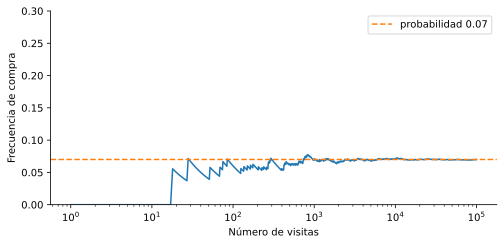

# 1.1 Sucesos y reglas de la probabilidad

> Versión web, con demos interactivas: <https://alberpro.com/nebrija-mpan/topics/01-probabilidad/probabilidad/>

> ℹ️ **Lo que necesitas antes**
>
> Nada de estadística: solo las matemáticas de bachillerato. Para la sección "En Python", lo básico de NumPy y pandas, que tienes en el [tutorial de Python](index.md#antes-de-empezar).

## Por qué necesitamos la probabilidad

La mayor parte de las cosas que interesan en un negocio no se pueden predecir con certeza. No sabemos si un cliente concreto comprará, cuántas llamadas entrarán mañana en el call center ni si un préstamo se devolverá. Lo que sí podemos saber, observando muchos casos, es **con qué frecuencia** ocurre cada cosa. Y eso basta para tomar buenas decisiones: dimensionar un equipo, fijar un precio o decidir a qué clientes llamar.

La probabilidad es el lenguaje matemático para hablar de esa incertidumbre. Una probabilidad de 0.07 significa que, si repitiéramos la situación muchas veces, el suceso ocurriría aproximadamente en el 7 % de ellas. Esta lectura como **frecuencia a largo plazo** es la que usaremos en todo el curso y la que conecta la probabilidad con los datos.

Hay situaciones que no se pueden repetir, como el lanzamiento de un producto concreto o el resultado de unas elecciones. En ellas, una probabilidad se lee como un **grado de confianza**: decir que el producto tiene un 30 % de probabilidad de éxito expresa cuánto creemos en ello con la información disponible. Las reglas de cálculo que veremos son las mismas con las dos lecturas.

Para razonar con probabilidades hacen falta dos cosas, y esta página las desarrolla en orden. Primero, describir con precisión **qué** es incierto: experimentos, resultados y sucesos. Después, asignar a cada suceso un número y saber qué reglas deben cumplir esos números.

## El lenguaje: experimentos, resultados y sucesos

Volvamos a la tienda online. Cada visita a la web es una situación cuyo resultado no conocemos de antemano: puede acabar en compra o no, puede llegar desde el móvil o desde un ordenador. Antes de calcular nada hay que poner nombre a esas piezas.

> 📘 **Definición**
>
> - Un **experimento aleatorio** es cualquier proceso cuyo resultado no se puede predecir con certeza, aunque sepamos qué resultados son posibles. Por ejemplo, observar una visita a la web y ver si compra.
> - El **espacio muestral** $\Omega$ (omega) es el conjunto de todos los resultados posibles del experimento.
> - Un **suceso** es un conjunto de resultados: cualquier afirmación sobre el resultado de la que podamos decir si se cumple o no. Se nombran con letras mayúsculas: $A$, $B$, $C$…

En la tienda, el experimento es "llega una visita". Si nos interesan el dispositivo y si compra, el espacio muestral tiene cuatro resultados:

$$\Omega = \{(\text{móvil}, \text{compra}),\ (\text{móvil}, \text{no compra}),\ (\text{ordenador}, \text{compra}),\ (\text{ordenador}, \text{no compra})\}$$

"La visita compra" es un suceso, $C$, formado por dos de esos resultados: $(\text{móvil}, \text{compra})$ y $(\text{ordenador}, \text{compra})$. "La visita llega desde el móvil" es otro suceso, $M$, y "la visita llega desde un ordenador" es $O$.

Elegir $\Omega$ es ya una **decisión de modelización**: podríamos haber incluido también el navegador, la hora o el importe. Conviene incluir lo que necesitamos para responder la pregunta y nada más.

Otro ejemplo, que usaremos para practicar porque se puede contar a mano: lanzar dos dados. Cada resultado es un par $(d_1, d_2)$, donde $d_1$ es lo que sale en el primer dado y $d_2$ lo que sale en el segundo, así que $\Omega$ tiene $6 \cdot 6 = 36$ resultados. El suceso "la suma es 4" agrupa tres de ellos: $(1, 3)$, $(2, 2)$ y $(3, 1)$. Un suceso puede contener un resultado, varios o ninguno.

### Operaciones con sucesos

Las preguntas de negocio rara vez se refieren a un solo suceso: "¿qué proporción de visitas llega desde el móvil **y** compra?", "¿cuántas **no** compran?". Los sucesos se combinan igual que los conjuntos, y cada operación tiene una traducción directa al lenguaje cotidiano:

| Notación | Se lee | Ocurre cuando… | En la tienda |
|---|---|---|---|
| $A \cup B$ | $A$ o $B$ (unión) | ocurre al menos uno de los dos | entra desde el móvil **o** compra |
| $A \cap B$ | $A$ y $B$ (intersección) | ocurren los dos a la vez | entra desde el móvil **y** compra |
| $\bar{A}$ | no $A$ (complementario) | no ocurre $A$ | **no** compra |
| $A - B$ | $A$ pero no $B$ (diferencia) | ocurre $A$ y no ocurre $B$ | entra desde el móvil y **no** compra |

La "o" de la unión es inclusiva: $M \cup C$ incluye las visitas que llegan desde el móvil y además compran. La diferencia se puede escribir con las otras operaciones, $A - B = A \cap \bar{B}$.

Dos sucesos son **incompatibles** (o disjuntos) si no pueden ocurrir a la vez, es decir, si $A \cap B = \emptyset$. Por ejemplo, "entra desde el móvil" y "entra desde el ordenador" son incompatibles. El suceso $\Omega$ se llama **suceso seguro**, porque siempre ocurre, y el conjunto vacío $\emptyset$, **suceso imposible**. Un suceso y su complementario son siempre incompatibles y juntos cubren todo $\Omega$.

## Asignar probabilidades

Una probabilidad es un número entre 0 y 1 asociado a cada suceso. Hay tres formas habituales de obtenerlo, y en la práctica las combinarás todas.

**1. Por simetría (regla de Laplace).** Si todos los resultados son igual de probables, basta con contar:

$$P(A) = \frac{\text{número de resultados en } A}{\text{número total de resultados}}$$

Es lo que hacemos con dados, monedas o sorteos. Al lanzar dos dados hay 36 pares $(d_1, d_2)$ igual de probables. Seis suman 7: $(1, 6)$, $(2, 5)$, $(3, 4)$, $(4, 3)$, $(5, 2)$ y $(6, 1)$. Así que $P(\text{suma} = 7) = 6/36 = 1/6$. La regla **solo** vale con resultados equiprobables. Las once sumas posibles (de 2 a 12) no lo son, y por eso $P(\text{suma} = 7)$ no es $1/11$: la suma 2 solo se obtiene con $(1, 1)$, mientras que la suma 7 se obtiene de seis formas.

**2. Por frecuencias observadas.** Casi siempre en los negocios, la probabilidad se estima con datos. Esta es la tabla de las 1000 visitas de ayer:

| | Compra | No compra | Total |
|---|---|---|---|
| **Móvil** | 30 | 570 | 600 |
| **Ordenador** | 40 | 360 | 400 |
| **Total** | 70 | 930 | 1000 |

Con ella estimamos $P(C) = 70/1000 = 0.07$ y $P(M) = 600/1000 = 0.6$. Una tabla así, que cruza dos variables, se llama **tabla de contingencia**. Volverá a aparecer muchas veces en el curso. Las cifras de dentro de la tabla dan las probabilidades de las intersecciones, como $P(M \cap C) = 30/1000 = 0.03$, y los totales de los márgenes dan las probabilidades de cada suceso por separado.

Una frecuencia observada es una **estimación**: con otro día de datos saldría un número algo distinto. Más adelante en esta página veremos por qué, con muchos datos, la estimación se acerca a la probabilidad real.

**3. Por un modelo.** A veces la probabilidad sale de un modelo matemático con unas suposiciones, como las [distribuciones con nombre propio](../02-variables-aleatorias/distribuciones.md) del próximo tema. Otras veces sale del juicio de un experto, cuando no hay datos.

### Las reglas que cumple toda probabilidad

Sea cual sea el origen, toda asignación de probabilidades debe cumplir tres reglas básicas, los **axiomas de Kolmogórov**. Son las propiedades que cumple cualquier proporción: no puede ser negativa, la proporción del total es 1 y las proporciones de grupos que no se solapan se suman.

> 📘 **Axiomas de la probabilidad**
>
> 1. $P(A) \ge 0$ para cualquier suceso $A$.
> 2. $P(\Omega) = 1$: algún resultado ocurre seguro.
> 3. Si $A$ y $B$ son incompatibles, $P(A \cup B) = P(A) + P(B)$.

De estas tres reglas se deduce todo lo demás, y merece la pena ver cómo, porque las deducciones son cortas.

**El complementario.** $A$ y $\bar{A}$ son incompatibles y juntos forman $\Omega$. Por los axiomas 2 y 3, $P(A) + P(\bar{A}) = P(\Omega) = 1$. De ahí sale la **regla del complementario**, que usarás constantemente:

$$P(\bar{A}) = 1 - P(A)$$

**El suceso imposible.** Aplicando la regla anterior a $A = \Omega$, cuyo complementario es $\emptyset$: $P(\emptyset) = 1 - P(\Omega) = 0$.

**Ninguna probabilidad pasa de 1.** Como $P(\bar{A}) \ge 0$ por el axioma 1, $P(A) = 1 - P(\bar{A}) \le 1$. Por tanto, $0 \le P(A) \le 1$ siempre.

**Un suceso más pequeño no puede ser más probable.** Si todo resultado de $A$ está también en $B$ (se escribe $A \subseteq B$), entonces $P(A) \le P(B)$. Por ejemplo, "móvil y compra" está dentro de "compra", así que $P(M \cap C) \le P(C)$: $0.03 \le 0.07$. Parece obvio, pero es una buena comprobación de cualquier cálculo: si te sale una intersección más probable que uno de sus sucesos, hay un error.

La regla del complementario es especialmente útil para sucesos del tipo "al menos uno". Calcular directamente "al menos una de tres visitas compra" obliga a sumar muchos casos (compra solo la primera, solo la segunda, la primera y la tercera…). En cambio, su complementario, "ninguna compra", es un solo caso.

### Probabilidad de la unión

¿Qué proporción de visitas llega desde el móvil **o** compra? Si sumamos $P(M) + P(C) = 0.6 + 0.07$, las 30 visitas que son de móvil **y** compran se cuentan dos veces: una en las 600 de móvil y otra en las 70 compras. Hay que restarlas una vez.

> 📘 **Regla de la unión**
>
> Para dos sucesos cualesquiera $A$ y $B$,
> $$P(A \cup B) = P(A) + P(B) - P(A \cap B)$$

Para deducirla de los axiomas, parte $A \cup B$ en dos trozos incompatibles: $A$ y "$B$ pero no $A$". A su vez, $B$ se parte en "$B$ y $A$" y "$B$ pero no $A$", así que $P(B \text{ pero no } A) = P(B) - P(A \cap B)$. Sumando los dos trozos, por el axioma 3, sale la fórmula.

En la tienda, $P(M \cup C) = 0.6 + 0.07 - 0.03 = 0.64$. Compruébalo en la tabla: 600 visitas de móvil más las 40 de ordenador que compran, 640 de 1000. Si los sucesos son incompatibles, $P(A \cap B) = 0$ y recuperamos el axioma 3.

> ✏️ **Ejemplo resuelto: al menos un seis**
>
> Lanzamos dos dados. ¿Qué probabilidad hay de que salga al menos un seis?
>
> **Por el complementario.** "Al menos un seis" es lo contrario de "ningún seis". Sin seis, cada dado tiene 5 caras posibles, así que hay $5 \cdot 5 = 25$ pares sin ningún seis de los 36. $P(\text{ningún seis}) = 25/36$ y $P(\text{al menos un seis}) = 1 - 25/36 = 11/36 \approx 0.306$.
>
> **Por la unión.** Sea $A$ = "seis en el primer dado" y $B$ = "seis en el segundo". $P(A) = P(B) = 6/36$, porque hay 6 pares con un seis en una posición fija, y $P(A \cap B) = 1/36$, solo el par $(6, 6)$. Así que $P(A \cup B) = 6/36 + 6/36 - 1/36 = 11/36$.
>
> Los dos caminos dan lo mismo, como debe ser. El error típico es sumar $1/6 + 1/6 = 12/36$, que cuenta dos veces el $(6, 6)$.

> ✏️ **Ejemplo resuelto: leer probabilidades de la tabla de visitas**
>
> Con la tabla de las 1000 visitas, calcula la probabilidad de que una visita no compre, la de que llegue desde un ordenador y no compre, y la de que llegue desde un ordenador o compre.
>
> - **No compra.** Por el complementario, $P(\bar{C}) = 1 - 0.07 = 0.93$. En la tabla: 930 de 1000.
> - **Ordenador y no compra.** Es una intersección, una casilla interior de la tabla: $P(O \cap \bar{C}) = 360/1000 = 0.36$.
> - **Ordenador o compra.** Por la regla de la unión, $P(O \cup C) = 0.4 + 0.07 - 0.04 = 0.43$. En la tabla: las 400 visitas de ordenador más las 30 de móvil que compran, 430 de 1000.
>
> Comprobar cada resultado de dos formas, con la fórmula y contando en la tabla, es un buen hábito mientras te familiarizas con las reglas.

## Frecuencias y probabilidades: la ley de los grandes números

Hemos estimado probabilidades con frecuencias observadas, como el 70/1000. ¿Por qué es legítimo? Porque, cuando un experimento se repite muchas veces de forma independiente, la **frecuencia relativa** de un suceso (el número de veces que ocurre dividido entre el número de repeticiones) se acerca cada vez más a su probabilidad.

> 📘 **Ley de los grandes números**
>
> Si un experimento se repite $n$ veces de forma independiente y en las mismas condiciones, la frecuencia relativa de un suceso $A$ se acerca a $P(A)$ a medida que $n$ crece.

La ley tiene una consecuencia práctica importante: con pocas repeticiones, la frecuencia puede alejarse bastante de la probabilidad. Si la probabilidad real de compra es 0.07, en un día con solo 20 visitas es perfectamente posible observar 0 compras (un 0 %) o 3 compras (un 15 %). Una estimación basada en 20 visitas es mucho menos fiable que una basada en 1000. En el tema de [inferencia](../03-inferencia/index.md) aprenderemos a cuantificar exactamente cuánto.

La ley también tiene un límite: habla del **promedio a largo plazo**, no de lo que va a pasar en la próxima repetición. Si después de 30 visitas seguidas sin compra pensamos que "ya toca" una compra, estamos cometiendo la **falacia del jugador**: si las visitas son independientes, la siguiente sigue comprando con probabilidad 0.07, haya pasado lo que haya pasado antes.

Experimenta con dos dados: con pocos lanzamientos, las frecuencias saltan mucho; con miles, se pegan a la probabilidad teórica. El gráfico de la derecha muestra cómo evoluciona la frecuencia de la suma elegida a medida que se acumulan lanzamientos.

▶️ [Demo interactiva: dados](https://alberpro.com/nebrija-mpan/topics/01-probabilidad/demo_dados.html) (en la web)

## Errores frecuentes

- **Aplicar Laplace sin resultados equiprobables.** Antes de "contar casos", pregúntate si todos son igual de probables. Las sumas de dos dados no lo son, ni tampoco "compra" y "no compra".
- **Sumar probabilidades de sucesos que se solapan.** La unión solo es una suma si los sucesos son incompatibles. Si no, resta la intersección.
- **Obtener probabilidades imposibles.** Un resultado mayor que 1, negativo o una intersección más probable que uno de sus sucesos indica un error de cálculo.
- **Tomar una frecuencia con pocos datos por la probabilidad.** 3 compras de 20 visitas no demuestran una tasa de conversión del 15 %.
- **Pensar que "ya toca".** Con repeticiones independientes, lo que pasó antes no cambia la probabilidad de la siguiente.

## En Python

Para contar casos con la regla de Laplace, se pueden enumerar todos los resultados del espacio muestral con `itertools.product`:

```python
from itertools import product

dados = list(product(range(1, 7), repeat=2))   # los 36 pares (d1, d2)
print(len(dados))
```

```text
36
```

```python
suma_7 = [d for d in dados if sum(d) == 7]
print(suma_7, round(len(suma_7) / len(dados), 3))   # 6 casos: 1/6 ≈ 0.167
```

```text
[(1, 6), (2, 5), (3, 4), (4, 3), (5, 2), (6, 1)] 0.167
```

```python
al_menos_un_6 = [d for d in dados if 6 in d]
print(round(len(al_menos_un_6) / len(dados), 3))   # 11/36 ≈ 0.306
```

```text
0.306
```

Con datos, las probabilidades son proporciones de filas. La media de una condición verdadera/falsa es la proporción de veces que se cumple:

```python
import pandas as pd

# Reconstruimos las 1000 visitas de la tabla
visitas = pd.DataFrame({
    "dispositivo": ["móvil"] * 600 + ["ordenador"] * 400,
    "compra": ["sí"] * 30 + ["no"] * 570 + ["sí"] * 40 + ["no"] * 360,
})

movil = visitas.dispositivo == "móvil"
compra = visitas.compra == "sí"

print("P(M)      =", movil.mean())               # 0.6
```

```text
P(M)      = 0.6
```

```python
print("P(C)      =", compra.mean())              # 0.07
```

```text
P(C)      = 0.07
```

```python
print("P(M ∩ C)  =", (movil & compra).mean())    # 0.03
```

```text
P(M ∩ C)  = 0.03
```

```python
print("P(M ∪ C)  =", (movil | compra).mean())    # 0.64
```

```text
P(M ∪ C)  = 0.64
```

```python
print("P(no C)   =", round((~compra).mean(), 2)) # 0.93
```

```text
P(no C)   = 0.93
```

```python
pd.crosstab(visitas.dispositivo, visitas.compra, margins=True)   # la tabla de contingencia
```

```text
compra        no  sí   All
dispositivo               
móvil        570  30   600
ordenador    360  40   400
All          930  70  1000
```

Y para ver la ley de los grandes números, simulamos visitas que compran con probabilidad 0.07 y seguimos la frecuencia acumulada de compras:

```python
import numpy as np
import matplotlib.pyplot as plt

rng = np.random.default_rng(42)
compras = rng.random(100_000) < 0.07            # True si la visita compra
n = np.arange(1, len(compras) + 1)
frecuencia = compras.cumsum() / n               # frecuencia tras cada visita

for k in [20, 1000, 100_000]:
    print(k, "visitas:", round(frecuencia[k - 1], 3))
```

```text
20 visitas: 0.05
1000 visitas: 0.07
100000 visitas: 0.07
```

```python
fig, ax = plt.subplots(figsize=(8, 3.5))
ax.plot(n, frecuencia)
ax.axhline(0.07, color="C1", ls="--", label="probabilidad 0.07")
ax.set(xscale="log", xlabel="Número de visitas", ylabel="Frecuencia de compra", ylim=(0, 0.3))
ax.legend()
plt.show()
```



> ✅ **Lo esencial**
>
> - Un **experimento aleatorio** tiene un resultado incierto; el **espacio muestral** $\Omega$ reúne todos los resultados posibles y un **suceso** es un conjunto de resultados.
> - Los sucesos se combinan con la **unión** (o), la **intersección** (y) y el **complementario** (no). Son **incompatibles** si no pueden ocurrir a la vez.
> - Las probabilidades se asignan contando casos igual de probables (**Laplace**), con **frecuencias observadas** o con un **modelo**, y siempre cumplen los axiomas de Kolmogórov.
> - Las dos reglas básicas son la del complementario, $P(\bar{A}) = 1 - P(A)$, muy útil para "al menos uno", y la de la unión, $P(A \cup B) = P(A) + P(B) - P(A \cap B)$.
> - Por la **ley de los grandes números**, la frecuencia observada se acerca a la probabilidad cuando hay muchas repeticiones; con pocas, puede alejarse bastante.

## Ejercicios

**1.** Una empresa pide a cada cliente que valore el servicio de 1 a 5 estrellas y que diga si lo recomendaría (sí o no). Describe el espacio muestral de una respuesta y cuántos resultados tiene. Escribe como conjuntos de resultados los sucesos $S$ = "el cliente está satisfecho" (4 o 5 estrellas) y $R$ = "lo recomendaría", y describe con palabras $S \cap \bar{R}$.

<details>
<summary>✅ <b>Solución</b></summary>

Cada respuesta es un par (estrellas, recomienda), con 5 valores posibles para las estrellas y 2 para la recomendación, así que $\Omega$ tiene $5 \cdot 2 = 10$ resultados: $(1, \text{sí}), (1, \text{no}), \ldots, (5, \text{sí}), (5, \text{no})$.

- $S = \{(4, \text{sí}), (4, \text{no}), (5, \text{sí}), (5, \text{no})\}$.
- $R = \{(1, \text{sí}), (2, \text{sí}), (3, \text{sí}), (4, \text{sí}), (5, \text{sí})\}$.
- $S \cap \bar{R} = \{(4, \text{no}), (5, \text{no})\}$: clientes satisfechos que, sin embargo, **no** recomendarían el servicio. Es un grupo interesante para el negocio, porque su satisfacción no se traduce en recomendaciones.

</details>

**2.** Lanzamos dos dados. Calcula la probabilidad de sacar dobles (los dos dados iguales), la de que la suma sea 8 y la de sacar dobles o que la suma sea 8.

<details>
<summary>✅ <b>Solución</b></summary>

Hay 36 pares igual de probables, así que podemos contar.

- **Dobles:** $(1, 1), \ldots, (6, 6)$, 6 casos: $P(D) = 6/36 = 1/6$.
- **Suma 8:** $(2, 6), (3, 5), (4, 4), (5, 3), (6, 2)$, 5 casos: $P(S) = 5/36$.
- **Dobles o suma 8:** los dos sucesos comparten el $(4, 4)$, así que $P(D \cap S) = 1/36$ y, por la regla de la unión, $P(D \cup S) = 6/36 + 5/36 - 1/36 = 10/36 = 5/18 \approx 0.278$.

Sumar sin más daría $11/36$, contando dos veces el $(4, 4)$.

</details>

**3.** En una tienda online, el 40 % de los pedidos usa un código de descuento, el 15 % se devuelve y el 8 % usa descuento y se devuelve. ¿Qué proporción de pedidos usa descuento o se devuelve? ¿Qué proporción no hace ninguna de las dos cosas? ¿Y cuál se devuelve sin haber usado descuento?

<details>
<summary>✅ <b>Solución</b></summary>

Sea $D$ = "usa descuento" y $V$ = "se devuelve".

- **Descuento o devolución:** $P(D \cup V) = 0.40 + 0.15 - 0.08 = 0.47$.
- **Ninguna de las dos:** es el complementario de la unión, $1 - 0.47 = 0.53$.
- **Devuelto sin descuento:** de los pedidos devueltos (15 %) quitamos los que además usaron descuento (8 %): $P(V \cap \bar{D}) = 0.15 - 0.08 = 0.07$.

Construir la tabla de contingencia con estas cifras ayuda a comprobarlo:

| | Devuelto | No devuelto | Total |
|---|---|---|---|
| Descuento | 0.08 | 0.32 | 0.40 |
| Sin descuento | 0.07 | 0.53 | 0.60 |
| Total | 0.15 | 0.85 | 1 |

</details>

**4.** Un compañero dice: "el 15 % de los pedidos se devuelve y el 20 % de los pedidos se devuelve y usa descuento". ¿Puede ser cierto?

<details>
<summary>✅ <b>Solución</b></summary>

No. "Se devuelve y usa descuento" está contenido en "se devuelve", así que su probabilidad no puede superar el 15 %. Es la propiedad de que un suceso más pequeño no puede ser más probable: $P(V \cap D) \le P(V)$. Alguna de las dos cifras está mal calculada.

</details>

**5.** Lanzamos un dado cuatro veces. ¿Qué probabilidad hay de sacar al menos un seis? Hazlo contando con la regla de Laplace y el complementario.

<details>
<summary>✅ <b>Solución</b></summary>

Cada resultado es una secuencia de cuatro caras, así que hay $6^4 = 1296$ resultados igual de probables. Las secuencias sin ningún seis tienen 5 opciones en cada lanzamiento: $5^4 = 625$. Por el complementario,

$$P(\text{al menos un seis}) = 1 - \frac{625}{1296} = \frac{671}{1296} \approx 0.518$$

Es algo más probable que no. Contar directamente las secuencias con al menos un seis (con uno, con dos, con tres o con cuatro seises) sería mucho más largo.

</details>

**6.** Una nueva página de producto se lanza por la mañana. A mediodía ha recibido 20 visitas y 3 han comprado. La responsable de marketing concluye que la nueva página convierte al 15 %, más del doble que la tasa habitual del 7 %. ¿Qué le dirías?

<details>
<summary>✅ <b>Solución</b></summary>

Que 20 visitas son muy pocas para estimar una probabilidad. Por la ley de los grandes números, la frecuencia observada se acerca a la probabilidad real solo con muchas repeticiones; con 20 puede alejarse mucho por puro azar. Con una tasa real del 7 %, lo esperado en 20 visitas es $20 \cdot 0.07 = 1.4$ compras, y observar 3 no es nada raro (en el [tema de variables aleatorias](../02-variables-aleatorias/distribuciones.md) aprenderás a calcular que pasa en torno al 16 % de las veces). Hay que esperar a tener muchas más visitas, y el [contraste de hipótesis](../04-contraste-hipotesis/index.md) dirá cuántas hacen falta para afirmar que hay una diferencia real.

</details>

[← Volver al tema](index.md) [Siguiente: Probabilidad condicionada y teorema de Bayes →](condicionada.md)
