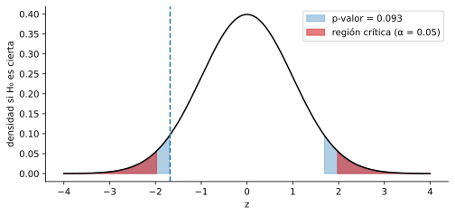

# 4.1 La lógica del contraste de hipótesis

> Versión web, con demos interactivas: <https://alberpro.com/nebrija-mpan/topics/04-contraste-hipotesis/logica/>

> ℹ️ **Antes de empezar**
>
> Esta página usa el **error estándar** de una proporción y el **teorema del límite central** de [cuánto se equivoca una estimación](../03-inferencia/variabilidad.md), los [intervalos de confianza](../03-inferencia/intervalos.md) y la [normal estándar](../02-variables-aleatorias/distribuciones.md#normal-estándar), con sus funciones `cdf` y `ppf`.

## El problema

Seguimos con el caso del tema anterior. Una tienda online envía cada día un email promocional a **500 clientes**. Cada venta deja un margen de 15 €, la campaña cuesta 450 € al día (hacen falta 30 ventas para cubrir costes) y el almacén prepara como máximo 45 pedidos al día. La agencia que diseñó el email aseguró al contratarla que **el 8 % de los clientes que lo reciben compra**.

Al terminar la primera semana, marketing tiene los datos: **253 ventas de 3500 emails**, un **7.23 %**. Es menos de lo prometido. ¿Basta para decir que la agencia se equivocó? Hay dos explicaciones posibles:

1. La agencia se equivocó: la tasa real de compra es distinta del 8 %.
2. La agencia tiene razón, y esta semana las ventas han salido algo bajas por azar. En el tema anterior vimos que una proporción calculada con una muestra [cambia de una muestra a otra](../03-inferencia/variabilidad.md).

Un **contraste de hipótesis** es un procedimiento para elegir entre estas dos explicaciones con los datos, controlando la probabilidad de equivocarse. Es la herramienta que hay detrás de cualquier test A/B, de la mayoría de los estudios de mercado y de los ensayos clínicos.

## La idea: suponer que la afirmación es cierta

El razonamiento empieza por **suponer que la agencia tiene razón** y preguntarse: si $p = 0.08$, ¿sería raro ver una semana con un 7.23 %?

Esta pregunta ya la sabemos responder. Por el teorema del límite central, si $p = 0.08$ la proporción de una semana de 3500 emails sigue aproximadamente una normal centrada en 0.08 con error estándar

$$\text{SE}_0 = \sqrt{\frac{0.08 \cdot 0.92}{3500}} = 0.00459$$

El subíndice 0 indica que el error estándar está calculado **suponiendo que la afirmación es cierta**. El 95 % de las semanas caería entre $0.08 \pm 1.96 \cdot 0.00459$, es decir, entre **7.10 % y 8.90 %**. Nuestro 7.23 % está dentro de ese rango, así que una semana como la nuestra es perfectamente posible aunque la agencia tenga razón. Con estos datos no podemos acusar a la agencia de exagerar.

Hay dos conclusiones posibles de un contraste, y conviene fijarse en cómo se dicen:

- Si los datos serían **muy raros** suponiendo la afirmación, la **rechazamos**: los datos son evidencia en su contra.
- Si los datos **no serían raros**, **no la rechazamos**. Eso no demuestra que sea cierta: solo dice que los datos no bastan para descartarla.

El resto de la página da nombre a cada pieza de este razonamiento y lo convierte en un procedimiento que sirve para cualquier contraste.

## Hipótesis nula y alternativa

> 📘 **Definición: hipótesis nula y alternativa**
>
> Un contraste enfrenta dos afirmaciones sobre un parámetro de la población:
>
> - La **hipótesis nula** $H_0$ es la afirmación que se supone cierta mientras los datos no digan lo contrario. Siempre incluye una igualdad: $H_0: p = 0.08$.
> - La **hipótesis alternativa** $H_1$ es lo que queremos detectar si $H_0$ es falsa: $H_1: p \ne 0.08$.
>
> El valor del parámetro en la hipótesis nula se escribe con subíndice 0: $p_0 = 0.08$, $\mu_0$.

¿Cuál de las dos afirmaciones va en $H_0$? La regla práctica es que $H_0$ es la afirmación "aburrida": la que mantiene lo que ya se dice o lo que ya se hace (la cifra de la agencia, el tiempo de entrega que se anuncia, el diseño actual de la web), o la que dice que no hay diferencia ni efecto (las dos campañas convierten igual). $H_1$ es el cambio, la diferencia o el efecto que nos interesa detectar. El contraste solo puede dar evidencia **contra** $H_0$, nunca a su favor, así que lo que queremos demostrar va en $H_1$.

Las hipótesis se plantean **antes de ver los datos**. Más abajo veremos por qué importa.

## El estadístico de contraste

Para decidir si los datos son raros bajo $H_0$ medimos a cuántos errores estándar está la estimación del valor que dice $H_0$. Esa medida es el estadístico de contraste.

> 📘 **Definición: estadístico de contraste**
>
> Un **estadístico de contraste** es un número calculado con la muestra cuya distribución conocemos **si $H_0$ es cierta**. Casi todos los del curso tienen la misma forma:
>
> $$\text{estadístico} = \frac{\text{estimación} - \text{valor según } H_0}{\text{error estándar}}$$
>
> Para una proporción, con $\hat{p}$ la proporción de la muestra, $p_0$ el valor de $H_0$ y $n$ el tamaño de la muestra:
>
> $$z = \frac{\hat{p} - p_0}{\sqrt{p_0(1 - p_0)/n}} \qquad \text{que, si } H_0 \text{ es cierta, sigue aproximadamente una } N(0, 1)$$

En la primera semana:

$$z = \frac{0.0723 - 0.08}{0.00459} = -1.68$$

La proporción observada está 1.68 errores estándar por debajo del 8 %. Si $H_0$ es cierta, $z$ es un valor de una normal estándar, y ya sabemos que valores como $-1.68$ no son raros en una normal estándar: entre $-1.96$ y $1.96$ cae el 95 % de los casos.

## Nivel de significación y valor crítico

Falta decidir **a partir de cuándo** consideramos que un resultado es "raro". Esa frontera se fija de antemano.

> 📘 **Definición: nivel de significación, región crítica y valor crítico**
>
> El **nivel de significación** $\alpha$ es la probabilidad de rechazar $H_0$ cuando en realidad es cierta, y lo elige el analista antes de ver los datos. Lo habitual es $\alpha = 0.05$; también se usan 0.10 y 0.01.
>
> La **región crítica** (o región de rechazo) es el conjunto de valores del estadístico que llevan a rechazar $H_0$. Se elige para que, si $H_0$ es cierta, el estadístico caiga en ella con probabilidad $\alpha$. Sus extremos son los **valores críticos**.

Con $H_1: p \ne 0.08$, tanto un valor muy bajo como uno muy alto de $z$ son evidencia contra $H_0$, así que la región crítica tiene dos partes, una en cada cola, con probabilidad $\alpha/2$ cada una. Con $\alpha = 0.05$ el valor crítico es $z_{0.025} = 1.96$ (`stats.norm.ppf(0.975)`), y rechazamos $H_0$ si $|z| > 1.96$. Es el mismo 1.96 de los intervalos de confianza al 95 %, y no por casualidad: lo veremos en la [página siguiente](una-muestra.md#contraste-e-intervalo-de-confianza).

En la primera semana, $|z| = 1.68 < 1.96$: **no rechazamos** $H_0$.

| $\alpha$ | Valor crítico bilateral | Valor crítico unilateral |
|---|---|---|
| 0.10 | 1.645 | 1.282 |
| 0.05 | 1.960 | 1.645 |
| 0.01 | 2.576 | 2.326 |

## El p-valor

Comparar con el valor crítico da una respuesta de sí o no. El **p-valor** da más información: dice **cómo de raro** es el resultado.

> 📘 **Definición: p-valor**
>
> El **p-valor** es la probabilidad de obtener, **si $H_0$ es cierta**, un estadístico al menos tan extremo como el observado, en la dirección que indica $H_1$. Cuanto más pequeño, más evidencia hay contra $H_0$. La regla de decisión es:
>
> - si $\text{p-valor} \le \alpha$, se rechaza $H_0$;
> - si $\text{p-valor} > \alpha$, no se rechaza $H_0$.

En la primera semana, con $H_1: p \ne 0.08$, "al menos tan extremo" significa a 1.68 errores estándar o más del 8 %, por arriba o por abajo:

$$\text{p-valor} = P(|Z| \ge 1.68) = 2 \cdot P(Z \le -1.68) = 2 \cdot 0.046 = 0.093$$

Si la agencia tuviera razón, un 9.3 % de las semanas se alejarían del 8 % tanto como la nuestra o más. No es tan raro: no rechazamos $H_0$ con $\alpha = 0.05$.

Las dos reglas, comparar $|z|$ con el valor crítico y comparar el p-valor con $\alpha$, llevan **siempre a la misma decisión**. $|z|$ supera el valor crítico exactamente cuando el área de las colas más allá de $z$ es menor que $\alpha$. En la figura, el área sombreada en rojo es $\alpha = 0.05$ y la azul es el p-valor:

```python
import numpy as np
import matplotlib.pyplot as plt
from scipy import stats

z_obs = -1.68
x = np.linspace(-4, 4, 400)
fig, ax = plt.subplots(figsize=(8, 3.5))
ax.plot(x, stats.norm.pdf(x), color="black")
cola = np.abs(x) >= abs(z_obs)
ax.fill_between(x, stats.norm.pdf(x), where=cola, color="tab:blue", alpha=0.35, label="p-valor = 0.093")
critica = np.abs(x) >= 1.96
ax.fill_between(x, stats.norm.pdf(x), where=critica, color="tab:red", alpha=0.6, label="región crítica (α = 0.05)")
ax.axvline(z_obs, color="tab:blue", linestyle="--")
ax.set(xlabel="z", ylabel="densidad si H₀ es cierta")
ax.legend()
plt.show()
```



El p-valor tiene una ventaja práctica: cada lector puede aplicar su propio $\alpha$. Con un p-valor de 0.093, quien use $\alpha = 0.10$ rechaza $H_0$, y quien use 0.05 o 0.01 no. Por eso los informes dan el p-valor y no solo la decisión.

## Contrastes bilaterales y unilaterales

Hasta ahora la pregunta era "¿la tasa es **distinta** del 8 %?", y por eso un resultado muy alto o muy bajo contaba como evidencia. A veces la pregunta de negocio solo tiene una dirección. Si marketing quiere reclamar a la agencia porque el email convierte **menos** de lo prometido, lo que interesa detectar es $p < 0.08$. Un resultado por encima del 8 % no daría motivo para reclamar.

> 📘 **Definición: contraste bilateral y unilateral**
>
> - **Bilateral:** $H_1: p \ne p_0$. La región crítica está repartida entre las dos colas, con $\alpha/2$ en cada una, y el p-valor suma las dos colas.
> - **Unilateral por la izquierda:** $H_1: p < p_0$. La región crítica está solo en la cola izquierda, con probabilidad $\alpha$, y el p-valor es $P(Z \le z)$.
> - **Unilateral por la derecha:** $H_1: p > p_0$. La región crítica está solo en la cola derecha y el p-valor es $P(Z \ge z)$.
>
> En un contraste unilateral, $H_0$ se suele escribir con la desigualdad contraria ($H_0: p \ge 0.08$ frente a $H_1: p < 0.08$), pero el cálculo se hace con la igualdad, $p_0 = 0.08$, que es el caso más difícil de rechazar.

Con $H_1: p < 0.08$, el p-valor de la primera semana es solo la cola izquierda: $P(Z \le -1.68) = 0.046$. Ahora es **menor que 0.05**, y rechazaríamos $H_0$. El mismo dato lleva a conclusiones distintas según la pregunta.

Un contraste unilateral detecta mejor las diferencias en la dirección que le interesa, porque pone toda la región crítica en un lado: le basta $z < -1.645$ en vez de $z < -1.96$. A cambio, no puede detectar nada en la otra dirección. Si el email convirtiera un 9 %, el contraste unilateral por la izquierda nunca lo diría.

> ⚠️ **La dirección se elige antes de ver los datos**
>
> Mirar los datos, ver que la tasa ha salido por debajo del 8 % y entonces elegir $H_1: p < 0.08$ porque así sale significativo es hacer trampa: en la práctica se está usando un $\alpha$ del 10 %, no del 5 %. La dirección de $H_1$ la dicta la pregunta de negocio, y se fija antes de mirar los resultados. Ante la duda, usa el bilateral.

## Ocho semanas después

La campaña siguió ocho semanas. En total hubo **1968 ventas de 28 000 emails**, una tasa del **7.03 %**. Repetimos el contraste bilateral con $H_0: p = 0.08$:

$$\text{SE}_0 = \sqrt{\frac{0.08 \cdot 0.92}{28\,000}} = 0.00162 \qquad z = \frac{0.0703 - 0.08}{0.00162} = -5.99 \qquad \text{p-valor} = 2 \cdot 10^{-9}$$

Ahora la tasa observada está a casi 6 errores estándar del 8 %. Si la agencia tuviera razón, un resultado así ocurriría dos veces de cada mil millones. **Rechazamos $H_0$**: los datos son evidencia muy fuerte de que la tasa real es distinta del 8 %, y en concreto menor.

La diferencia con la primera semana no está en la tasa observada, que es parecida (7.23 % y 7.03 %), sino en la cantidad de datos. Con 3500 emails el error estándar era 0.0046, y una diferencia de 0.8 puntos cabía dentro del azar. Con 28 000 el error estándar es 0.0016, y la misma diferencia ya no cabe. No rechazar $H_0$ en la primera semana no significaba que la agencia tuviera razón: significaba que una semana no bastaba para saberlo. En la [página 4.4](errores-potencia.md) calcularemos con qué probabilidad un contraste detecta una diferencia real según el tamaño de la muestra.

## Cómo leer el resultado de un contraste

> ⚠️ **Lo que significa y lo que no significa un p-valor**
>
> | ✅ Correcto | ❌ Incorrecto |
> |---|---|
> | "Si la tasa real fuera del 8 %, solo un 9.3 % de las semanas se alejarían tanto o más." | "Hay un 9.3 % de probabilidad de que la agencia tenga razón." (El p-valor se calcula **suponiendo** que $H_0$ es cierta, así que no puede ser la probabilidad de que lo sea.) |
> | "Con una semana de datos no podemos descartar el 8 %." | "Los datos demuestran que la tasa es del 8 %." (No rechazar no es aceptar.) |
> | "Con ocho semanas, los datos son incompatibles con el 8 %." | "Como el p-valor es minúsculo, la diferencia es muy grande." (El p-valor mide la evidencia, no el tamaño de la diferencia: depende mucho de $n$.) |

Un juicio sigue la misma lógica. El acusado se presume inocente ($H_0$) y solo se le condena si las pruebas lo hacen muy difícil de sostener. Un veredicto de "no culpable" no declara que sea inocente: dice que no hay pruebas suficientes. Por eso se dice "no rechazamos $H_0$" y no "aceptamos $H_0$".

## El procedimiento en cinco pasos

Todos los contrastes del tema siguen los mismos pasos. Lo único que cambia de uno a otro es el estadístico del paso 3.

1. **Plantear las hipótesis** $H_0$ y $H_1$ a partir de la pregunta de negocio, y decidir si el contraste es bilateral o unilateral.
2. **Fijar el nivel de significación** $\alpha$ antes de ver los resultados.
3. **Calcular el estadístico de contraste** con la muestra, comprobando antes las condiciones que necesita (muestra aleatoria, tamaño suficiente).
4. **Calcular el p-valor**, o el valor crítico.
5. **Decidir y traducir** la decisión a la pregunta de negocio, con la estimación y su intervalo de confianza.

> ✏️ **Ejemplo resuelto: el contraste de la primera semana, paso a paso**
>
> 1. **Hipótesis.** $H_0: p = 0.08$ frente a $H_1: p \ne 0.08$. Bilateral, porque la pregunta es si la cifra de la agencia es correcta, en cualquier dirección.
> 2. **Nivel de significación.** $\alpha = 0.05$.
> 3. **Estadístico.** Condiciones: los 3500 clientes se eligen sin relación entre ellos y $n p_0 = 280$ y $n(1 - p_0) = 3220$ son grandes, así que la aproximación normal es buena. $\hat{p} = 253/3500 = 0.0723$ y $z = (0.0723 - 0.08)/0.00459 = -1.68$.
> 4. **p-valor.** $2 \cdot P(Z \le -1.68) = 0.093$.
> 5. **Decisión.** $0.093 > 0.05$: no rechazamos $H_0$. Con una semana de datos, la tasa observada (7.2 %) es compatible con el 8 % de la agencia. Hay que seguir midiendo antes de reclamar.

> ⛔ **Errores frecuentes**
>
> - **Leer el p-valor como la probabilidad de que $H_0$ sea cierta.** Es la probabilidad de unos datos así **si** $H_0$ es cierta.
> - **Decir "aceptamos $H_0$"** cuando no se rechaza. Puede que falten datos para detectar la diferencia.
> - **Elegir la dirección del contraste o el $\alpha$ después de ver los datos.**
> - **Poner en $H_0$ lo que se quiere demostrar.** El contraste solo acumula evidencia contra $H_0$, así que lo que se quiere demostrar va en $H_1$.
> - **Calcular el error estándar con $\hat{p}$ en lugar de $p_0$.** En el contraste de una proporción, el error estándar se calcula suponiendo $H_0$, con $p_0$.

## En Python

```python
import numpy as np
from scipy import stats

p0 = 0.08          # lo que afirma la agencia (H0)
alpha = 0.05

def contraste_proporcion(exitos, n, p0):
    """Estadístico z y p-valores de H0: p = p0."""
    p_hat = exitos / n
    se0 = np.sqrt(p0 * (1 - p0) / n)          # error estándar suponiendo H0
    z = (p_hat - p0) / se0
    return p_hat, z, {
        "bilateral": 2 * stats.norm.sf(abs(z)),
        "menor": stats.norm.cdf(z),           # H1: p < p0
        "mayor": stats.norm.sf(z),            # H1: p > p0
    }

for nombre, exitos, n in [("primera semana", 253, 3500), ("ocho semanas", 1968, 28_000)]:
    p_hat, z, p_valores = contraste_proporcion(exitos, n, p0)
    print(f"{nombre}: p̂ = {p_hat:.4f}, z = {z:.2f}, "
          f"p-valor bilateral = {p_valores['bilateral']:.3g}, "
          f"unilateral (p < 0.08) = {p_valores['menor']:.3g}")
```

```text
primera semana: p̂ = 0.0723, z = -1.68, p-valor bilateral = 0.0925, unilateral (p < 0.08) = 0.0463
ocho semanas: p̂ = 0.0703, z = -5.99, p-valor bilateral = 2.08e-09, unilateral (p < 0.08) = 1.04e-09
```

```python
print("valor crítico bilateral:", round(stats.norm.ppf(1 - alpha / 2), 3))
```

```text
valor crítico bilateral: 1.96
```

```python
print("valor crítico unilateral:", round(stats.norm.ppf(1 - alpha), 3))
```

```text
valor crítico unilateral: 1.645
```

Las tres funciones de `scipy.stats` que se usan en todos los contrastes son `cdf(z)`, el área a la izquierda de $z$; `sf(z)`, el área a la derecha, igual a `1 - cdf(z)` pero más precisa cuando el resultado es muy pequeño; y `ppf(q)`, el valor que deja un área $q$ a su izquierda, que da los valores críticos.

> ✅ **Lo esencial**
>
> - Un contraste **supone que $H_0$ es cierta** y mide lo raros que serían los datos en ese caso. Si serían muy raros, se rechaza $H_0$.
> - El **estadístico de contraste** mide a cuántos errores estándar está la estimación del valor de $H_0$.
> - El **p-valor** es la probabilidad, si $H_0$ es cierta, de un resultado al menos tan extremo como el observado. Se rechaza $H_0$ si es menor o igual que $\alpha$, y es equivalente a comparar con el valor crítico.
> - El contraste es **bilateral** o **unilateral** según la pregunta, y la dirección se fija antes de ver los datos.
> - **No rechazar $H_0$ no demuestra que sea cierta.** Con más datos, la misma diferencia puede pasar a ser significativa.

## Ejercicios

**1.** Escribe $H_0$ y $H_1$ e indica si el contraste es bilateral o unilateral. (a) Un fabricante dice que sus botellas contienen 500 ml de media, y control de calidad quiere comprobarlo. (b) Un banco quiere saber si un nuevo proceso reduce el tiempo medio de concesión de un préstamo, que ahora es de 12 días. (c) Una web quiere saber si la tasa de rebote ha subido por encima del 40 % tras un cambio de diseño.

<details>
<summary>✅ <b>Solución</b></summary>

(a) $H_0: \mu = 500$ frente a $H_1: \mu \ne 500$. **Bilateral**: a control de calidad le importa tanto que falte líquido como que sobre.

(b) $H_0: \mu = 12$ (o $\mu \ge 12$) frente a $H_1: \mu < 12$. **Unilateral por la izquierda**: lo que se quiere demostrar es la reducción.

(c) $H_0: p = 0.40$ (o $p \le 0.40$) frente a $H_1: p > 0.40$. **Unilateral por la derecha**.

En los tres casos, $H_0$ contiene la igualdad y $H_1$ lo que se quiere detectar.

</details>

**2.** Un contraste da $z = 2.1$. Calcula el p-valor si el contraste es bilateral y si es unilateral por la derecha. ¿Qué decides en cada caso con $\alpha = 0.05$? ¿Y con $\alpha = 0.01$?

<details>
<summary>✅ <b>Solución</b></summary>

Unilateral por la derecha: $P(Z \ge 2.1) = $ `stats.norm.sf(2.1)` $= 0.018$. Bilateral: el doble, $0.036$.

Con $\alpha = 0.05$ se rechaza $H_0$ en los dos casos, porque los dos p-valores son menores que 0.05. Con $\alpha = 0.01$ no se rechaza en ninguno. Lo mismo sale comparando con los valores críticos: $2.1 > 1.96$ y $2.1 > 1.645$, pero $2.1 < 2.576$ y $2.1 < 2.326$.

</details>

**3.** En una encuesta, 92 de 400 clientes dicen que recomendarían la marca (un 23 %). El departamento de marketing siempre ha dicho que lo haría el 25 %. Haz el contraste bilateral con $\alpha = 0.05$.

<details>
<summary>✅ <b>Solución</b></summary>

$H_0: p = 0.25$ frente a $H_1: p \ne 0.25$. Condiciones: $n p_0 = 100$ y $n(1 - p_0) = 300$, suficientes.

$\text{SE}_0 = \sqrt{0.25 \cdot 0.75/400} = 0.0217$ y $z = (0.23 - 0.25)/0.0217 = -0.92$. El p-valor es $2 \cdot P(Z \le -0.92) = 0.356$.

$0.356 > 0.05$: **no rechazamos** $H_0$. La encuesta es compatible con el 25 % que dice marketing. Cuadra con el intervalo de confianza al 95 % de esta encuesta, $[0.189,\ 0.271]$, calculado en [intervalos de confianza](../03-inferencia/intervalos.md), que contiene el 0.25.

</details>

**4.** Un informe dice: "El p-valor es 0.03, así que hay un 97 % de probabilidad de que el nuevo diseño funcione mejor". Otro dice: "El p-valor es 0.40, así que el nuevo diseño funciona igual que el antiguo". ¿Qué está mal en cada frase? Reescríbelas.

<details>
<summary>✅ <b>Solución</b></summary>

La primera interpreta el p-valor como una probabilidad sobre las hipótesis. El p-valor se calcula suponiendo que $H_0$ es cierta: "Si el nuevo diseño funcionara igual que el antiguo, solo un 3 % de los experimentos darían una diferencia tan grande como la observada. Con $\alpha = 0.05$, los datos son evidencia de que el nuevo diseño funciona mejor".

La segunda trata "no rechazar" como "aceptar": "Con estos datos no hay evidencia de que el nuevo diseño funcione distinto que el antiguo". Puede que sí funcione distinto y que haga falta más muestra para detectarlo.

</details>

**5.** *(Más difícil)* Con los datos de la primera semana ($z = -1.68$), un analista plantea el contraste unilateral $H_1: p > 0.08$. ¿Qué p-valor obtiene? ¿Por qué es tan grande? ¿Qué le dice eso sobre la importancia de elegir bien la dirección?

<details>
<summary>✅ <b>Solución</b></summary>

El p-valor es la cola derecha: $P(Z \ge -1.68) = 1 - 0.046 = 0.954$.

Es tan grande porque el resultado ha ido en la dirección **contraria** a la de $H_1$. Si $H_1$ dice que la tasa es mayor del 8 %, una tasa observada del 7.2 % no es ninguna evidencia a favor, así que no hay motivo para rechazar $H_0$.

La dirección se elige con la pregunta de negocio, antes de ver los datos. Un contraste unilateral es ciego a las diferencias en la otra dirección: si lo que importaba era detectar cualquier desviación de la cifra de la agencia, había que usar el bilateral.

</details>

[← Volver al tema](index.md) [Siguiente: Contrastes para una muestra →](una-muestra.md)
