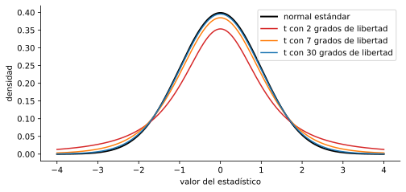

# 4.2 Contrastes para una muestra: proporciones y medias

> Versión web, con demos interactivas: <https://alberpro.com/nebrija-mpan/topics/04-contraste-hipotesis/una-muestra/>

> ℹ️ **Antes de empezar**
>
> Esta página aplica la lógica de la [página 4.1](logica.md): hipótesis, estadístico, p-valor y contrastes uni y bilaterales. Usa también la diferencia entre la desviación típica de los datos y el [error estándar](../03-inferencia/variabilidad.md), y los [intervalos de confianza](../03-inferencia/intervalos.md).

## El problema

Con las ocho semanas de datos de la campaña (56 días, del 7 de septiembre al 1 de noviembre de 2026), el director comercial tiene tres preguntas:

1. **¿Cubre costes la campaña?** Hacen falta 30 ventas al día de 500 emails, una tasa del 6 %. En el tema anterior vimos que los lunes se vende bastante más que el resto de la semana, así que la pregunta interesante es si los **demás días** superan el 6 %.
2. **¿Se satura el almacén los lunes?** El almacén prepara como máximo 45 pedidos al día. ¿Superan los lunes esa cifra de media?
3. **¿Cuánto se puede fiar de cada respuesta?** Para los lunes solo hay 8 datos.

La primera pregunta es sobre una **proporción** y la segunda sobre una **media**. Las dos se responden con el procedimiento de la página anterior; lo que cambia es el estadístico. Los datos están en el fichero `ventas_campana.csv`, con una fila por día:

```python
import numpy as np
import pandas as pd
from scipy import stats

ventas = pd.read_csv("https://raw.githubusercontent.com/ami232/nebrija-mpan/main/data/ventas_campana.csv")
print(ventas.head())
```

```text
        fecha dia_semana  emails  ventas
0  2026-09-07      lunes     500      52
1  2026-09-08     martes     500      32
2  2026-09-09  miércoles     500      37
3  2026-09-10     jueves     500      27
4  2026-09-11    viernes     500      36
```

```python
ventas.groupby("dia_semana", sort=False).ventas.agg(["count", "sum", "mean"]).round(2)
```

```text
            count  sum   mean
dia_semana                   
lunes           8  373  46.62
martes          8  271  33.88
miércoles       8  272  34.00
jueves          8  260  32.50
viernes         8  262  32.75
sábado          8  257  32.12
domingo         8  273  34.12
```

## Contraste para una proporción

Es el contraste de la página anterior. Lo resumimos para tenerlo a mano.

> 📘 **Definición: contraste Z para una proporción**
>
> Para contrastar $H_0: p = p_0$ con una muestra de $n$ casos independientes en la que la proporción de éxitos es $\hat{p}$:
>
> $$z = \frac{\hat{p} - p_0}{\sqrt{p_0(1 - p_0)/n}}$$
>
> Si $H_0$ es cierta, $z$ sigue aproximadamente una normal estándar. La aproximación es buena si $n p_0 \ge 5$ y $n(1 - p_0) \ge 5$; con un margen más cómodo, ambos mayores que 10.

> ✏️ **Ejemplo resuelto: ¿cubren costes los días que no son lunes?**
>
> De martes a domingo hubo 48 días, con 24 000 emails y 1595 ventas: $\hat{p} = 1595/24\,000 = 0.0665$.
>
> 1. **Hipótesis.** La campaña cubre costes si $p > 0.06$, y es lo que queremos demostrar, así que va en $H_1$: $H_0: p = 0.06$ frente a $H_1: p > 0.06$. Unilateral por la derecha.
> 2. **Nivel de significación.** $\alpha = 0.05$.
> 3. **Estadístico.** Condiciones: $n p_0 = 1440$, de sobra. $\text{SE}_0 = \sqrt{0.06 \cdot 0.94 / 24\,000} = 0.00153$ y $z = (0.0665 - 0.06)/0.00153 = 4.21$.
> 4. **p-valor.** $P(Z \ge 4.21) = 0.00001$.
> 5. **Decisión.** Rechazamos $H_0$. Los datos son evidencia muy fuerte de que, también fuera de los lunes, la tasa de compra supera el 6 % y la campaña cubre costes.

El contraste supone, como el modelo binomial del tema anterior, que todos los clientes de esos 48 días tienen **la misma** probabilidad de compra y que compran de forma independiente. Si la tasa cambiara de un día a otro (por el tiempo, por otras campañas), las ventas diarias variarían más de lo que dice el modelo, y el error estándar real sería mayor que el calculado. Más abajo repetimos el contraste de otra forma que no necesita esa suposición.

## Contraste Z para una media con σ conocida

Para una media, el estadístico tiene la misma forma: la media muestral menos el valor de $H_0$, dividido entre el error estándar de la media, $\sigma/\sqrt{n}$.

> 📘 **Definición: contraste Z para una media**
>
> Para contrastar $H_0: \mu = \mu_0$ con una muestra de $n$ datos independientes de media $\bar{x}$, si se **conoce** la desviación típica $\sigma$ de la población:
>
> $$z = \frac{\bar{x} - \mu_0}{\sigma/\sqrt{n}}$$
>
> Si $H_0$ es cierta, $z$ sigue una normal estándar: exactamente si los datos son normales, y aproximadamente, por el teorema del límite central, si $n$ es grande.

> ✏️ **Ejemplo resuelto: el tiempo de espera**
>
> Una empresa anuncia que el tiempo medio de espera en su servicio de atención es de 5 minutos. Por años de registros se sabe que la desviación típica es $\sigma = 2$ minutos. En una muestra de 50 clientes, el tiempo medio es $\bar{x} = 5.8$ minutos.
>
> 1. $H_0: \mu = 5$ frente a $H_1: \mu \ne 5$, bilateral, con $\alpha = 0.05$.
> 2. $\text{SE} = 2/\sqrt{50} = 0.283$ y $z = (5.8 - 5)/0.283 = 2.83$.
> 3. p-valor: $2 \cdot P(Z \ge 2.83) = 0.0047$.
> 4. Rechazamos $H_0$: el tiempo medio de espera no es de 5 minutos. Los datos indican que es mayor.

En la práctica, casi nunca se conoce $\sigma$. Si no conocemos la media de la población, es raro conocer su desviación típica. Lo normal es estimarla con la desviación típica de la muestra, $s$, y eso cambia la distribución del estadístico.

## La t de Student

Al sustituir $\sigma$ por $s$, el estadístico $(\bar{x} - \mu_0)/(s/\sqrt{n})$ tiene **dos** fuentes de variación en lugar de una: la media $\bar{x}$ cambia de una muestra a otra, y también $s$. Con muestras grandes, $s$ está muy cerca de $\sigma$ y la diferencia no importa. Con muestras pequeñas, $s$ puede salir bastante menor que $\sigma$ por azar, y entonces el estadístico sale más extremo de lo que diría una normal. La distribución que tiene en cuenta esta variación extra es la **t de Student**.

> 📘 **Definición: distribución t de Student**
>
> Si $x_1, \ldots, x_n$ es una muestra de una población normal de media $\mu$,
>
> $$t = \frac{\bar{x} - \mu}{s/\sqrt{n}}$$
>
> sigue una distribución **t de Student con $n - 1$ grados de libertad**, que se escribe $t_{n-1}$. Es simétrica y con forma de campana, como la normal estándar, pero con **colas más pesadas**: da más probabilidad a los valores extremos. Cuantos más grados de libertad, más se parece a la normal.

Los **grados de libertad** son el número de datos menos el número de cantidades que hemos estimado con ellos antes de calcular $s$. Para calcular $s$ hace falta antes $\bar{x}$, así que quedan $n - 1$. Es el mismo $n - 1$ que aparece en la fórmula de $s$.

```python
import matplotlib.pyplot as plt

x = np.linspace(-4, 4, 400)
plt.figure(figsize=(8, 3.5))
plt.plot(x, stats.norm.pdf(x), color="black", linewidth=2, label="normal estándar")
for gl, color in [(2, "tab:red"), (7, "tab:orange"), (30, "tab:blue")]:
    plt.plot(x, stats.t.pdf(x, df=gl), color=color, label=f"t con {gl} grados de libertad")
plt.xlabel("valor del estadístico")
plt.ylabel("densidad")
plt.legend()
plt.show()
```



Como las colas son más pesadas, los valores críticos de la t son mayores que los de la normal. Con pocos datos, hace falta un estadístico más extremo para rechazar $H_0$:

| Grados de libertad | Bilateral, $\alpha = 0.05$ | Unilateral, $\alpha = 0.05$ |
|---:|---:|---:|
| 4 | 2.776 | 2.132 |
| 7 | 2.365 | 1.895 |
| 14 | 2.145 | 1.761 |
| 29 | 2.045 | 1.699 |
| 99 | 1.984 | 1.660 |
| normal | 1.960 | 1.645 |

En Python, el valor crítico es `stats.t.ppf(1 - alpha/2, df=gl)` y los p-valores se calculan con `stats.t.cdf` y `stats.t.sf`, igual que con la normal pero indicando los grados de libertad.

## Contraste t para una media

> 📘 **Definición: contraste t para una media**
>
> Para contrastar $H_0: \mu = \mu_0$ con una muestra de $n$ datos independientes de media $\bar{x}$ y desviación típica $s$, sin conocer $\sigma$:
>
> $$t = \frac{\bar{x} - \mu_0}{s/\sqrt{n}} \qquad \text{que, si } H_0 \text{ es cierta, sigue una } t_{n-1}$$
>
> Es exacto si los datos son normales. Con $n \ge 30$ funciona bien aunque no lo sean, por el teorema del límite central. Con muestras más pequeñas hay que comprobar que los datos no sean muy asimétricos ni tengan valores atípicos.

> ✏️ **Ejemplo resuelto: ¿se satura el almacén los lunes?**
>
> En los 8 lunes de la campaña hubo 52, 47, 46, 38, 49, 44, 58 y 39 ventas: $\bar{x} = 46.6$ y $s = 6.59$.
>
> 1. **Hipótesis.** Lo que preocupa es que los lunes superen la capacidad del almacén de media: $H_0: \mu = 45$ frente a $H_1: \mu > 45$. Unilateral por la derecha, con $\alpha = 0.05$.
> 2. **Condiciones.** Solo hay 8 datos, así que necesitamos que las ventas de un lunes sean aproximadamente normales. Son el resultado de 500 decisiones de compra, y por el [teorema del límite central](../03-inferencia/variabilidad.md) lo son. Los 8 valores no muestran nada raro.
> 3. **Estadístico.** $\text{SE} = 6.59/\sqrt{8} = 2.33$ y $t = (46.6 - 45)/2.33 = 0.70$, con $8 - 1 = 7$ grados de libertad.
> 4. **p-valor.** $P(t_7 \ge 0.70) = 0.25$. El valor crítico es $t_{0.05,\,7} = 1.895$.
> 5. **Decisión.** $0.25 > 0.05$ (o $0.70 < 1.895$): no rechazamos $H_0$. Con 8 lunes no hay evidencia de que la media de los lunes supere los 45 pedidos.
>
> Que no haya evidencia de que la **media** supere 45 no significa que el almacén esté tranquilo. En 5 de los 8 lunes hubo más de 45 ventas. El contraste responde a una pregunta sobre la media; al almacén le interesa cuántos días individuales superan su capacidad, que es otra pregunta. Con un modelo normal para las ventas de un lunes, $N(46.6,\ 6.59^2)$, un lunes cualquiera supera los 45 pedidos con probabilidad 0.60. Para planificar el almacén, esa es la cifra relevante.

¿Qué habría pasado usando la normal en vez de la t? El p-valor habría sido $P(Z \ge 0.70) = 0.24$, algo menor. Aquí no cambia la decisión, pero con estadísticos cerca del valor crítico sí puede cambiarla: con 8 datos, la normal pide $z > 1.645$ y la t pide $t > 1.895$. Usar la normal con muestras pequeñas rechaza $H_0$ con más frecuencia de lo que dice $\alpha$.

### Otra forma de contrastar si se cubren costes

Volvamos a la primera pregunta con otro enfoque. En lugar de contar clientes, tomamos cada día como un dato: las ventas de los 48 días que no son lunes tienen media $\bar{x} = 33.2$ y desviación típica $s = 6.24$. Cubrir costes es vender más de 30 al día: $H_0: \mu = 30$ frente a $H_1: \mu > 30$.

$$t = \frac{33.2 - 30}{6.24/\sqrt{48}} = \frac{3.23}{0.90} = 3.59 \qquad \text{p-valor} = P(t_{47} \ge 3.59) = 0.0004$$

La conclusión es la misma que con la proporción, pero el estadístico es menor (3.59 frente a 4.21). La razón es que la t usa la variación entre días que se ha **observado**, $s = 6.24$, mientras que el contraste de la proporción usa la que predice el modelo binomial, $\sqrt{500 \cdot 0.0665 \cdot 0.9335} = 5.57$. Los días varían algo más de lo que dice la binomial, así que el contraste por días es más prudente. Cuando dos enfoques razonables llevan a la misma conclusión, la conclusión es más sólida.

## Qué contraste usar

| Pregunta sobre | Datos | Estadístico | Distribución si $H_0$ es cierta |
|---|---|---|---|
| una proporción $p$ | éxitos de $n$ casos | $z = \dfrac{\hat{p} - p_0}{\sqrt{p_0(1 - p_0)/n}}$ | normal estándar, si $n p_0$ y $n(1 - p_0) \ge 5$ |
| una media $\mu$, $\sigma$ conocida | $n$ valores | $z = \dfrac{\bar{x} - \mu_0}{\sigma/\sqrt{n}}$ | normal estándar |
| una media $\mu$, $\sigma$ desconocida | $n$ valores | $t = \dfrac{\bar{x} - \mu_0}{s/\sqrt{n}}$ | $t_{n-1}$ |

En la práctica, para una media se usa **siempre la t** cuando se estima $\sigma$ con $s$. Con muestras grandes da casi lo mismo que la Z, y con muestras pequeñas es la correcta.

## Contraste e intervalo de confianza

Un contraste bilateral y un intervalo de confianza usan los mismos ingredientes: la estimación, su error estándar y el valor crítico. Por eso están relacionados.

> 📘 **Relación entre contraste e intervalo de confianza**
>
> Un contraste **bilateral** con nivel de significación $\alpha$ rechaza $H_0: \mu = \mu_0$ **si y solo si** $\mu_0$ queda **fuera** del intervalo de confianza al $100(1 - \alpha)\,\%$.
>
> El intervalo de confianza es, por tanto, el conjunto de valores de $\mu_0$ que el contraste **no** rechazaría.

El motivo es que el contraste rechaza cuando $|\bar{x} - \mu_0| > t_{\alpha/2} \cdot \text{SE}$, es decir, cuando $\mu_0$ está a más de un margen de error de $\bar{x}$, y el intervalo de confianza es justo $\bar{x} \pm t_{\alpha/2} \cdot \text{SE}$. Para medias, con la t, la relación es exacta. Para proporciones es aproximada, porque el contraste calcula el error estándar con $p_0$ y el intervalo con $\hat{p}$, aunque con muestras grandes coinciden casi siempre.

Ejemplos con la campaña:

- **La tasa de compra global.** El intervalo al 95 % con las ocho semanas es $0.0703 \pm 1.96 \cdot 0.00153 = [0.0673,\ 0.0733]$. El 8 % de la agencia está fuera, así que el contraste bilateral lo rechaza con $\alpha = 0.05$, como vimos en la [página 4.1](logica.md#ocho-semanas-después). Un 7 % está dentro: no lo rechazaría.
- **Las ventas medias de los lunes.** Con la t, el intervalo al 95 % es $46.6 \pm 2.365 \cdot 2.33 = [41.1,\ 52.1]$. Contiene el 45, y también el 42 y el 50: con 8 lunes, la media real podría estar en cualquier punto de ese rango. Con la normal en lugar de la t habría salido $[42.1,\ 51.2]$: la t da intervalos más anchos con muestras pequeñas.

Para un contraste **unilateral** la relación es con un intervalo de un solo lado. En el contraste de los días que no son lunes, $H_1: \mu > 30$ con $\alpha = 0.05$, la cota inferior al 95 % es $\bar{x} - t_{0.05,\,47} \cdot \text{SE} = 33.2 - 1.678 \cdot 0.90 = 31.7$. Con un 95 % de confianza, la media de ventas de esos días es mayor que 31.7, y como 31.7 está por encima de 30, se rechaza $H_0$.

Un intervalo da **más información** que un contraste. El contraste dice si un valor concreto es compatible con los datos; el intervalo dice cuáles lo son todos, y por tanto cuánto puede valer la diferencia. Por eso un buen informe da los dos: "la tasa de compra es del 7.0 % (IC 95 %: 6.7 %–7.3 %), significativamente menor que el 8 % prometido (p < 0.001)".

> ⛔ **Errores frecuentes**
>
> - **Usar la normal con muestras pequeñas** cuando se ha estimado $\sigma$ con $s$. Hay que usar la t con $n - 1$ grados de libertad.
> - **Usar $s$ en lugar de $s/\sqrt{n}$** en el denominador. El estadístico mide la distancia en errores estándar de la media, no en desviaciones típicas de los datos.
> - **Confundir una afirmación sobre la media con una sobre los individuos.** Que la media de los lunes no supere 45 de forma significativa no dice nada de cuántos lunes concretos lo superan.
> - **Olvidar las condiciones**: independencia de los datos, normalidad aproximada con muestras pequeñas, y $n p_0 \ge 5$ en las proporciones.

## En Python

```python
# 1. Contraste para una proporción: ¿superan el 6 % los días que no son lunes?
resto = ventas[ventas.dia_semana != "lunes"]
exitos, n, p0 = resto.ventas.sum(), resto.emails.sum(), 0.06
p_hat = exitos / n
z = (p_hat - p0) / np.sqrt(p0 * (1 - p0) / n)
print(f"p̂ = {p_hat:.4f}, z = {z:.2f}, p-valor = {stats.norm.sf(z):.1e}")
```

```text
p̂ = 0.0665, z = 4.21, p-valor = 1.3e-05
```

```python
# La versión exacta, con la binomial, sin aproximación normal
print(f"p-valor exacto: {stats.binomtest(exitos, n, p0, alternative='greater').pvalue:.1e}")
```

```text
p-valor exacto: 1.8e-05
```

```python
# 2. Contraste t para una media: ¿superan los lunes los 45 pedidos de media?
lunes = ventas.loc[ventas.dia_semana == "lunes", "ventas"]
res = stats.ttest_1samp(lunes, popmean=45, alternative="greater")
print(f"lunes: media = {lunes.mean():.2f}, t = {res.statistic:.2f}, p-valor = {res.pvalue:.3f}")
```

```text
lunes: media = 46.62, t = 0.70, p-valor = 0.254
```

```python
# El mismo cálculo, a mano
se = lunes.std(ddof=1) / np.sqrt(len(lunes))
t = (lunes.mean() - 45) / se
print(f"a mano: t = {t:.2f}, p-valor = {stats.t.sf(t, df=len(lunes) - 1):.3f}")
```

```text
a mano: t = 0.70, p-valor = 0.254
```

```python
# 3. Intervalo de confianza con la t
print("IC 95 % lunes:", np.round(stats.t.interval(0.95, df=len(lunes) - 1, loc=lunes.mean(), scale=se), 1))
```

```text
IC 95 % lunes: [41.1 52.1]
```

```python
# 4. Ventas diarias de los días que no son lunes frente a 30
res = stats.ttest_1samp(resto.ventas, popmean=30, alternative="greater")
print(f"resto: t = {res.statistic:.2f}, p-valor = {res.pvalue:.4f}")
```

```text
resto: t = 3.59, p-valor = 0.0004
```

`stats.ttest_1samp` hace el contraste t completo a partir de los datos. El argumento `alternative` indica $H_1$: `"two-sided"` (el valor por defecto) para $\mu \ne \mu_0$, `"greater"` para $\mu > \mu_0$ y `"less"` para $\mu < \mu_0$.

> ✅ **Lo esencial**
>
> - Para una **proporción** se usa el contraste Z, con el error estándar calculado con $p_0$.
> - Para una **media**, el estadístico es $(\bar{x} - \mu_0)/(s/\sqrt{n})$ y sigue una **t de Student** con $n - 1$ grados de libertad. La t tiene colas más pesadas que la normal y se parece a ella cuando $n$ crece.
> - Con $\sigma$ conocida se usa la normal, pero es un caso raro. Si se estima $\sigma$ con $s$, se usa la t.
> - Un contraste bilateral al nivel $\alpha$ rechaza $\mu_0$ si y solo si $\mu_0$ está fuera del intervalo de confianza al $1 - \alpha$. El intervalo da además el tamaño de la diferencia.
> - Un contraste sobre la media no dice nada de los individuos.

## Ejercicios

**1.** Un servicio de atención al cliente afirma que atiende las llamadas en 2 minutos de media. En 36 llamadas, el tiempo medio fue de 2.3 minutos, con $s = 0.9$ minutos. Haz el contraste bilateral con $\alpha = 0.05$.

<details>
<summary>✅ <b>Solución</b></summary>

$H_0: \mu = 2$ frente a $H_1: \mu \ne 2$. No conocemos $\sigma$, así que usamos la t con 35 grados de libertad.

$\text{SE} = 0.9/\sqrt{36} = 0.15$ y $t = (2.3 - 2)/0.15 = 2.0$. El p-valor es $2 \cdot P(t_{35} \ge 2.0) = 0.053$, y el valor crítico es $t_{0.025,\,35} = 2.030$.

$0.053 > 0.05$: **no rechazamos** $H_0$, por muy poco. Con la normal el p-valor habría sido 0.046 y habríamos rechazado: en casos al límite, usar la distribución correcta importa. Lo razonable es informar de que los datos apuntan a un tiempo algo mayor de 2 minutos, pero que la evidencia no es concluyente con 36 llamadas.

</details>

**2.** La tasa histórica de devoluciones de una tienda es del 10 %. Con un nuevo proveedor, de 300 pedidos se devolvieron 21. ¿Hay evidencia, con $\alpha = 0.05$, de que la tasa de devoluciones ha bajado?

<details>
<summary>✅ <b>Solución</b></summary>

$H_0: p = 0.10$ frente a $H_1: p < 0.10$, unilateral por la izquierda. Condiciones: $n p_0 = 30$ y $n(1 - p_0) = 270$.

$\hat{p} = 21/300 = 0.07$, $\text{SE}_0 = \sqrt{0.10 \cdot 0.90/300} = 0.0173$ y $z = (0.07 - 0.10)/0.0173 = -1.73$. El p-valor es $P(Z \le -1.73) = 0.042$.

$0.042 < 0.05$: **rechazamos** $H_0$. Hay evidencia de que, con el nuevo proveedor, la tasa de devoluciones es menor del 10 %. La evidencia no es muy fuerte: con $\alpha = 0.01$ no se rechazaría.

</details>

**3.** La web de la tienda debe cargar en 3 segundos de media como máximo. Seis mediciones dan 3.4, 2.9, 3.8, 3.1, 3.6 y 3.3 segundos. ¿Hay evidencia, con $\alpha = 0.05$, de que la media supera los 3 segundos?

<details>
<summary>✅ <b>Solución</b></summary>

$H_0: \mu = 3$ frente a $H_1: \mu > 3$. $\bar{x} = 3.35$ y $s = 0.327$, así que $\text{SE} = 0.327/\sqrt{6} = 0.134$ y $t = 0.35/0.134 = 2.62$, con 5 grados de libertad.

El valor crítico es $t_{0.05,\,5} = 2.015$ y el p-valor, `stats.ttest_1samp(x, 3, alternative="greater")`, es 0.024. **Rechazamos** $H_0$: la carga media supera los 3 segundos.

Con solo 6 datos, el resultado se apoya en que los tiempos de carga sean aproximadamente normales. Los seis valores son bastante simétricos y no hay ninguno atípico, así que es razonable.

</details>

**4.** Un intervalo de confianza al 95 % para el gasto medio de los clientes, calculado con una muestra grande, es $[12.4,\ 15.8]$ €. Sin hacer más cálculos, ¿qué decide el contraste bilateral con $\alpha = 0.05$ para $\mu_0 = 12$, $\mu_0 = 13$ y $\mu_0 = 16$? Para $\mu_0 = 16$ y $\alpha = 0.01$, calcula el intervalo al 99 % a partir del de 95 % y decide.

<details>
<summary>✅ <b>Solución</b></summary>

Con $\alpha = 0.05$: se rechazan $\mu_0 = 12$ y $\mu_0 = 16$, que están fuera del intervalo, y no se rechaza $\mu_0 = 13$, que está dentro.

Para el 99 %: el centro es $\bar{x} = 14.1$ y el margen al 95 % es $1.7 = 1.96 \cdot \text{SE}$, así que $\text{SE} = 0.867$. El margen al 99 % es $2.576 \cdot 0.867 = 2.23$ y el intervalo, $[11.87,\ 16.33]$. Contiene el 16, así que con $\alpha = 0.01$ **no** se rechaza $\mu_0 = 16$. Pedir más seguridad para rechazar ensancha el intervalo.

</details>

**5.** *(Más difícil)* El responsable del almacén lee que "no hay evidencia de que los lunes superen los 45 pedidos de media" y decide no reforzar el turno de los lunes. ¿Es una buena decisión? Usa los datos de los 8 lunes para argumentar, y propón la pregunta que debería hacerse.

<details>
<summary>✅ <b>Solución</b></summary>

No es una buena decisión, por dos motivos.

Primero, **no rechazar no es aceptar**. El intervalo al 95 % para la media de los lunes es $[41.1,\ 52.1]$: con 8 datos, la media podría estar bastante por encima de 45. Falta información, no hay evidencia de que todo vaya bien.

Segundo, y más importante, la pregunta del contraste no es la que le interesa al almacén. El almacén no prepara la "media de los lunes": prepara los pedidos de cada lunes concreto. En 5 de los 8 lunes se superaron los 45 pedidos, y con un modelo normal ajustado a los datos, `stats.norm(46.6, 6.59).sf(45)`, un lunes cualquiera supera la capacidad con probabilidad 0.60. La pregunta útil es "¿en qué proporción de lunes nos faltará capacidad, y cuánto cuesta cada vez?", y la respuesta aconseja reforzar el turno.

</details>

[← La lógica del contraste](logica.md) [Siguiente: Comparar dos grupos →](dos-muestras.md)
