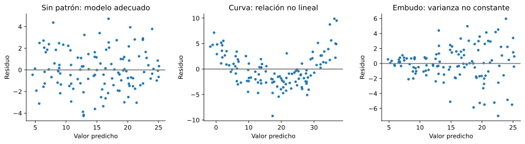
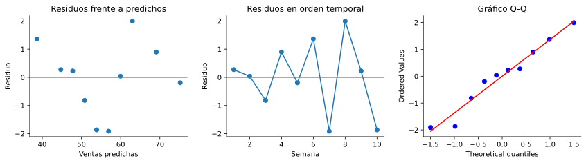

# 5.3 Residuos, R² e inferencia sobre la pendiente

> Versión web, con demos interactivas: <https://alberpro.com/nebrija-mpan/topics/05-regresion-lineal-simple/ajuste/>

> ℹ️ **Lo que necesitas antes**
>
> El modelo de regresión y la recta de mínimos cuadrados de la [página anterior](modelo.md). Para la última sección, el [error estándar](../03-inferencia/variabilidad.md) y los [intervalos de confianza](../03-inferencia/intervalos.md) del tema 3, y el [contraste de hipótesis](../04-contraste-hipotesis/index.md) del tema 4 (hipótesis nula, estadístico t y p-valor).

## Tres preguntas sobre la recta

En la página anterior estimamos la recta de la publicidad, $\widehat{\text{Ventas}} = 14.26 + 3.05 \times \text{Publicidad}$. Antes de presentarla al director comercial hay que responder a tres preguntas. **¿Cuánto se equivoca?** Una recta que acierta las ventas con un margen de mil euros no sirve para lo mismo que una que se equivoca en veinte mil. **¿Es adecuado el modelo?** La recta se apoya en unas suposiciones (relación lineal, varianza constante, normalidad, independencia) que hay que comprobar. **¿Es real la relación?** Con solo diez semanas, una pendiente positiva podría deberse al azar. Las tres se responden con la misma herramienta: los residuos.

## Residuos

> 📘 **Definición: residuo**
>
> El **residuo** de la observación $i$ es la diferencia entre el valor observado y el valor que predice la recta:
> $$e_i = y_i - \hat{y}_i = y_i - (\hat{\beta}_0 + \hat{\beta}_1 x_i).$$
> Un residuo positivo significa que el punto está por encima de la recta (la recta se queda corta) y uno negativo, que está por debajo.

El residuo es la versión observable del error $\varepsilon$. El error es la distancia a la recta **real**, $\beta_0 + \beta_1 x$, que no conocemos; el residuo es la distancia a la recta **estimada**. Por eso los residuos son nuestra ventana a los errores: todo lo que suponemos sobre $\varepsilon$ se comprueba mirando los residuos.

Estos son los residuos de las diez semanas:

| Semana | 1 | 2 | 3 | 4 | 5 | 6 | 7 | 8 | 9 | 10 |
|---|---|---|---|---|---|---|---|---|---|---|
| Publicidad $x_i$ | 10 | 15 | 12 | 18 | 20 | 8 | 14 | 16 | 11 | 13 |
| Ventas $y_i$ | 45 | 60 | 50 | 70 | 75 | 40 | 55 | 65 | 48 | 52 |
| Predicción $\hat{y}_i$ | 44.73 | 59.96 | 50.82 | 69.10 | 75.19 | 38.63 | 56.91 | 63.01 | 47.77 | 53.87 |
| Residuo $e_i$ | 0.27 | 0.04 | −0.82 | 0.90 | −0.19 | 1.37 | −1.91 | 1.99 | 0.23 | −1.87 |

En la semana 8, por ejemplo, se vendieron 65 mil € y la recta predecía 63.01: el residuo es $+1.99$, la semana fue algo mejor de lo esperado para su inversión.

Los residuos de mínimos cuadrados cumplen siempre dos propiedades, que salen de las ecuaciones que definen la recta (ver "De dónde salen las fórmulas" en la [página anterior](modelo.md)):

- **suman cero**, $\sum_i e_i = 0$: los que quedan por encima de la recta compensan exactamente a los que quedan por debajo;
- **no están correlacionados con $x$**, $\sum_i x_i e_i = 0$: la recta ya ha recogido toda la parte lineal de la relación, y en los residuos no queda tendencia lineal.

Que sumen cero no dice nada sobre si el modelo es bueno: sale así con cualquier conjunto de datos. Lo que importa es su **tamaño** y si muestran algún **patrón**.

### El tamaño de los residuos: el error típico de la regresión

Para resumir cuánto se equivoca la recta, el primer paso es la **suma de los residuos al cuadrado**, $SS_\text{res} = \sum_i e_i^2$, que es justo lo que minimiza mínimos cuadrados. A partir de ella se estima la varianza del error, $\sigma^2$.

> 📘 **Definición: varianza residual y error típico de la regresión**
>
> La **varianza residual** estima la varianza del error $\sigma^2$:
> $$s^2 = \frac{SS_\text{res}}{n - 2} = \frac{\sum_{i=1}^{n} e_i^2}{n - 2}.$$
> Su raíz cuadrada, $s$, es el **error típico de la regresión** (en inglés, *residual standard error*), y está en las unidades de $Y$.

Se divide entre $n - 2$, y no entre $n$, por el mismo motivo por el que la varianza muestral divide entre $n - 1$: los residuos están medidos respecto a una recta que se ha ajustado a esos mismos datos, y por eso son algo más pequeños que los errores reales. Para estimar la recta se han usado dos parámetros ($\hat{\beta}_0$ y $\hat{\beta}_1$), y se "pierden" dos grados de libertad. Con muchos datos la diferencia es despreciable; con diez semanas, no.

> ✏️ **Ejemplo resuelto: el error típico en la publicidad**
>
> Sumando los cuadrados de los diez residuos, $SS_\text{res} = 0.27^2 + 0.04^2 + \cdots + (-1.87)^2 = 14.63$. Entonces
> $$s^2 = \frac{14.63}{10 - 2} = 1.83, \qquad s = \sqrt{1.83} = 1.35 \text{ miles de €}.$$
> La recta se equivoca, típicamente, en unos 1350 € por semana. Si los errores son normales, alrededor del 95 % de las semanas deberían quedar a menos de $2s \approx 2700$ € de la recta. En los datos, el residuo más grande es de 1990 €.

## Bondad de ajuste: el coeficiente $R^2$

El error típico tiene un inconveniente: depende de las unidades. Un error de 1350 € es pequeño para unas ventas de 56 000 € y enorme para unas de 2000 €. Para tener una medida relativa, comparamos lo que se equivoca la recta con lo que nos equivocaríamos **sin** ella.

Si no tuviéramos el dato de la publicidad, la mejor predicción para las ventas de cualquier semana sería la media, $\bar{y} = 56$. Los errores de esa predicción ingenua son $y_i - \bar{y}$, y su suma de cuadrados es la **variabilidad total** de las ventas, $SS_\text{tot} = \sum_i (y_i - \bar{y})^2$. Con la recta, los errores son los residuos, y su suma de cuadrados es $SS_\text{res}$. La diferencia, $SS_\text{tot} - SS_\text{res}$, es la variabilidad que la recta ha conseguido explicar.

> 📘 **Definición: coeficiente de determinación $R^2$**
>
> El **coeficiente de determinación** es la proporción de la variabilidad de $Y$ que explica el modelo:
> $$R^2 = 1 - \frac{SS_\text{res}}{SS_\text{tot}} = 1 - \frac{\sum_i (y_i - \hat{y}_i)^2}{\sum_i (y_i - \bar{y})^2}.$$
> Siempre $0 \le R^2 \le 1$. $R^2 = 1$ indica un ajuste perfecto (todos los residuos son cero) y $R^2 = 0$, que la recta no mejora en nada a la media. En regresión lineal simple, $R^2 = r^2$, el cuadrado de la correlación.

> ✏️ **Ejemplo resuelto: $R^2$ en la publicidad**
>
> La variabilidad total de las ventas es $SS_\text{tot} = \sum (y_i - 56)^2 = 1148$. Con $SS_\text{res} = 14.63$,
> $$R^2 = 1 - \frac{14.63}{1148} = 0.987.$$
> El 98.7 % de la variabilidad de las ventas entre semanas se asocia con las diferencias de publicidad, y el 1.3 % restante se debe a otros factores. Coincide con el cuadrado de la correlación, $0.9936^2 = 0.987$.

Un $R^2$ de 0.987 es muy alto, típico de datos de ejemplo o de series agregadas. Con datos de personas o de clientes individuales son habituales valores de 0.2 o 0.3, y un modelo así puede ser muy útil si la pendiente es clara: la publicidad no explicará todo lo que gasta cada cliente, pero sí puede tener un efecto medio importante.

> ⚠️ **Lo que $R^2$ no dice**
>
> - **No dice que el modelo sea correcto.** Los cuatro conjuntos del [cuarteto de Anscombe](correlacion.md#la-misma-correlación-con-datos-muy-distintos) tienen el mismo $R^2 = 0.67$, y solo en uno de ellos la recta es un modelo adecuado.
> - **No dice que la relación sea causal.** Un $R^2$ alto es compatible con una variable de confusión.
> - **No dice si las predicciones son suficientemente precisas** para la decisión que hay que tomar. Para eso, mira $s$ en las unidades del problema.

## Diagnóstico: mirar los residuos

Si el modelo es adecuado, los residuos deberían parecer ruido: valores sin ninguna estructura, repartidos alrededor de cero con la misma dispersión en todas partes. Cualquier patrón en ellos es información que la recta no ha recogido. La herramienta principal es el **gráfico de residuos**: los residuos en el eje vertical frente a los valores predichos $\hat{y}_i$ (o frente a $x_i$, que en regresión simple es equivalente) en el horizontal.

Estos tres gráficos muestran un caso correcto y los dos problemas más habituales, con datos simulados:

```python
import numpy as np
import matplotlib.pyplot as plt
from scipy import stats

rng = np.random.default_rng(3)
x = rng.uniform(0, 10, 120)
casos = {
    "Sin patrón: modelo adecuado": 5 + 2 * x + rng.normal(0, 2, 120),
    "Curva: relación no lineal": 5 + 0.4 * x**2 + rng.normal(0, 2, 120),
    "Embudo: varianza no constante": 5 + 2 * x + rng.normal(0, 0.4 * x + 0.2, 120),
}
fig, axes = plt.subplots(1, 3, figsize=(12, 3.4))
for ax, (titulo, y) in zip(axes, casos.items()):
    m = stats.linregress(x, y)
    ajustados = m.intercept + m.slope * x
    ax.scatter(ajustados, y - ajustados, s=10)
    ax.axhline(0, color="gray")
    ax.set(title=titulo, xlabel="Valor predicho", ylabel="Residuo")
plt.tight_layout()
plt.show()
```



- **Sin patrón.** Una nube horizontal alrededor de cero, de anchura constante. Es lo que queremos ver.
- **Curva.** Los residuos son positivos en los extremos y negativos en el centro (o al revés): la relación no es lineal, y la recta se equivoca de forma sistemática. Hay que transformar las variables o usar otro modelo; lo veremos en el tema de [feature engineering](../08-feature-engineering/index.md).
- **Embudo.** La dispersión de los residuos crece con el valor predicho: la varianza no es constante (**heterocedasticidad**). Es muy habitual con importes: las tiendas grandes varían más en euros que las pequeñas. La recta puede seguir siendo razonable, pero los errores estándar y los p-valores de la última sección dejan de ser fiables.

Además del gráfico de residuos, conviene revisar tres cosas más. La **normalidad** de los residuos se mira con un histograma o, mejor, con un **gráfico Q-Q**, que compara los cuantiles de los residuos con los de una normal: si los puntos siguen la diagonal, son aproximadamente normales. La **independencia** se mira, en datos ordenados en el tiempo, dibujando los residuos en orden: si los positivos van seguidos de positivos y los negativos de negativos, hay dependencia temporal (lo trata el tema de [series temporales](../11-series-temporales/index.md)). Y los **valores atípicos**, puntos con un residuo mucho mayor que el resto (más de unas $3s$), hay que revisarlos uno a uno antes de decidir qué hacer con ellos.

> ✏️ **Ejemplo resuelto: diagnóstico de la publicidad**
>
> Con solo diez puntos, los gráficos de diagnóstico se leen con prudencia: una muestra pequeña de ruido puro puede parecer tener patrones.
>
> - **Gráfico de residuos:** los residuos van de $-1.91$ a $+1.99$, alternan signos y no muestran curva ni embudo.
> - **Normalidad:** el gráfico Q-Q (en la sección "En Python") sigue razonablemente la diagonal. Con diez datos no se puede afirmar mucho más.
> - **Atípicos:** ningún residuo supera $2s = 2.7$, ni mucho menos $3s$.
> - **Independencia:** es la duda principal. Son semanas consecutivas, y factores como la temporada podrían hacer que los errores de semanas cercanas se parezcan. Habría que mirarlos en orden temporal y, con más datos, comprobarlo.
>
> Conclusión: no hay indicios de problemas graves, y el modelo lineal es razonable dentro del rango observado.

## ¿Es real la relación? Inferencia sobre la pendiente

La pendiente $\hat{\beta}_1 = 3.047$ se ha calculado con diez semanas concretas. Con otras diez semanas habría salido algo distinta, igual que la media de una muestra cambia de una muestra a otra. La pendiente estimada es, por tanto, una variable aleatoria, con su propio error estándar, y podemos hacer con ella lo mismo que en los temas 3 y 4 hicimos con la media: un contraste de hipótesis y un intervalo de confianza.

> 📘 **Definición: error estándar de la pendiente**
>
> Si se cumplen las suposiciones del modelo, la pendiente estimada $\hat{\beta}_1$ se distribuye alrededor de la pendiente real $\beta_1$ con **error estándar**
> $$SE(\hat{\beta}_1) = \frac{s}{\sqrt{\sum_{i=1}^{n} (x_i - \bar{x})^2}},$$
> donde $s$ es el error típico de la regresión. El cociente $(\hat{\beta}_1 - \beta_1) / SE(\hat{\beta}_1)$ sigue una distribución $t$ de Student con $n - 2$ grados de libertad.

La fórmula tiene una lectura intuitiva. La pendiente es más precisa cuando los puntos están cerca de la recta ($s$ pequeño) y cuando los valores de $x$ están **muy repartidos** (suma de cuadrados grande): es más fácil medir la inclinación de una recta con puntos separados que con puntos amontonados. Por eso, si se puede elegir, conviene probar valores de $X$ variados.

### El contraste de la pendiente

La pregunta "¿hay relación lineal entre publicidad y ventas?" se traduce en un contraste sobre $\beta_1$. Si la pendiente real fuera cero, la publicidad no cambiaría las ventas medias.

- **Hipótesis nula:** $H_0: \beta_1 = 0$ (no hay relación lineal).
- **Hipótesis alternativa:** $H_1: \beta_1 \neq 0$.
- **Estadístico:** $t = \hat{\beta}_1 / SE(\hat{\beta}_1)$, que bajo $H_0$ sigue una $t$ con $n - 2$ grados de libertad.

El p-valor es la probabilidad de obtener un $|t|$ tan grande como el observado si $H_0$ fuera cierta. Es el p-valor que da `scipy.stats.linregress` y cualquier programa de regresión.

### El intervalo de confianza de la pendiente

Más útil que saber si la pendiente es distinta de cero es saber **cuánto** vale, con su margen de error. El intervalo de confianza al $(1 - \alpha)$ es
$$\hat{\beta}_1 \pm t_{n-2,\, 1-\alpha/2} \cdot SE(\hat{\beta}_1),$$
donde $t_{n-2,\, 1-\alpha/2}$ es el cuantil de la $t$ con $n - 2$ grados de libertad (2.306 para el 95 % con 8 grados de libertad).

> ✏️ **Ejemplo resuelto: inferencia sobre la pendiente de la publicidad**
>
> Ya tenemos $s = 1.352$ y $\sum (x_i - \bar{x})^2 = 122.1$.
>
> 1. **Error estándar:** $SE(\hat{\beta}_1) = 1.352 / \sqrt{122.1} = 1.352 / 11.05 = 0.122$.
> 2. **Contraste:** $t = 3.047 / 0.122 = 24.9$, con $10 - 2 = 8$ grados de libertad. El p-valor es $7 \times 10^{-9}$: si la publicidad no tuviera relación con las ventas, sería prácticamente imposible observar una pendiente así. Rechazamos $H_0$.
> 3. **Intervalo al 95 %:** $3.047 \pm 2.306 \cdot 0.122 = [2.76,\ 3.33]$.
>
> Para el informe: "Cada 1000 € adicionales de publicidad semanal se asocian con entre 2760 € y 3330 € más de ventas (intervalo de confianza al 95 %), dentro del rango de inversión observado de 8 000 a 20 000 €". El intervalo no incluye el cero, lo que es coherente con el rechazo de $H_0$, y además dice que la relación es claramente mayor que 1: cada euro de publicidad va con más de un euro de ventas.

Estas conclusiones dependen de las suposiciones del modelo. Si los residuos muestran una curva, un embudo o dependencia temporal, el error estándar, el p-valor y el intervalo pueden estar muy equivocados, por eso el diagnóstico va **antes** de la inferencia. Y un p-valor pequeño no dice que la relación sea causal ni que sea grande: con muchos datos, una pendiente minúscula y sin importancia práctica también sale significativa. Mira siempre el intervalo y pregúntate si su tamaño importa para la decisión.

> ⚠️ **Errores frecuentes**
>
> - **Creer que un $R^2$ alto valida el modelo.** Mira siempre el gráfico de residuos.
> - **Descartar un modelo solo porque su $R^2$ es bajo.** Puede tener una pendiente clara y útil.
> - **Hacer inferencia sin diagnóstico.** Los p-valores y los intervalos solo valen si se cumplen las suposiciones.
> - **Confundir significación estadística con importancia práctica.** Un p-valor pequeño dice que la pendiente probablemente no es cero, no que sea grande.
> - **Eliminar atípicos sin investigarlos.** Primero hay que entender por qué un punto se separa: puede ser un error de registro o la información más importante de los datos.

## En Python

Residuos, $R^2$, error típico, gráficos de diagnóstico e inferencia sobre la pendiente:

```python
x = np.array([10, 15, 12, 18, 20, 8, 14, 16, 11, 13])   # publicidad (miles €)
y = np.array([45, 60, 50, 70, 75, 40, 55, 65, 48, 52])  # ventas (miles €)
n = len(x)

modelo = stats.linregress(x, y)
predichos = modelo.intercept + modelo.slope * x
residuos = y - predichos
print("Residuos:", residuos.round(2))
```

```text
Residuos: [ 0.27  0.04 -0.82  0.9  -0.19  1.37 -1.91  1.99  0.23 -1.87]
```

```python
print("Suma de residuos:", abs(round(residuos.sum(), 10)))           # 0
```

```text
Suma de residuos: 0.0
```

```python
# Sumas de cuadrados, R² y error típico
ss_res = (residuos**2).sum()
ss_tot = ((y - y.mean()) ** 2).sum()
print(f"SS_res = {ss_res:.2f}, SS_tot = {ss_tot:.0f}")              # 14.63 y 1148
```

```text
SS_res = 14.63, SS_tot = 1148
```

```python
print(f"R² = {1 - ss_res / ss_tot:.3f} (r² = {modelo.rvalue**2:.3f})")   # 0.987
```

```text
R² = 0.987 (r² = 0.987)
```

```python
s = np.sqrt(ss_res / (n - 2))
print(f"Error típico de la regresión: s = {s:.2f}")                # 1.35
```

```text
Error típico de la regresión: s = 1.35
```

```python
# Inferencia sobre la pendiente
se = s / np.sqrt(((x - x.mean()) ** 2).sum())
t = modelo.slope / se
t_crit = stats.t.ppf(0.975, df=n - 2)
print(f"SE = {se:.3f} (linregress: {modelo.stderr:.3f}), t = {t:.1f}, p-valor = {modelo.pvalue:.1e}")
```

```text
SE = 0.122 (linregress: 0.122), t = 24.9, p-valor = 7.3e-09
```

```python
print(f"IC 95 %: [{modelo.slope - t_crit * se:.2f}, {modelo.slope + t_crit * se:.2f}]")   # [2.76, 3.33]
```

```text
IC 95 %: [2.76, 3.33]
```

```python
# Gráficos de diagnóstico: residuos frente a predichos, residuos en orden y Q-Q
fig, axes = plt.subplots(1, 3, figsize=(12, 3.4))
axes[0].scatter(predichos, residuos)
axes[0].axhline(0, color="gray")
axes[0].set(title="Residuos frente a predichos", xlabel="Ventas predichas", ylabel="Residuo")
axes[1].plot(range(1, n + 1), residuos, marker="o")
axes[1].axhline(0, color="gray")
axes[1].set(title="Residuos en orden temporal", xlabel="Semana", ylabel="Residuo")
stats.probplot(residuos, dist="norm", plot=axes[2])
```

```text
((array([-1.4988, -0.9849, -0.647 , -0.3711, -0.1212,  0.1212,  0.3711,
        0.647 ,  0.9849,  1.4988]), array([-1.914 , -1.8673, -0.8206, -0.1941,  0.0393,  0.226 ,  0.2727,
        0.8993,  1.3661,  1.9926])), (1.366155133132095, 1.3907507338399385e-15, 0.9829026861076364))
```

```python
axes[2].set_title("Gráfico Q-Q")
plt.tight_layout()
plt.show()
```



> ✅ **Lo esencial**
>
> - Los **residuos** $e_i = y_i - \hat{y}_i$ son la versión observable de los errores: suman cero y no están correlacionados con $x$. Su tamaño se resume en el **error típico de la regresión** $s = \sqrt{SS_\text{res} / (n - 2)}$, en unidades de $Y$.
> - El **$R^2$** es la proporción de la variabilidad de $Y$ explicada por la recta; en regresión simple, $R^2 = r^2$. En la publicidad, $R^2 = 0.987$ y $s = 1.35$ miles de €.
> - Un $R^2$ alto no garantiza que el modelo sea adecuado: el **gráfico de residuos** debe ser una nube sin patrón. Una curva indica no linealidad, y un embudo, varianza no constante.
> - La pendiente estimada tiene un **error estándar** $SE(\hat{\beta}_1) = s / \sqrt{\sum (x_i - \bar{x})^2}$. Con él se contrasta $H_0: \beta_1 = 0$ con una $t$ de $n - 2$ grados de libertad y se construye el intervalo $\hat{\beta}_1 \pm t \cdot SE$.
> - En la publicidad, cada 1000 € se asocian con entre 2760 € y 3330 € más de ventas (IC al 95 %), siempre que se cumplan las suposiciones del modelo.

## Ejercicios

**1.** Con los datos de formación y ventas, $x = (2, 4, 6, 8)$ e $y = (3, 5, 6, 10)$, y la recta $\hat{Y} = 0.5 + 1.1X$ del ejercicio 2 de la página anterior, calcula los residuos, comprueba que suman cero, y calcula $s$ y $R^2$.

<details>
<summary>✅ <b>Solución</b></summary>

Predicciones: $0.5 + 1.1 \cdot 2 = 2.7$, $4.9$, $7.1$ y $9.3$. Residuos: $3 - 2.7 = 0.3$, $0.1$, $-1.1$ y $0.7$, que suman $0.3 + 0.1 - 1.1 + 0.7 = 0$.

$SS_\text{res} = 0.09 + 0.01 + 1.21 + 0.49 = 1.8$, así que $s^2 = 1.8 / (4 - 2) = 0.9$ y $s = 0.95$ mil €.

$SS_\text{tot} = \sum (y_i - 6)^2 = 9 + 1 + 0 + 16 = 26$, y $R^2 = 1 - 1.8/26 = 0.931$. Coincide con el cuadrado de la correlación de la página 5.1: $0.965^2 = 0.931$.

</details>

**2.** En una regresión del gasto mensual de los clientes sobre su antigüedad se obtiene $SS_\text{tot} = 500$ y $SS_\text{res} = 125$, y la pendiente es negativa. Calcula $R^2$ y la correlación.

<details>
<summary>✅ <b>Solución</b></summary>

$R^2 = 1 - 125/500 = 0.75$: la antigüedad explica el 75 % de la variabilidad del gasto. La correlación es $\pm\sqrt{0.75} = \pm 0.866$, y su signo es el de la pendiente, así que $r = -0.866$.

</details>

**3.** Describe qué indica cada uno de estos gráficos de residuos frente a valores predichos y qué harías: (a) una nube horizontal sin forma; (b) residuos positivos para valores predichos bajos y altos, y negativos en el centro; (c) residuos muy juntos a la izquierda y cada vez más dispersos hacia la derecha.

<details>
<summary>✅ <b>Solución</b></summary>

- (a) **Modelo adecuado** en cuanto a linealidad y varianza. Se puede pasar a la inferencia (comprobando también la normalidad y, si hay orden temporal, la independencia).
- (b) Forma de U: la relación **no es lineal**. La recta sobreestima en el centro y subestima en los extremos. Habría que transformar alguna variable (por ejemplo, añadir $x^2$ o usar logaritmos) o usar otro modelo.
- (c) Embudo: **heterocedasticidad**. La recta puede servir para predecir el valor medio, pero los errores estándar, los p-valores y los intervalos no son fiables. Una solución habitual con importes es modelar el logaritmo de $Y$.

</details>

**4.** Una regresión con $n = 27$ observaciones da $\hat{\beta}_1 = 2.4$ con $SE(\hat{\beta}_1) = 0.8$. Contrasta $H_0: \beta_1 = 0$ al 5 % y calcula el intervalo de confianza al 95 % de la pendiente. (El cuantil 0.975 de la $t$ con 25 grados de libertad es 2.060.)

<details>
<summary>✅ <b>Solución</b></summary>

$t = 2.4 / 0.8 = 3$, con $27 - 2 = 25$ grados de libertad. Como $3 > 2.060$, se rechaza $H_0$ al 5 %. El p-valor es $2 \cdot P(t_{25} > 3) = 0.006$ (en Python, `2 * stats.t.sf(3, 25)`).

Intervalo: $2.4 \pm 2.060 \cdot 0.8 = [0.75,\ 4.05]$. La pendiente es positiva con bastante seguridad, pero el intervalo es ancho: su valor real podría estar entre menos de 1 y más de 4. Con más datos, o con valores de $x$ más repartidos, el intervalo se estrecharía.

</details>

**5.** Un compañero ajusta una recta al segundo conjunto del cuarteto de Anscombe, obtiene $R^2 = 0.67$ y un p-valor de 0.002 para la pendiente, y concluye que el modelo es bueno. ¿Qué le dirías?

<details>
<summary>✅ <b>Solución</b></summary>

Que el $R^2$ y el p-valor no comprueban si el modelo es adecuado. En ese conjunto los puntos dibujan una curva (una parábola), así que el gráfico de residuos tendría forma de U: la recta se equivoca de forma sistemática y las suposiciones del contraste no se cumplen. Hay que dibujar los datos y los residuos antes de interpretar cualquier estadístico, y en este caso usar un modelo que recoja la curvatura.

</details>

**6.** Un modelo del gasto anual de cada cliente frente al número de emails promocionales recibidos tiene $R^2 = 0.04$ con 20 000 clientes, y la pendiente es de 0.50 € por email, con un intervalo de confianza al 95 % de [0.45, 0.55]. ¿Sirve para algo este modelo?

<details>
<summary>✅ <b>Solución</b></summary>

Para **predecir** el gasto de un cliente concreto, poco: los emails explican solo el 4 % de la variabilidad del gasto, que depende sobre todo de otras cosas. Pero para **estimar el efecto medio** de los emails, la pendiente está medida con mucha precisión: cada email se asocia con unos 0.50 € más de gasto anual, entre 0.45 y 0.55 €. Si enviar un email cuesta menos que eso, la campaña podría compensar, siempre que la relación sea causal (por ejemplo, si los emails se enviaron al azar). Un $R^2$ bajo no hace inútil un modelo; depende de la pregunta.

</details>

[← El modelo y mínimos cuadrados](modelo.md) [Siguiente: Práctica guiada →](practica.md)
