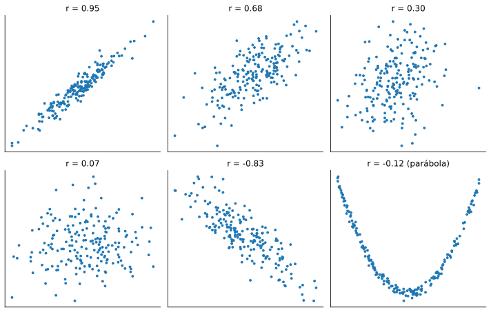
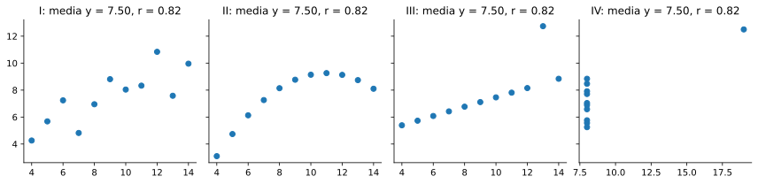
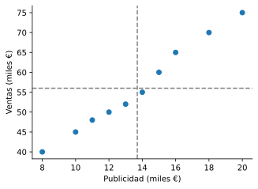

# 5.1 Dependencia, covarianza y correlación

> Versión web, con demos interactivas: <https://alberpro.com/nebrija-mpan/topics/05-regresion-lineal-simple/correlacion/>

> ℹ️ **Lo que necesitas antes**
>
> Qué significa que dos sucesos sean independientes, del [tema de probabilidad](../01-probabilidad/index.md), y la [media y la varianza](../02-variables-aleatorias/variables.md#media-y-varianza-de-una-distribución) de una variable aleatoria, junto con su versión calculada con una muestra, del [tema de estimación](../03-inferencia/estimacion.md).

## De una variable a dos

Hasta ahora hemos estudiado variables de una en una: cuántos artículos tiene un pedido, cuánto tarda una entrega, qué proporción de clientes compra tras recibir un email. Las preguntas de negocio más interesantes, sin embargo, casi siempre relacionan **dos** variables. ¿Cuánto aumentan las ventas por cada euro que invertimos en publicidad? ¿Cómo afecta la temperatura a la demanda de helados? ¿Qué salario cabe esperar para alguien con diez años de experiencia? Para responderlas necesitamos describir cómo se mueve una variable cuando se mueve la otra.

El caso que recorre todo el tema es el de una empresa que ha anotado, durante diez semanas, cuánto invirtió en publicidad y cuánto vendió, ambas cifras en miles de euros:

| Semana | 1 | 2 | 3 | 4 | 5 | 6 | 7 | 8 | 9 | 10 |
|---|---|---|---|---|---|---|---|---|---|---|
| Publicidad $x$ | 10 | 15 | 12 | 18 | 20 | 8 | 14 | 16 | 11 | 13 |
| Ventas $y$ | 45 | 60 | 50 | 70 | 75 | 40 | 55 | 65 | 48 | 52 |

A simple vista, las semanas con más publicidad parecen ser también las de más ventas. Esta página da las herramientas para convertir esa impresión en números: primero, la idea de dependencia; después, la **covarianza** y la **correlación**, que miden cuánto y en qué sentido se mueven juntas dos variables.

## Variables dependientes e independientes

Dos variables son independientes cuando conocer el valor de una no cambia lo que esperamos de la otra. El resultado de dos dados lanzados por separado es el ejemplo clásico: saber que el primero ha salido 6 no dice nada sobre el segundo. Las horas de estudio y la nota de un examen, en cambio, son dependientes: saber que alguien ha estudiado mucho cambia lo que esperamos de su nota.

> 📘 **Definición: independencia de dos variables**
>
> Dos variables aleatorias $X$ e $Y$ son **independientes** si, para cualquier par de valores $x$ e $y$,
> $$P(X = x, Y = y) = P(X = x)\, P(Y = y),$$
> es decir, si la probabilidad conjunta es el producto de las probabilidades de cada variable por separado. Si esta igualdad falla para algún par de valores, las variables son **dependientes**. (En variables continuas la condición es la misma con las densidades.)

Es la misma regla de independencia de sucesos del tema de probabilidad, aplicada a todos los valores de las dos variables a la vez.

> ✏️ **Ejemplo resuelto: anuncio y compra**
>
> Una tienda online registra 200 visitas. 100 vieron un anuncio y, de ellas, 40 compraron. De las otras 100, que no lo vieron, compraron 20. Sea $A = 1$ si la visita vio el anuncio y $C = 1$ si compró.
>
> - Probabilidades por separado: $P(A = 1) = 100/200 = 0.5$ y $P(C = 1) = 60/200 = 0.3$.
> - Probabilidad conjunta: $P(A = 1, C = 1) = 40/200 = 0.2$.
> - Si fueran independientes, la conjunta sería $0.5 \cdot 0.3 = 0.15$. Como $0.2 \neq 0.15$, **son dependientes**: entre quienes vieron el anuncio compra el 40 %, y entre quienes no lo vieron, el 20 %.
>
> Ver el anuncio y comprar van juntos. Eso no prueba que el anuncio cause la compra (puede que el anuncio se mostrara sobre todo a clientes habituales), pero sí que conocer una variable ayuda a predecir la otra.

Con variables numéricas que toman muchos valores, como la publicidad y las ventas, comprobar la igualdad valor a valor es imposible. Necesitamos un resumen numérico de la relación, y el más sencillo es la covarianza.

## La covarianza

Coloca los diez puntos de la publicidad en un gráfico de dispersión y traza dos líneas: una vertical en la media de la publicidad, $\bar{x} = 13.7$, y otra horizontal en la media de las ventas, $\bar{y} = 56$. El plano queda dividido en cuatro cuadrantes. Si la relación es positiva, la mayoría de los puntos caerá en el cuadrante de arriba a la derecha (publicidad por encima de la media y ventas por encima de la media) y en el de abajo a la izquierda (ambas por debajo). En esos dos cuadrantes las desviaciones $x_i - \bar{x}$ e $y_i - \bar{y}$ tienen el mismo signo y su producto es **positivo**. En los otros dos cuadrantes el producto es **negativo**.

La covarianza es el promedio de esos productos. Si dominan los puntos de los cuadrantes "positivos", sale positiva; si dominan los otros, negativa; si se compensan, cerca de cero.

> 📘 **Definición: covarianza**
>
> La **covarianza** de dos variables aleatorias es la esperanza del producto de sus desviaciones respecto a sus medias:
> $$\operatorname{Cov}(X, Y) = \mathbb{E}\big[(X - \mathbb{E}[X])(Y - \mathbb{E}[Y])\big].$$
> Con una muestra de $n$ pares $(x_1, y_1), \ldots, (x_n, y_n)$, de medias $\bar{x}$ e $\bar{y}$, se estima con
> $$\widehat{\operatorname{Cov}}(X, Y) = \frac{1}{n} \sum_{i=1}^{n} (x_i - \bar{x})(y_i - \bar{y}).$$
>
> - $\operatorname{Cov} > 0$: cuando una variable está por encima de su media, la otra también tiende a estarlo (relación **positiva**).
> - $\operatorname{Cov} < 0$: cuando una está por encima, la otra tiende a estar por debajo (relación **negativa**).
> - $\operatorname{Cov} \approx 0$: no hay relación **lineal**.

La covarianza de una variable consigo misma es su varianza: $\operatorname{Cov}(X, X) = \mathbb{E}[(X - \mathbb{E}[X])^2] = \mathbb{V}[X]$. Igual que con la varianza, al calcularla con una muestra se puede dividir entre $n$ o entre $n - 1$; Python usa $n - 1$ por defecto (`np.cov`, `df.cov()`). La diferencia es pequeña con muestras grandes y, como veremos, no afecta a la correlación siempre que se use el mismo divisor en todo el cálculo.

> ✏️ **Ejemplo resuelto: covarianza de publicidad y ventas**
>
> Las medias son $\bar{x} = 137/10 = 13.7$ y $\bar{y} = 560/10 = 56$. Para cada semana se calculan las dos desviaciones y su producto. Por ejemplo, en la semana 5, $(20 - 13.7)(75 - 56) = 6.3 \cdot 19 = 119.7$: mucha publicidad y muchas ventas, producto positivo y grande. En la semana 6, $(8 - 13.7)(40 - 56) = (-5.7)(-16) = 91.2$: poca publicidad y pocas ventas, producto también positivo. Sumando los diez productos se obtiene 372, así que
> $$\widehat{\operatorname{Cov}}(X, Y) = \frac{372}{10} = 37.2 \text{ (miles de €)}^2.$$
> Es positiva: más publicidad va con más ventas. Dividiendo entre $n - 1 = 9$ saldría $41.33$.

El problema de la covarianza es su escala. Sus unidades son el producto de las unidades de las dos variables, aquí "miles de euros al cuadrado", que no tienen lectura intuitiva. Peor aún, depende de cómo midamos: si expresamos las ventas en euros en lugar de en miles de euros, todas las desviaciones $y_i - \bar{y}$ se multiplican por 1000 y la covarianza pasa a ser 37 200, aunque la relación entre las variables es exactamente la misma. Por eso el **signo** de la covarianza es informativo, pero su **tamaño** no sirve para decir si la relación es fuerte o débil.

## La correlación de Pearson

La solución es medir las desviaciones en "número de desviaciones típicas", que no tiene unidades. Dividiendo la covarianza entre el producto de las dos desviaciones típicas se obtiene un número que no depende de las unidades y que siempre está entre $-1$ y $1$.

> 📘 **Definición: coeficiente de correlación de Pearson**
>
> La **correlación** de $X$ e $Y$ es su covarianza dividida entre el producto de sus desviaciones típicas $\sigma_X$ y $\sigma_Y$:
> $$\rho(X, Y) = \frac{\operatorname{Cov}(X, Y)}{\sigma_X\, \sigma_Y}.$$
> Con una muestra se estima con
> $$r = \frac{\widehat{\operatorname{Cov}}(X, Y)}{s_X\, s_Y},$$
> donde $s_X$ y $s_Y$ son las desviaciones típicas de la muestra, calculadas con el mismo divisor ($n$ o $n - 1$) que la covarianza.
>
> Siempre $-1 \le r \le 1$. El valor $r = 1$ indica que los puntos están exactamente sobre una recta con pendiente positiva, $r = -1$ sobre una recta con pendiente negativa, y $r = 0$ que no hay relación lineal.

La correlación tiene tres propiedades que la hacen muy cómoda. No tiene unidades, así que se pueden comparar correlaciones de variables muy distintas. No cambia si cambiamos las unidades de medida (euros o miles de euros, grados Celsius o Fahrenheit), porque el factor que multiplica la covarianza también multiplica la desviación típica. Y es simétrica: la correlación de $X$ con $Y$ es la misma que la de $Y$ con $X$.

> ✏️ **Ejemplo resuelto: correlación de publicidad y ventas**
>
> Con divisor $n$, las desviaciones típicas son $s_X = 3.494$ y $s_Y = 10.714$ miles de €. Entonces
> $$r = \frac{37.2}{3.494 \cdot 10.714} = 0.994.$$
> Con divisor $n - 1$ se obtiene lo mismo: $41.33 / (3.683 \cdot 11.294) = 0.994$, porque el cambio de divisor afecta igual al numerador y al denominador.
>
> Una correlación de 0.994 es muy cercana a 1: en estas diez semanas, la publicidad y las ventas siguen casi una línea recta creciente.

### Cómo se ve una correlación

No hay reglas universales para decir cuándo una correlación es "fuerte", porque depende del campo: en datos de ventas agregadas es habitual ver correlaciones de 0.9, y en datos de comportamiento de personas individuales una de 0.3 puede ser relevante. Lo más útil es tener en la cabeza el aspecto de cada valor. Estos seis conjuntos de datos simulados tienen 200 puntos cada uno:

```python
import numpy as np
import matplotlib.pyplot as plt

rng = np.random.default_rng(1)
fig, axes = plt.subplots(2, 3, figsize=(10, 6.4))
for ax, rho in zip(axes.flat[:5], [0.95, 0.7, 0.3, 0.0, -0.8]):
    x = rng.normal(size=200)
    y = rho * x + np.sqrt(1 - rho**2) * rng.normal(size=200)
    ax.scatter(x, y, s=8)
    ax.set_title(f"r = {np.corrcoef(x, y)[0, 1]:.2f}")
# Relación perfecta pero no lineal: una parábola
x = rng.uniform(-2, 2, size=200)
y = x**2 + 0.1 * rng.normal(size=200)
axes.flat[5].scatter(x, y, s=8)
axes.flat[5].set_title(f"r = {np.corrcoef(x, y)[0, 1]:.2f} (parábola)")
for ax in axes.flat:
    ax.set_xticks([])
    ax.set_yticks([])
plt.tight_layout()
plt.show()
```



Fíjate en el último panel. La relación entre las dos variables es casi perfecta (cada $y$ es prácticamente $x^2$), y sin embargo la correlación es cercana a cero. Es la primera advertencia importante.

## Lo que la correlación no dice

### Correlación cero no implica independencia

La correlación solo mide relaciones **lineales**. En la parábola, para valores de $x$ negativos la relación es decreciente y para valores positivos es creciente; los productos de las desviaciones de las dos mitades se compensan y la correlación sale cero. Pero las variables son claramente dependientes: conocer $x$ determina $y$ casi por completo. La implicación solo va en un sentido: si dos variables son independientes, su correlación es cero; si su correlación es cero, pueden ser independientes o tener una relación no lineal.

### La misma correlación con datos muy distintos

Un único número no puede resumir la forma de una nube de puntos. El estadístico Francis Anscombe lo mostró en 1973 con cuatro conjuntos de 11 puntos, conocidos como el **cuarteto de Anscombe**, que tienen la misma media de $x$, la misma media de $y$, casi la misma varianza y la misma correlación, $r = 0.82$:

```python
x = [10, 8, 13, 9, 11, 14, 6, 4, 12, 7, 5]
anscombe = {
    "I": (x, [8.04, 6.95, 7.58, 8.81, 8.33, 9.96, 7.24, 4.26, 10.84, 4.82, 5.68]),
    "II": (x, [9.14, 8.14, 8.74, 8.77, 9.26, 8.10, 6.13, 3.10, 9.13, 7.26, 4.74]),
    "III": (x, [7.46, 6.77, 12.74, 7.11, 7.81, 8.84, 6.08, 5.39, 8.15, 6.42, 5.73]),
    "IV": ([8, 8, 8, 8, 8, 8, 8, 19, 8, 8, 8], [6.58, 5.76, 7.71, 8.84, 8.47, 7.04, 5.25, 12.50, 5.56, 7.91, 6.89]),
}
fig, axes = plt.subplots(1, 4, figsize=(12, 3), sharey=True)
for ax, (nombre, (xs, ys)) in zip(axes, anscombe.items()):
    ax.scatter(xs, ys)
    ax.set_title(f"{nombre}: media y = {np.mean(ys):.2f}, r = {np.corrcoef(xs, ys)[0, 1]:.2f}")
plt.tight_layout()
plt.show()
```



Solo el primero es una relación lineal con ruido. El segundo es una curva. En el tercero, todos los puntos están sobre una recta excepto uno, que es suficiente para cambiar la correlación. En el cuarto, no hay relación ninguna salvo por un único punto extremo. El [Datasaurus Dozen](https://jumpingrivers.github.io/datasauRus/) lleva la idea más lejos: trece conjuntos de datos con los mismos estadísticos, uno de los cuales dibuja un dinosaurio. La conclusión práctica es una regla de trabajo: **dibuja siempre el gráfico de dispersión antes de calcular una correlación**.

### Correlación no implica causalidad

Que dos variables se muevan juntas no significa que una cause la otra. Las ventas de helados y el número de ahogamientos en playas están muy correlacionados a lo largo del año, y nadie piensa que los helados provoquen ahogamientos: ambas variables dependen de una tercera, la temperatura, que hace que más gente compre helados y más gente se bañe. A esa tercera variable se le llama **variable de confusión**. En otros casos la relación es pura coincidencia: la web de [relaciones espurias](https://www.tylervigen.com/spurious-correlations) recoge pares de series temporales sin ninguna conexión con correlaciones superiores a 0.9.

En el caso de la publicidad, la correlación de 0.994 no demuestra por sí sola que la publicidad cause las ventas. Si la empresa invierte más en publicidad justo en las semanas en que espera vender más (por ejemplo, antes de Navidad), parte de la relación se debe a la temporada, no a los anuncios. Para hablar de causa hace falta un experimento (asignar al azar la inversión) o un análisis que controle las variables de confusión, como la regresión múltiple del [tema 6](../06-regresion-lineal-multiple/index.md).

> ⚠️ **Errores frecuentes**
>
> - **Interpretar el tamaño de la covarianza.** Depende de las unidades. Para medir la fuerza de una relación, usa la correlación.
> - **Concluir independencia porque $r \approx 0$.** Puede haber una relación no lineal fuerte.
> - **Calcular la correlación sin mirar los datos.** Un solo valor atípico puede crear o destruir una correlación.
> - **Leer causalidad en una correlación.** Busca siempre posibles variables de confusión.
> - **Mezclar divisores.** Si la covarianza se calcula con $n - 1$ (lo que hace pandas) y las desviaciones típicas con $n$ (lo que hace `np.std` por defecto), $r$ sale mal.

La correlación nos dice que la publicidad y las ventas se mueven juntas y casi en línea recta, pero no responde a la pregunta de negocio: **cuántos** euros de ventas se asocian con cada euro de publicidad. Para eso necesitamos la recta misma, que es el objeto de la [página siguiente](modelo.md).

## En Python

Covarianza y correlación con NumPy y pandas, y la comprobación de que el divisor no afecta a $r$:

```python
import pandas as pd

datos = pd.DataFrame({
    "publicidad": [10, 15, 12, 18, 20, 8, 14, 16, 11, 13],
    "ventas": [45, 60, 50, 70, 75, 40, 55, 65, 48, 52],
})
x, y = datos["publicidad"], datos["ventas"]

# Covarianza "a mano", con divisor n
cov_n = ((x - x.mean()) * (y - y.mean())).sum() / len(x)
print("Covarianza (divisor n):", round(cov_n, 2))                       # 37.2
```

```text
Covarianza (divisor n): 37.2
```

```python
print("Covarianza (divisor n-1):", round(x.cov(y), 2))                  # pandas usa n-1: 41.33
```

```text
Covarianza (divisor n-1): 41.33
```

```python
# Correlación con el mismo divisor arriba y abajo
r = cov_n / (x.std(ddof=0) * y.std(ddof=0))
print("r a mano:", round(r, 3))                                         # 0.994
```

```text
r a mano: 0.994
```

```python
print("r con pandas:", round(x.corr(y), 3))
```

```text
r con pandas: 0.994
```

```python
# Matriz de correlaciones de todas las columnas numéricas
print(datos.corr().round(3))
```

```text
            publicidad  ventas
publicidad       1.000   0.994
ventas           0.994   1.000
```

```python
# Gráfico de dispersión con las medias
plt.figure(figsize=(5, 3.5))
plt.scatter(x, y)
plt.axvline(x.mean(), color="gray", ls="--")
plt.axhline(y.mean(), color="gray", ls="--")
plt.xlabel("Publicidad (miles €)")
plt.ylabel("Ventas (miles €)")
plt.show()
```



> ✅ **Lo esencial**
>
> - Dos variables son **independientes** si $P(X = x, Y = y) = P(X = x)\,P(Y = y)$ para todos los valores; si no, son **dependientes** y una ayuda a predecir la otra.
> - La **covarianza** promedia el producto de las desviaciones respecto a las medias: su signo indica si la relación es positiva o negativa, pero su tamaño depende de las unidades.
> - La **correlación** $r = \widehat{\operatorname{Cov}}(X, Y) / (s_X s_Y)$ no tiene unidades, está entre $-1$ y $1$ y mide la fuerza de la relación **lineal**. En el caso de la publicidad, $r = 0.994$.
> - Correlación cero no implica independencia, y datos muy distintos pueden tener la misma correlación: dibuja siempre los datos.
> - **Correlación no implica causalidad**: puede haber variables de confusión o simple coincidencia.

## Ejercicios

**1.** Indica qué signo esperas en la correlación de cada par de variables: (a) precio de un producto y unidades vendidas; (b) temperatura exterior y gasto en calefacción; (c) número de empleados de una tienda y su facturación; (d) día del mes de nacimiento de un cliente y su gasto anual.

<details>
<summary>✅ <b>Solución</b></summary>

- (a) **Negativa**: a mayor precio, normalmente menos unidades vendidas.
- (b) **Negativa**: cuanto más calor hace fuera, menos se gasta en calefacción.
- (c) **Positiva**: las tiendas grandes tienen más empleados y facturan más. Ojo: eso no quiere decir que contratar a una persona más aumente la facturación; el tamaño de la tienda es una variable de confusión.
- (d) **Cercana a cero**: no hay ningún motivo para que estén relacionadas.

</details>

**2.** Una empresa anota las horas de formación de cuatro comerciales y sus ventas mensuales (miles de €): $x = (2, 4, 6, 8)$, $y = (3, 5, 6, 10)$. Calcula a mano la covarianza (con divisor $n$) y la correlación.

<details>
<summary>✅ <b>Solución</b></summary>

Medias: $\bar{x} = 20/4 = 5$ y $\bar{y} = 24/4 = 6$.

Desviaciones de $x$: $-3, -1, 1, 3$. Desviaciones de $y$: $-3, -1, 0, 4$. Productos: $9, 1, 0, 12$, que suman 22. Covarianza: $22/4 = 5.5$.

Desviaciones típicas con divisor $n$: $s_X = \sqrt{(9 + 1 + 1 + 9)/4} = \sqrt{5} = 2.236$ y $s_Y = \sqrt{(9 + 1 + 0 + 16)/4} = \sqrt{6.5} = 2.550$.

Correlación: $r = 5.5 / (2.236 \cdot 2.550) = 0.965$. Una relación positiva muy fuerte.

</details>

**3.** En el ejemplo de la publicidad, si expresamos las ventas en euros en lugar de en miles de euros, ¿cómo cambian la covarianza y la correlación?

<details>
<summary>✅ <b>Solución</b></summary>

Todas las ventas, su media y sus desviaciones se multiplican por 1000. La covarianza también se multiplica por 1000: pasa de 37.2 a 37 200. La desviación típica de las ventas se multiplica por 1000 igualmente, así que en la correlación el factor aparece arriba y abajo y se cancela: $r$ sigue siendo 0.994. Por eso la correlación sirve para medir la fuerza de una relación y la covarianza no.

</details>

**4.** Los datos $x = (-2, -1, 0, 1, 2)$ e $y = x^2 = (4, 1, 0, 1, 4)$ tienen correlación exactamente 0. ¿Son independientes $x$ e $y$? Explícalo calculando la covarianza.

<details>
<summary>✅ <b>Solución</b></summary>

$\bar{x} = 0$ e $\bar{y} = 2$. Los productos $(x_i - 0)(y_i - 2)$ son $-2 \cdot 2 = -4$, $-1 \cdot (-1) = 1$, $0$, $1 \cdot (-1) = -1$ y $2 \cdot 2 = 4$, que suman 0. La covarianza, y por tanto la correlación, es cero.

Pero no son independientes: $y$ está completamente determinada por $x$. La correlación es cero porque la relación no es lineal: en la mitad izquierda $y$ baja al crecer $x$, y en la derecha sube, y los dos efectos se cancelan.

</details>

**5.** Un estudio encuentra una correlación de 0.7 entre el número de cafeterías de una ciudad y el número de patentes registradas. Un periodista titula: "Abrir cafeterías impulsa la innovación". ¿Qué le dirías?

<details>
<summary>✅ <b>Solución</b></summary>

Que correlación no implica causalidad. Hay una variable de confusión evidente, el **tamaño de la ciudad**: las ciudades grandes tienen más cafeterías y más empresas y universidades que registran patentes. Para comparar de forma razonable habría que, como mínimo, usar cifras por habitante, y aun así podrían influir otras variables (renta, nivel educativo). Solo un análisis que controle esas variables, o un experimento, permitiría hablar de efecto.

</details>

**6.** Los puntos $(1, 2), (2, 4), (3, 6), (4, 8), (5, 10)$ están sobre una recta, así que $r = 1$. Se añade un sexto punto, $(6, 0)$, que resulta ser un error de registro. Calcula la nueva correlación con Python. ¿Qué conclusión sacas?

<details>
<summary>✅ <b>Solución</b></summary>

Con `np.corrcoef([1, 2, 3, 4, 5, 6], [2, 4, 6, 8, 10, 0])[0, 1]` se obtiene $r = 0.14$. Un único punto erróneo ha hecho que una relación perfecta parezca casi inexistente. La correlación es muy sensible a los valores atípicos, sobre todo con pocos datos: antes de calcularla hay que dibujar los datos y revisar los puntos que se separan del resto.

</details>

[← Volver al tema](index.md) [Siguiente: El modelo y mínimos cuadrados →](modelo.md)
