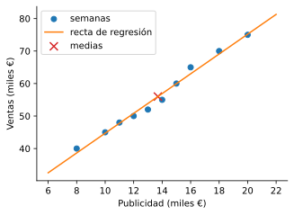

# 5.2 El modelo de regresión y mínimos cuadrados

> Versión web, con demos interactivas: <https://alberpro.com/nebrija-mpan/topics/05-regresion-lineal-simple/modelo/>

> ℹ️ **Lo que necesitas antes**
>
> La covarianza y la correlación de la [página anterior](correlacion.md), y la idea de [estimar un parámetro con una muestra](../03-inferencia/estimacion.md). Usamos el mismo caso: diez semanas de inversión en publicidad ($x$) y ventas ($y$), en miles de euros.

## Del análisis descriptivo al predictivo

En la página anterior describimos la relación entre la publicidad y las ventas con un número, $r = 0.994$. Es una descripción de lo que **ha pasado**: en esas diez semanas, las dos variables se movieron juntas casi en línea recta. El director comercial, sin embargo, quiere saber otras cosas. ¿Cuántos euros de ventas se asocian con cada euro de publicidad? Si el mes que viene invertimos 15 000 € a la semana, ¿cuánto esperamos vender? Son preguntas sobre lo que **pasará**, y la correlación no las responde: una correlación de 0.994 es compatible con que cada euro de publicidad vaya con 1 € de ventas o con 10 €.

Para responderlas necesitamos un **modelo**: una fórmula que diga qué valor de $y$ esperamos para cada valor de $x$. La regresión lineal simple conecta los dos enfoques. Con ella podemos **describir** la relación entre dos variables, **cuantificar** cuánto cambia una cuando cambia la otra y **predecir** valores nuevos.

## El modelo de regresión lineal simple

La idea es suponer que, en promedio, $y$ depende de $x$ según una recta, y que cada observación se separa de esa recta por una cantidad aleatoria. Las semanas con 15 000 € de publicidad no venden todas lo mismo, pero sus ventas se reparten alrededor de un valor medio, y ese valor medio crece de forma lineal con la publicidad.

> 📘 **Definición: modelo de regresión lineal simple**
>
> El modelo de regresión lineal simple supone que
> $$Y = \beta_0 + \beta_1 X + \varepsilon,$$
> donde
>
> - $Y$ es la **variable dependiente** o **respuesta**: lo que queremos explicar o predecir (las ventas);
> - $X$ es la **variable independiente** o **predictor**: lo que usamos para explicar (la publicidad);
> - $\beta_0$ es el **intercepto** u ordenada en el origen: el valor esperado de $Y$ cuando $X = 0$;
> - $\beta_1$ es la **pendiente**: el cambio esperado en $Y$ por cada unidad más de $X$;
> - $\varepsilon$ es el **error aleatorio**: la parte de $Y$ que la recta no explica.
>
> Los parámetros $\beta_0$ y $\beta_1$ son desconocidos. Con una muestra se calculan unas estimaciones, $\hat{\beta}_0$ y $\hat{\beta}_1$, y con ellas la **predicción** o valor ajustado
> $$\hat{Y} = \hat{\beta}_0 + \hat{\beta}_1 X.$$

Observa que el modelo tiene dos partes. La recta $\beta_0 + \beta_1 X$ es la parte **sistemática**, lo que esperamos de $Y$ en promedio para cada valor de $X$. El error $\varepsilon$ es la parte **aleatoria**. La predicción $\hat{Y}$ no lleva error: es nuestra mejor estimación del valor medio de $Y$ para ese $X$, no una promesa del valor exacto.

### Cómo se interpretan los parámetros

Tomemos un ejemplo fuera de la publicidad para fijar ideas. Una empresa estima que el salario anual de sus empleados (en euros) se relaciona con sus años de experiencia según
$$\widehat{\text{Salario}} = 25\,000 + 1\,500 \times \text{Años de experiencia}.$$

- La **pendiente**, $\hat{\beta}_1 = 1500$, es la interpretación clave del modelo: cada año más de experiencia se asocia, en promedio, con 1500 € más de salario. La pendiente siempre se lee en las unidades de $Y$ por unidad de $X$ (euros por año).
- El **intercepto**, $\hat{\beta}_0 = 25\,000$, es el salario esperado para alguien con 0 años de experiencia: el salario de entrada. Aquí tiene sentido, porque la empresa contrata a gente sin experiencia. En muchos otros casos $X = 0$ queda lejos de los datos o no tiene sentido (una vivienda de 0 m², una temperatura de 0 °C en una heladería en verano), y entonces el intercepto es solo el punto donde la recta corta el eje, sin interpretación práctica.
- **Predecir** es sustituir: para alguien con 5 años, $\hat{Y} = 25\,000 + 1\,500 \times 5 = 32\,500$ €.

La palabra "promedio" en la interpretación de la pendiente es importante. El modelo no dice que cada empleado gane exactamente 1500 € más por año, sino que el salario **medio** sube 1500 € por cada año.

### El error aleatorio

Si $Y$ dependiera solo de $X$, todos los puntos estarían sobre la recta. Nunca es así, por tres motivos. Hay **variabilidad natural**: dos semanas con la misma publicidad venden distinto porque los clientes no se comportan siempre igual. Hay **variables que no están en el modelo**: el tiempo, la competencia, la época del año. Y hay **errores de medición**. El término $\varepsilon$ recoge todo eso.

Para que la recta estimada se comporte bien y para poder hacer inferencia sobre ella ([página siguiente](ajuste.md)), se hacen cuatro suposiciones sobre el error:

1. **Media cero:** $\mathbb{E}[\varepsilon] = 0$. Los errores no se desvían sistemáticamente hacia arriba ni hacia abajo; si lo hicieran, la recta estaría mal colocada.
2. **Varianza constante (homocedasticidad):** $\mathbb{V}[\varepsilon] = \sigma^2$, igual para todos los valores de $X$. La dispersión de las ventas alrededor de la recta es la misma en las semanas de poca publicidad que en las de mucha.
3. **Normalidad:** $\varepsilon \sim N(0, \sigma^2)$. Esta suposición se usa para los contrastes y los intervalos de confianza.
4. **Independencia:** el error de una observación no dice nada del error de otra. En datos ordenados en el tiempo, como semanas, es la suposición que más a menudo falla: una buena semana suele ir seguida de otra buena.

Estas suposiciones no se pueden comprobar directamente, porque los errores $\varepsilon$ no se observan. Se comprueban de forma indirecta con los residuos, en la [página siguiente](ajuste.md).

## Estimación por mínimos cuadrados

Ahora hay que elegir la recta. Dibuja los diez puntos de la publicidad: hay infinitas rectas que pasan cerca de ellos. Necesitamos un criterio que diga cuál es la mejor.

Para cualquier recta candidata $y = b_0 + b_1 x$, cada punto queda a una distancia vertical $y_i - (b_0 + b_1 x_i)$ de ella: lo que la recta se equivoca al predecir esa semana. Una buena recta hace pequeños esos errores. No basta con sumarlos, porque los errores positivos y negativos se compensarían, y una recta muy mala podría tener suma cero. La solución habitual es sumar sus **cuadrados**: todos son positivos, los errores grandes pesan mucho más que los pequeños y, como veremos, la recta óptima se obtiene con una fórmula sencilla.

> 📘 **Definición: estimación por mínimos cuadrados (OLS)**
>
> Los **estimadores de mínimos cuadrados** (OLS, del inglés *ordinary least squares*) son los valores $\hat{\beta}_0$ y $\hat{\beta}_1$ que minimizan la suma de los errores al cuadrado,
> $$\min_{\beta_0,\, \beta_1} \sum_{i=1}^{n} \big(y_i - \beta_0 - \beta_1 x_i\big)^2.$$
> A esta cantidad se le llama **función de pérdida** o **función de coste**. El mínimo se alcanza en
> $$\hat{\beta}_1 = \frac{\sum_{i=1}^{n} (x_i - \bar{x})(y_i - \bar{y})}{\sum_{i=1}^{n} (x_i - \bar{x})^2} = \frac{\widehat{\operatorname{Cov}}(X, Y)}{s_X^2}, \qquad \hat{\beta}_0 = \bar{y} - \hat{\beta}_1 \bar{x}.$$

La fórmula de la pendiente es la covarianza dividida entre la varianza de $X$ (las dos con el mismo divisor, que se cancela). La fórmula del intercepto dice que $\bar{y} = \hat{\beta}_0 + \hat{\beta}_1 \bar{x}$: **la recta de regresión siempre pasa por el punto de las medias** $(\bar{x}, \bar{y})$. Si invertimos la publicidad media, predecimos las ventas medias.

<details>
<summary>ℹ️ <b>Para saber más: de dónde salen las fórmulas</b></summary>

La función de pérdida $L(\beta_0, \beta_1) = \sum_i (y_i - \beta_0 - \beta_1 x_i)^2$ es una parábola en cada parámetro, y su mínimo está donde las dos derivadas parciales valen cero:

$$\frac{\partial L}{\partial \beta_0} = -2 \sum_i (y_i - \beta_0 - \beta_1 x_i) = 0, \qquad \frac{\partial L}{\partial \beta_1} = -2 \sum_i x_i (y_i - \beta_0 - \beta_1 x_i) = 0.$$

La primera ecuación, dividida entre $n$, da $\bar{y} - \beta_0 - \beta_1 \bar{x} = 0$, es decir, $\hat{\beta}_0 = \bar{y} - \hat{\beta}_1 \bar{x}$. Sustituyendo esto en la segunda y reorganizando se llega a la fórmula de $\hat{\beta}_1$. Las dos ecuaciones dicen además que los residuos suman cero y que no están correlacionados con $x$, dos propiedades que usaremos en la página siguiente.

</details>

### Relación entre la pendiente y la correlación

Como $r = \widehat{\operatorname{Cov}}(X, Y) / (s_X s_Y)$, la covarianza es $r\, s_X s_Y$, y sustituyendo en la fórmula de la pendiente:
$$\hat{\beta}_1 = \frac{r\, s_X\, s_Y}{s_X^2} = r\, \frac{s_Y}{s_X}.$$

La pendiente es la correlación pasada a las unidades del problema. De aquí salen varias consecuencias. La pendiente tiene **el mismo signo** que la correlación. Si $r = 0$, la pendiente es 0 y la recta es horizontal: conocer $X$ no cambia la predicción de $Y$. Y, con las mismas desviaciones típicas, una correlación mayor en valor absoluto da una pendiente mayor en valor absoluto. Pero la pendiente y la correlación miden cosas distintas: $r$ dice **lo bien** que una recta describe los datos, y $\hat{\beta}_1$ dice **lo inclinada** que es esa recta.

> ✏️ **Ejemplo resuelto: la recta de la publicidad**
>
> De la página anterior tenemos $\bar{x} = 13.7$, $\bar{y} = 56$ y $\sum (x_i - \bar{x})(y_i - \bar{y}) = 372$. Falta la suma de cuadrados de las desviaciones de $x$: $\sum (x_i - \bar{x})^2 = 122.1$. Entonces
> $$\hat{\beta}_1 = \frac{372}{122.1} = 3.047, \qquad \hat{\beta}_0 = 56 - 3.047 \cdot 13.7 = 14.26.$$
> Con la fórmula de la correlación se llega a lo mismo: $\hat{\beta}_1 = 0.994 \cdot 10.714 / 3.494 = 3.047$.
>
> El modelo estimado es
> $$\widehat{\text{Ventas}} = 14.26 + 3.05 \times \text{Publicidad}.$$
>
> - **Pendiente:** cada 1000 € más de publicidad semanal se asocian, en promedio, con unos 3050 € más de ventas.
> - **Intercepto:** sería la venta esperada en una semana sin publicidad, 14 260 €. Pero en los datos la publicidad va de 8 a 20 mil €, y nunca hemos visto una semana sin ella. El intercepto es una extrapolación lejana y no conviene leerlo como "lo que venderíamos sin anunciarnos".
> - **Predicción:** con 15 000 € de publicidad, $\hat{Y} = 14.26 + 3.047 \cdot 15 = 59.96$ miles de €. En la semana 2 se invirtió justo eso y se vendieron 60 mil €.

## Predecir dentro y fuera del rango de los datos

El modelo se ha estimado con semanas en las que la publicidad estuvo entre 8 y 20 mil €. Dentro de ese rango, los datos respaldan que la relación es aproximadamente lineal. Fuera de él, no sabemos nada: predecir fuera del rango observado se llama **extrapolar**, y es arriesgado aunque la fórmula dé un número sin protestar.

Con 25 000 € de publicidad, el modelo predice $14.26 + 3.047 \cdot 25 = 90.43$ miles de €. Puede ser razonable, pero no hay ningún dato que lo respalde: es muy habitual que la publicidad tenga **rendimientos decrecientes** (a partir de cierto punto, cada euro adicional llega a gente que ya conocía el producto), y entonces la recta sobreestimaría las ventas. Con 50 000 €, el modelo predice 166.6 miles de €, y casi seguro se equivoca. Cuando se presenta una predicción fuera del rango de los datos, hay que decirlo.

Prueba a cambiar los datos o el código del lab: se ejecuta en tu navegador. Pulsa (abajo a la derecha) para ejecutar todas las celdas. Por ejemplo, añade una semana con 30 000 € de publicidad y 80 000 € de ventas (rendimientos decrecientes) y observa cómo cambia la recta.

▶️ [Laboratorio interactivo: publicidad](https://alberpro.com/nebrija-mpan/topics/05-regresion-lineal-simple/lab_publicidad.html) (en la web)

## Cuando el predictor es una categoría

El predictor no tiene por qué ser una cantidad. Muchas preguntas de negocio comparan grupos: ¿venden más las tiendas que hacen una promoción? Para meter una categoría con dos valores en una regresión se codifica como una **variable indicadora** (o *dummy*): $X = 1$ si la tienda hace la promoción y $X = 0$ si no.

Con esa codificación, la recta solo se evalúa en dos puntos, y los parámetros tienen una lectura muy concreta. Para $X = 0$ la predicción es $\hat{\beta}_0$, y para $X = 1$ es $\hat{\beta}_0 + \hat{\beta}_1$. Mínimos cuadrados elige esos dos valores como las medias de cada grupo, así que

- $\hat{\beta}_0$ es la **media del grupo de referencia** (el codificado con 0);
- $\hat{\beta}_1$ es la **diferencia de medias** entre el grupo codificado con 1 y el de referencia.

Si tres tiendas sin promoción venden 95, 100 y 105 mil € y tres con promoción venden 120, 130 y 110 mil €, la regresión da $\hat{\beta}_0 = 100$ y $\hat{\beta}_1 = 20$: las tiendas con promoción venden, en promedio, 20 mil € más. Es exactamente la diferencia de medias, y el contraste sobre la pendiente que veremos en la página siguiente es equivalente al contraste t de dos muestras del [tema 4](../04-contraste-hipotesis/index.md) (con varianzas iguales).

Una variable **ordinal**, con categorías ordenadas (secundaria, grado, máster, doctorado), se puede codificar como 0, 1, 2, 3. Pero entonces la pendiente supone que cada paso de nivel tiene el mismo efecto, y eso hay que comprobarlo con los datos. La [práctica guiada](practica.md) trabaja los dos casos, y la codificación de categorías con más de dos valores se estudia con detalle en los temas de regresión múltiple y de [feature engineering](../08-feature-engineering/index.md).

> ⚠️ **Errores frecuentes**
>
> - **Leer la pendiente como un efecto causal.** "Cada 1000 € de publicidad **se asocian** con 3050 € más de ventas" es correcto; "**generan**" solo lo es si la publicidad se asignó como en un experimento o se controlaron las variables de confusión.
> - **Interpretar el intercepto fuera del rango de los datos.** Si $X = 0$ no se ha observado, el intercepto no tiene lectura práctica.
> - **Extrapolar sin avisar.** La recta solo está respaldada por los datos en el rango de $X$ observado.
> - **Intercambiar $X$ e $Y$.** La regresión de $X$ sobre $Y$ no es la inversa de la de $Y$ sobre $X$. En la publicidad, la regresión de la publicidad sobre las ventas tiene pendiente 0.324, y $1/0.324 = 3.086$, no 3.047. Cada regresión minimiza los errores en la dirección de su variable respuesta. Pon como $Y$ lo que quieres predecir.
> - **Olvidar las unidades.** La pendiente se mide en unidades de $Y$ por unidad de $X$: aquí, miles de € de ventas por cada mil € de publicidad.

Ya tenemos la recta y sabemos usarla. Quedan tres preguntas: ¿cuánto se equivoca la recta?, ¿se cumplen las suposiciones del modelo? y ¿la relación que vemos en diez semanas es real o podría ser casualidad? Son el objeto de la [página siguiente](ajuste.md).

## En Python

Las fórmulas de mínimos cuadrados a mano, `scipy.stats.linregress` y el gráfico de la recta:

```python
import numpy as np
import matplotlib.pyplot as plt
from scipy import stats

x = np.array([10, 15, 12, 18, 20, 8, 14, 16, 11, 13])   # publicidad (miles €)
y = np.array([45, 60, 50, 70, 75, 40, 55, 65, 48, 52])  # ventas (miles €)

# Fórmulas de mínimos cuadrados
b1 = ((x - x.mean()) * (y - y.mean())).sum() / ((x - x.mean()) ** 2).sum()
b0 = y.mean() - b1 * x.mean()
print(f"A mano: b0 = {b0:.2f}, b1 = {b1:.3f}")               # 14.26 y 3.047
```

```text
A mano: b0 = 14.26, b1 = 3.047
```

```python
# Lo mismo con scipy
modelo = stats.linregress(x, y)
print(f"linregress: b0 = {modelo.intercept:.2f}, b1 = {modelo.slope:.3f}, r = {modelo.rvalue:.3f}")
```

```text
linregress: b0 = 14.26, b1 = 3.047, r = 0.994
```

```python
# Predicciones dentro y fuera del rango de los datos (8 a 20)
for inversion in [15, 25, 50]:
    aviso = "" if x.min() <= inversion <= x.max() else "  <- extrapolación"
    print(f"Publicidad {inversion}: ventas previstas {b0 + b1 * inversion:.2f}{aviso}")
```

```text
Publicidad 15: ventas previstas 59.96
Publicidad 25: ventas previstas 90.43  <- extrapolación
Publicidad 50: ventas previstas 166.59  <- extrapolación
```

```python
# La regresión inversa no es la inversa de la regresión
print("Pendiente de x sobre y:", round(stats.linregress(y, x).slope, 3))   # 0.324
```

```text
Pendiente de x sobre y: 0.324
```

```python
# Gráfico: datos, recta y punto de las medias
xs = np.linspace(6, 22, 50)
plt.figure(figsize=(5, 3.5))
plt.scatter(x, y, label="semanas")
plt.plot(xs, b0 + b1 * xs, color="C1", label="recta de regresión")
plt.scatter([x.mean()], [y.mean()], color="C3", marker="x", s=80, label="medias")
plt.xlabel("Publicidad (miles €)")
plt.ylabel("Ventas (miles €)")
plt.legend()
plt.show()
```



```python
# Predictor binario: la pendiente es la diferencia de medias
promocion = np.array([0, 0, 0, 1, 1, 1])
ventas_tienda = np.array([95, 100, 105, 120, 130, 110])
m = stats.linregress(promocion, ventas_tienda)
print(f"b0 = {m.intercept:.1f} (media sin promoción), b1 = {m.slope:.1f} (diferencia)")
```

```text
b0 = 100.0 (media sin promoción), b1 = 20.0 (diferencia)
```

> ✅ **Lo esencial**
>
> - El modelo de regresión lineal simple es $Y = \beta_0 + \beta_1 X + \varepsilon$: una recta que da el valor medio de $Y$ para cada $X$, más un error aleatorio con media cero, varianza constante, distribución normal e independiente.
> - La **pendiente** es el cambio medio de $Y$ por cada unidad más de $X$, en unidades de $Y$ por unidad de $X$. El **intercepto** es el valor esperado con $X = 0$, que a menudo no tiene sentido práctico.
> - **Mínimos cuadrados** elige la recta que minimiza la suma de los errores al cuadrado: $\hat{\beta}_1 = \widehat{\operatorname{Cov}}(X, Y) / s_X^2 = r\, s_Y / s_X$ y $\hat{\beta}_0 = \bar{y} - \hat{\beta}_1 \bar{x}$. La recta pasa siempre por $(\bar{x}, \bar{y})$.
> - En la publicidad, $\widehat{\text{Ventas}} = 14.26 + 3.05 \times \text{Publicidad}$: cada 1000 € de publicidad se asocian con unos 3050 € de ventas.
> - Las predicciones fuera del rango de $X$ observado son extrapolaciones. Con un predictor binario, la pendiente es la diferencia de medias entre los dos grupos.

## Ejercicios

**1.** Un portal inmobiliario estima que, en un barrio, $\widehat{\text{Precio}} = 30 + 2.5 \times \text{Superficie}$, con el precio en miles de € y la superficie en m², a partir de viviendas de entre 50 y 150 m². Interpreta la pendiente y el intercepto, y predice el precio de una vivienda de 100 m².

<details>
<summary>✅ <b>Solución</b></summary>

- **Pendiente:** cada metro cuadrado más se asocia, en promedio, con 2.5 mil € (2500 €) más de precio.
- **Intercepto:** sería el precio de una vivienda de 0 m², que no existe y queda muy lejos del rango de los datos (50 a 150 m²). No tiene interpretación práctica; es solo donde la recta corta el eje.
- **Predicción:** $\hat{Y} = 30 + 2.5 \cdot 100 = 280$ mil €. Está dentro del rango de los datos, así que es una predicción respaldada por ellos.

</details>

**2.** Con los datos de horas de formación y ventas del ejercicio 2 de la página anterior, $x = (2, 4, 6, 8)$ e $y = (3, 5, 6, 10)$, calcula a mano la recta de mínimos cuadrados. ¿Cuántas ventas predice para un comercial con 5 horas de formación?

<details>
<summary>✅ <b>Solución</b></summary>

Ya teníamos $\bar{x} = 5$, $\bar{y} = 6$ y $\sum (x_i - \bar{x})(y_i - \bar{y}) = 22$. La suma de cuadrados de $x$ es $\sum (x_i - \bar{x})^2 = 9 + 1 + 1 + 9 = 20$. Entonces
$$\hat{\beta}_1 = 22 / 20 = 1.1, \qquad \hat{\beta}_0 = 6 - 1.1 \cdot 5 = 0.5.$$
La recta es $\hat{Y} = 0.5 + 1.1 X$: cada hora de formación se asocia con 1.1 mil € más de ventas al mes. Para 5 horas, $\hat{Y} = 0.5 + 5.5 = 6$ mil €, que es justo $\bar{y}$: como $5 = \bar{x}$, la recta pasa por el punto de las medias.

</details>

**3.** De un estudio solo se conocen estos resúmenes: $\bar{x} = 10$, $\bar{y} = 40$, $s_X = 2$, $s_Y = 5$ y $r = 0.6$. Calcula la recta de regresión y la predicción para $x = 12$.

<details>
<summary>✅ <b>Solución</b></summary>

$\hat{\beta}_1 = r\, s_Y / s_X = 0.6 \cdot 5 / 2 = 1.5$ y $\hat{\beta}_0 = \bar{y} - \hat{\beta}_1 \bar{x} = 40 - 1.5 \cdot 10 = 25$. La recta es $\hat{Y} = 25 + 1.5 X$, y para $x = 12$, $\hat{Y} = 25 + 18 = 43$.

Otra forma de verlo: $x = 12$ está una desviación típica por encima de la media ($12 = 10 + 2$), y la predicción queda $r = 0.6$ desviaciones típicas de $Y$ por encima de su media: $40 + 0.6 \cdot 5 = 43$.

</details>

**4.** Seis tiendas, tres con promoción y tres sin ella, venden (en miles de €): sin promoción 95, 100 y 105; con promoción 120, 130 y 110. Si ajustas una regresión con $X = 1$ para las tiendas con promoción, ¿qué valores tendrán $\hat{\beta}_0$ y $\hat{\beta}_1$? ¿Y si codificas al revés ($X = 1$ sin promoción)?

<details>
<summary>✅ <b>Solución</b></summary>

Con $X = 1$ para la promoción, $\hat{\beta}_0$ es la media del grupo de referencia (sin promoción), $(95 + 100 + 105)/3 = 100$, y $\hat{\beta}_1$ es la diferencia de medias, $120 - 100 = 20$.

Si codificas al revés, el grupo de referencia pasa a ser el de la promoción: $\hat{\beta}_0 = 120$ y $\hat{\beta}_1 = 100 - 120 = -20$. Las predicciones para cada tienda son las mismas; solo cambia qué grupo es la referencia.

</details>

**5.** Con el modelo de la publicidad, un analista predice que con 50 000 € semanales se venderían 166 600 €, y propone multiplicar por cuatro el presupuesto. ¿Qué le objetarías?

<details>
<summary>✅ <b>Solución</b></summary>

La predicción es una **extrapolación**: los datos van de 8 a 20 mil € de publicidad, y 50 mil € está muy lejos de ese rango. Nada en los datos dice que la relación siga siendo lineal ahí; lo habitual es que la publicidad tenga rendimientos decrecientes. Además, la pendiente mide una asociación, no necesariamente un efecto causal. Antes de cuadruplicar el presupuesto habría que probar aumentos graduales y medir su efecto, a ser posible de forma experimental.

</details>

**6.** Si la correlación entre $X$ e $Y$ es 0.5 y las dos variables tienen la misma desviación típica, ¿cuál es la pendiente de la regresión de $Y$ sobre $X$? ¿Y la de $X$ sobre $Y$? ¿Por qué no es una la inversa de la otra?

<details>
<summary>✅ <b>Solución</b></summary>

Con $s_X = s_Y$, la pendiente de $Y$ sobre $X$ es $r\, s_Y / s_X = 0.5$, y la de $X$ sobre $Y$ es $r\, s_X / s_Y = 0.5$ también. Si una fuera la inversa de la otra, la segunda sería $1/0.5 = 2$.

No lo es porque cada regresión resuelve un problema distinto: la de $Y$ sobre $X$ minimiza los errores verticales (en $Y$) y la de $X$ sobre $Y$, los horizontales (en $X$). Solo coinciden cuando $|r| = 1$, es decir, cuando todos los puntos están sobre una recta. Con $|r| < 1$, las dos pendientes "regresan" hacia la media, de ahí el nombre de **regresión**.

</details>

[← Dependencia, covarianza y correlación](correlacion.md) [Siguiente: Residuos, R² e inferencia →](ajuste.md)
