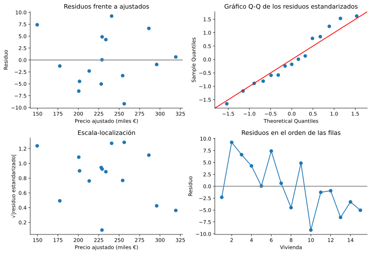
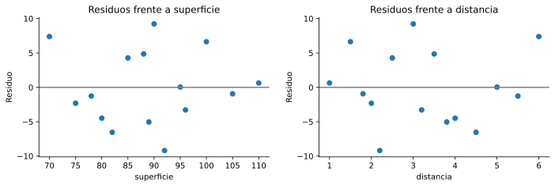
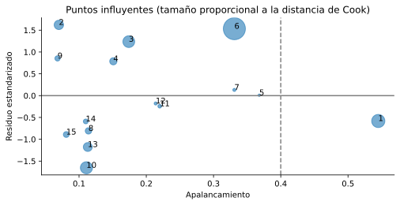
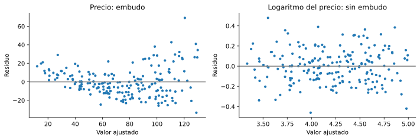

# 6.4 Diagnóstico del modelo

> Versión web, con demos interactivas: <https://alberpro.com/nebrija-mpan/topics/06-regresion-lineal-multiple/diagnostico/>

> ℹ️ **Lo que necesitas antes**
>
> El modelo de regresión múltiple de la página [El modelo de regresión múltiple](modelo.md) y el modelo elegido en [Selección de variables](seleccion.md): el precio de las viviendas explicado por la superficie y la distancia al centro. De la regresión simple, los [residuos](../05-regresion-lineal-simple/ajuste.md#residuos) y los [gráficos de residuos](../05-regresion-lineal-simple/ajuste.md#diagnóstico-mirar-los-residuos); aquí se amplían a varias variables. Del [contraste de hipótesis](../04-contraste-hipotesis/index.md), la hipótesis nula y el p-valor.

## Por qué hay que diagnosticar el modelo

En la página anterior elegimos el modelo
$$\widehat{\text{Precio}} = 38.2 + 2.671 \times \text{Superficie} - 12.588 \times \text{Distancia}$$
y concluimos que, a igual superficie, cada kilómetro más lejos del centro se asocia con entre 9 500 € y 15 600 € menos de precio (intervalo de confianza al 95 %). Esa frase depende de algo que no hemos comprobado. Los coeficientes de mínimos cuadrados se pueden calcular con cualquier conjunto de datos, pero sus errores estándar, sus p-valores y sus intervalos solo son correctos si el modelo cumple unas suposiciones. Si no las cumple, el intervalo puede ser demasiado estrecho, el p-valor demasiado pequeño, y las predicciones pueden equivocarse de forma sistemática en un tipo de vivienda.

El **diagnóstico** consiste en comprobar esas suposiciones con los datos, sobre todo mirando los residuos, y en buscar observaciones que estén determinando el resultado más que las demás. Va **antes** de presentar cualquier conclusión del modelo.

## Las suposiciones del modelo

Las suposiciones son las mismas que en regresión simple, más una que solo tiene sentido con varias variables.

> 📘 **Definición: suposiciones del modelo de regresión lineal múltiple**
>
> El modelo $Y = \beta_0 + \beta_1 X_1 + \cdots + \beta_p X_p + \varepsilon$ supone que:
>
> 1. **Linealidad.** El valor esperado de $Y$ es una función lineal de las $X_j$: cada variable tiene un efecto constante, el mismo en cualquier punto de su rango, sea cual sea el valor de las demás.
> 2. **Independencia.** Los errores $\varepsilon_i$ de observaciones distintas son independientes entre sí: saber que una vivienda está por encima de la predicción no dice nada de las demás.
> 3. **Homocedasticidad** (varianza constante). La varianza de los errores, $\sigma^2$, es la misma para cualquier valor de las $X_j$.
> 4. **Normalidad.** Los errores siguen una distribución normal de media 0.
> 5. **No multicolinealidad.** Ningún predictor es (casi) una combinación lineal de los demás. Se trata en la página de [multicolinealidad](multicolinealidad.md).

No todas las suposiciones pesan igual, y conviene saber qué se rompe cuando falla cada una:

| Suposición | Qué se rompe si falla | Cómo se mira |
|---|---|---|
| Linealidad | los coeficientes y las predicciones: el modelo se equivoca de forma sistemática | residuos frente a ajustados y frente a cada predictor |
| Independencia | los errores estándar, p-valores e intervalos (suelen salir demasiado optimistas) | residuos en orden, Durbin-Watson |
| Homocedasticidad | los errores estándar, p-valores e intervalos | residuos frente a ajustados, escala-localización |
| Normalidad | los p-valores e intervalos con muestras pequeñas; con muestras grandes importa poco | gráfico Q-Q, Omnibus, Jarque-Bera |
| No multicolinealidad | la precisión de los coeficientes afectados, no las predicciones | correlaciones, VIF, Cond. No. |

La linealidad es la más importante, porque si falla el modelo está mal planteado y ninguna otra cosa lo arregla. La normalidad es la menos importante con muchos datos: por el teorema central del límite, los coeficientes son aproximadamente normales aunque los errores no lo sean. Con 15 viviendas, en cambio, sí importa.

## Los cuatro gráficos de residuos

Como en regresión simple, todo lo que suponemos sobre los errores $\varepsilon$ se comprueba con su versión observable, los residuos $e_i = y_i - \hat{y}_i$. Si el modelo es adecuado, los residuos deberían parecer ruido sin estructura. Hay cuatro gráficos estándar; cada uno está pensado para una suposición.

Para dos de ellos se usan los **residuos estandarizados**, que ponen todos los residuos en la misma escala.

> 📘 **Definición: residuo estandarizado**
>
> El **residuo estandarizado** de la observación $i$ es
> $$r_i = \frac{e_i}{s \sqrt{1 - h_{ii}}},$$
> donde $s$ es el error típico de la regresión y $h_{ii}$ el **apalancamiento** de la observación, que se define más abajo, en [Puntos influyentes](#puntos-influyentes). Si el modelo es correcto, los $r_i$ tienen aproximadamente media 0 y desviación típica 1, así que valores por encima de 2 en valor absoluto son poco frecuentes (en torno al 5 %) y por encima de 3, muy raros.

Se divide por $\sqrt{1 - h_{ii}}$ porque los residuos no tienen todos la misma varianza: las observaciones con valores extremos de las $X$ atraen la recta hacia sí y tienen residuos más pequeños de lo que les correspondería. La corrección los pone en igualdad de condiciones.

### Residuos frente a valores ajustados: linealidad y varianza

En regresión simple se dibujaban los residuos frente a $x$. Con varias variables se dibujan frente a los **valores ajustados** $\hat{y}_i$, que resumen todas las variables en un número. Lo que se busca es lo mismo: una nube horizontal alrededor de cero, de anchura constante. Una **curva** indica que falta algún término no lineal; un **embudo**, que la varianza no es constante. Los ejemplos de los dos problemas, con datos simulados, están en [Diagnóstico: mirar los residuos](../05-regresion-lineal-simple/ajuste.md#diagnóstico-mirar-los-residuos).

Este gráfico puede esconder una relación no lineal con una sola de las variables. Por eso conviene dibujar también los residuos **frente a cada predictor**: si los residuos dibujan una curva frente a la distancia, el efecto de la distancia no es lineal (por ejemplo, el primer kilómetro resta más precio que el quinto).

### Gráfico Q-Q: normalidad

El gráfico Q-Q (cuantil-cuantil) ordena los residuos estandarizados de menor a mayor y los compara con los cuantiles que tendría una muestra del mismo tamaño de una normal. Si los residuos son normales, los puntos siguen la diagonal. Los patrones típicos son una forma de S (colas más gruesas o más finas que la normal) y una curva hacia un lado (asimetría). Con pocos datos, los puntos de los extremos se separan algo de la diagonal aunque los errores sean normales; hay que fijarse en patrones claros, no en cada punto.

### Escala-localización: varianza constante

El gráfico de **escala-localización** dibuja $\sqrt{|r_i|}$ frente a los valores ajustados. Al tomar el valor absoluto, los residuos grandes positivos y negativos quedan juntos arriba, y un embudo se convierte en una tendencia creciente, más fácil de ver que en el gráfico de residuos. Si la varianza es constante, los puntos forman una banda horizontal.

### Residuos en orden: independencia

Si los datos tienen un orden con sentido (el tiempo, la fecha de venta, el orden en que se recogieron), se dibujan los residuos en ese orden. Si los positivos van seguidos de positivos y los negativos de negativos, los errores de observaciones vecinas se parecen: hay **autocorrelación**, y los errores no son independientes. Es lo habitual con datos mensuales o semanales. Si los datos no tienen ningún orden natural, este gráfico no dice nada.

> ✏️ **Ejemplo resuelto: los gráficos de residuos de las viviendas**
>
> Los gráficos están en la sección "En Python". Con 15 viviendas se leen con prudencia: con tan pocos puntos, el ruido puro puede parecer tener patrones, y un patrón moderado puede no verse.
>
> - **Residuos frente a ajustados.** Los residuos van de $-9.2$ a $+9.2$ miles de €, con los dos signos repartidos a lo largo de todo el rango de precios predichos (de 150 a 319). No se ve curva ni embudo. Frente a la superficie y frente a la distancia, tampoco.
> - **Q-Q.** Los puntos siguen la diagonal, sin forma de S ni curva clara.
> - **Escala-localización.** Banda aproximadamente horizontal: no hay indicios de que las viviendas caras tengan residuos más dispersos que las baratas.
> - **Residuos en orden.** Las viviendas están en un orden sin significado (no sabemos cuándo se vendió cada una), así que no podemos comprobar la independencia con este gráfico. Si fueran ventas ordenadas por fecha, habría que mirarlo.
> - **Residuos estandarizados.** El mayor en valor absoluto es $-1.65$ (vivienda 10). Ninguno supera 2.
>
> Conclusión: no hay indicios de problemas. Eso no demuestra que las suposiciones se cumplan; con 15 datos, solo detectaríamos problemas grandes.

## Los diagnósticos del `summary()` de statsmodels

Debajo de la tabla de coeficientes, el `summary()` de statsmodels muestra un bloque de diagnósticos. Para el modelo de superficie y distancia:

```text
Omnibus:                        0.843   Durbin-Watson:                   1.633
Prob(Omnibus):                  0.656   Jarque-Bera (JB):                0.689
Skew:                           0.158   Prob(JB):                        0.708
Kurtosis:                       1.999   Cond. No.                     1.19e+03
```

> 📘 **Definición: diagnósticos del `summary()`**
>
> - **Omnibus** y **Jarque-Bera (JB)** son dos contrastes de normalidad de los residuos. Los dos tienen como hipótesis nula que los residuos son normales y miden lo lejos que están su **asimetría** (*Skew*, 0 en la normal) y su **curtosis** (*Kurtosis*, 3 en la normal; mide lo pesadas que son las colas). `Prob(Omnibus)` y `Prob(JB)` son sus p-valores: un p-valor pequeño (menor que 0.05) indica que los residuos no son normales.
> - **Durbin-Watson** contrasta la autocorrelación de los residuos consecutivos, en el orden en que están los datos:
>   $$DW = \frac{\sum_{i=2}^{n} (e_i - e_{i-1})^2}{\sum_{i=1}^{n} e_i^2} \approx 2(1 - \hat{\rho}),$$
>   donde $\hat{\rho}$ es la correlación entre cada residuo y el anterior. Va de 0 a 4: cerca de 2, no hay autocorrelación; claramente por debajo (como regla práctica, menos de 1.5), autocorrelación positiva; claramente por encima de 2.5, negativa.
> - **Cond. No.** (número de condición) mide lo cerca que está la matriz de predictores de que una columna sea combinación lineal de las demás. Valores muy grandes (statsmodels avisa a partir de 1000) indican multicolinealidad **o** simplemente que las variables tienen escalas muy distintas.

> ✏️ **Ejemplo resuelto: el bloque de diagnósticos de las viviendas**
>
> 1. **Normalidad.** `Prob(Omnibus)` = 0.656 y `Prob(JB)` = 0.708: no se rechaza la normalidad. La asimetría (0.16) es pequeña y la curtosis (2.0) es algo menor que 3, colas algo más ligeras que la normal, que es lo que se ve a menudo con 15 datos. Pero con 15 datos estos contrastes tienen muy poca potencia: solo rechazarían con desviaciones grandes. "No se rechaza" no es "se ha demostrado que son normales".
> 2. **Durbin-Watson** = 1.63, no muy lejos de 2. Pero se calcula en el orden de las filas, y aquí ese orden no significa nada: el valor no dice nada sobre la independencia. Solo tendría sentido si las filas estuvieran ordenadas por fecha de venta o por ubicación.
> 3. **Cond. No.** = 1 190, por encima del umbral, y statsmodels añade un aviso de "strong multicollinearity". Sin embargo, la correlación entre superficie y distancia es solo $-0.66$ y el VIF de las dos es 1.78, muy lejos de cualquier umbral preocupante. El número de condición es alto porque la superficie va de 70 a 110 y la distancia de 1 a 6: escalas muy distintas, y lejos de cero. Con las variables estandarizadas (media 0 y desviación típica 1), el número de condición es 2.2. En el modelo completo, en cambio, el Cond. No. de 3 330 sí refleja un problema real: los VIF de antigüedad y distancia son 48.
>
> El aviso de statsmodels hay que comprobarlo siempre con las correlaciones y los VIF antes de concluir que hay multicolinealidad.

## Puntos influyentes

Hasta ahora hemos mirado si el modelo describe bien los datos en general. Falta una pregunta distinta: ¿hay alguna observación que, por sí sola, esté cambiando el resultado? Con 15 viviendas, una sola vivienda rara puede mover los coeficientes. Para detectarlo hay dos medidas.

> 📘 **Definición: apalancamiento y distancia de Cook**
>
> - El **apalancamiento** (*leverage*) $h_{ii}$ de la observación $i$ mide lo inusual que es su combinación de valores de las $X$ respecto a las demás. Está entre $1/n$ y 1, y la suma de todos es $k = p + 1$, el número de coeficientes; la media es, por tanto, $k/n$. Una regla práctica habitual considera alto un apalancamiento mayor que $2k/n$. Depende solo de las $X$, no de $Y$.
> - La **distancia de Cook** $D_i$ mide cuánto cambiarían **todas** las predicciones del modelo si se eliminara la observación $i$ y se volviera a ajustar. Combina el apalancamiento y el residuo:
>   $$D_i = \frac{r_i^2}{k} \cdot \frac{h_{ii}}{1 - h_{ii}},$$
>   donde $r_i$ es el residuo estandarizado. Una regla habitual: $D_i > 1$ indica una observación muy influyente; $D_i > 4/n$ es una señal para revisarla.

La fórmula de Cook dice que una observación es influyente cuando tiene **a la vez** un residuo grande y un apalancamiento alto. Un punto con valores de $X$ muy inusuales pero que sigue el patrón de los demás (residuo pequeño) no cambia el modelo: está donde el modelo lo pondría. Un punto con un residuo grande pero valores de $X$ normales tampoco mueve mucho los coeficientes, porque hay muchos puntos a su alrededor que los sujetan. Lo peligroso es un punto lejos de los demás en las $X$ y que además no sigue el patrón: tira de la recta hacia sí.

> ✏️ **Ejemplo resuelto: puntos influyentes en las viviendas**
>
> En el modelo de superficie y distancia hay $k = 3$ coeficientes y $n = 15$ viviendas. El apalancamiento medio es $3/15 = 0.2$ y el umbral, $2 \cdot 0.2 = 0.4$. El umbral de revisión para Cook es $4/15 = 0.27$.
>
> - **Vivienda 1** (75 m², 2.0 km, 211 000 €): apalancamiento 0.545, el más alto. En estos datos las viviendas pequeñas suelen estar lejos del centro, y esta es pequeña y céntrica: una combinación inusual. Pero su residuo es pequeño ($-2.3$ miles de €, estandarizado $-0.58$) y su distancia de Cook es 0.13. Sigue el patrón y no influye mucho.
> - **Vivienda 6** (70 m², 6.0 km, 157 000 €): es la más pequeña, la más lejana y la más barata. Apalancamiento 0.331 y residuo estandarizado 1.53. Su distancia de Cook es
>   $$D_6 = \frac{1.53^2}{3} \cdot \frac{0.331}{1 - 0.331} = 0.780 \cdot 0.495 = 0.39,$$
>   la más alta de todas. Supera el umbral de revisión (0.27), aunque está lejos de 1.
>
> ¿Qué hacemos con la vivienda 6? Primero, revisar que sus datos sean correctos. Después, comprobar cuánto cambia el modelo sin ella: la superficie pasa de 2.671 a 2.736 y la distancia, de $-12.59$ a $-13.21$. Son cambios pequeños comparados con los errores estándar (0.19 y 1.40), y ninguna conclusión cambia. La vivienda es real y está dentro del tipo de viviendas que queremos tasar, así que se queda en el modelo. Lo que sí conviene decir en el informe es que el modelo tiene pocas viviendas lejos del centro, y que sus predicciones allí son menos seguras.

Eliminar una observación solo porque es influyente o porque "estropea" el ajuste no es correcto. Se elimina si es un error de datos o si no pertenece a la población que se quiere modelar (por ejemplo, un local comercial que se coló en una muestra de viviendas). En los demás casos se mantiene, y si cambia las conclusiones, se informa de los resultados con y sin ella.

## Qué hacer cuando falla una suposición

El diagnóstico no es un examen que el modelo aprueba o suspende: cuando algo falla, indica qué cambiar.

- **No linealidad** (curva en los residuos). Se transforma la variable que la causa: añadir su cuadrado ($X^2$), usar su logaritmo o agruparla en tramos. Si falta una variable importante, el patrón también puede desaparecer al añadirla.
- **Heterocedasticidad** (embudo). Es muy habitual con precios e importes: las viviendas caras varían más en euros que las baratas. Hay dos soluciones. La primera es modelar el **logaritmo** de $Y$: si los errores son proporcionales al precio, en escala logarítmica tienen varianza constante, y cada coeficiente pasa a leerse como un cambio porcentual (con un coeficiente $b$ pequeño, cada unidad más de $X_j$ se asocia con un $100 \cdot b$ % más de $Y$, aproximadamente). La segunda es mantener el modelo y calcular **errores estándar robustos** a la heterocedasticidad (en statsmodels, `fit(cov_type="HC3")`), que corrigen los p-valores y los intervalos sin cambiar los coeficientes.
- **No normalidad.** Con muchos datos importa poco para los coeficientes, porque sus intervalos siguen siendo aproximadamente válidos. Si los residuos son muy asimétricos, a menudo es porque $Y$ lo es, y el logaritmo de $Y$ también lo corrige. Si la falta de normalidad se debe a unos pocos residuos enormes, hay que revisar esas observaciones.
- **Dependencia** (autocorrelación). Es típica de datos en el tiempo. Se puede añadir al modelo lo que hace que observaciones vecinas se parezcan (la tendencia, el mes, el valor del periodo anterior) o usar modelos de series temporales, pensados para ello.
- **Multicolinealidad.** Quitar una de las variables correlacionadas, combinarlas en una o aceptar que sus coeficientes por separado no se pueden estimar bien: ver [multicolinealidad](multicolinealidad.md).
- **Puntos influyentes.** Revisarlos, corregir los errores de datos y, si se mantienen, informar de cómo cambian los resultados sin ellos.

Después de cualquier cambio hay que volver a ajustar el modelo y repetir el diagnóstico.

> ✏️ **Ejemplo resuelto: un embudo y el logaritmo**
>
> Para ver la heterocedasticidad y su solución usamos 200 viviendas **simuladas**, con una semilla fija, en las que el error es proporcional al precio (en torno a un ±18 %), como suele pasar con datos reales. El código y los gráficos están en la sección "En Python".
>
> 1. Con el precio en euros, los residuos frente a los ajustados forman un embudo claro: casi no hay dispersión en las viviendas baratas y mucha en las caras. El contraste de **Breusch-Pagan**, cuya hipótesis nula es que la varianza es constante, da un p-valor de $3 \times 10^{-6}$.
> 2. Con el logaritmo del precio como $Y$, el embudo desaparece y el p-valor de Breusch-Pagan es 0.74.
> 3. En el modelo del logaritmo, el coeficiente de la superficie es 0.0087: cada m² más se asocia con un 0.87 % más de precio, a igual distancia. El de la distancia es $-0.055$: cada kilómetro más lejos, un 5.4 % menos ($e^{-0.055} - 1 = -0.054$).
>
> Si se prefiere mantener el precio en euros, los errores estándar robustos (HC3) corrigen la inferencia: el de la superficie pasa de 0.025 a 0.028. Los coeficientes no cambian, pero el modelo sigue sin describir bien que el error crece con el precio.

> ⚠️ **Errores frecuentes**
>
> - **Saltarse el diagnóstico** porque el $R^2$ es alto o los p-valores son pequeños. Esos números solo valen si se cumplen las suposiciones.
> - **Tomar un p-valor grande en un contraste de normalidad como prueba de normalidad.** Con pocos datos, estos contrastes casi nunca rechazan. Con muchísimos datos, rechazan por desviaciones sin importancia práctica. Mira el gráfico Q-Q.
> - **Interpretar el Durbin-Watson cuando las filas no tienen un orden con sentido.** Se calcula en el orden de las filas: si el orden es arbitrario, el valor también lo es.
> - **Concluir que hay multicolinealidad por el aviso del Cond. No.** sin mirar los VIF. Variables con escalas muy distintas dan números de condición altos sin ningún problema.
> - **Eliminar observaciones influyentes o atípicas para "mejorar" el modelo.** Solo se eliminan los errores de datos y lo que no pertenece a la población; lo demás se mantiene y se informa.
> - **Mirar solo los residuos frente a los ajustados.** Una relación no lineal con una sola variable puede quedar escondida; dibuja también los residuos frente a cada predictor.

## En Python

El modelo de superficie y distancia y su bloque de diagnósticos:

```python
import numpy as np
import pandas as pd
import matplotlib.pyplot as plt
import statsmodels.api as sm
import statsmodels.formula.api as smf
from scipy import stats
from statsmodels.stats.outliers_influence import variance_inflation_factor
from statsmodels.stats.diagnostic import het_breuschpagan

casas = pd.DataFrame({
    "superficie": [75, 90, 100, 85, 95, 70, 110, 80, 88, 92, 78, 105, 82, 96, 89],   # m²
    "antiguedad": [19, 17, 22, 17, 8, 5, 22, 12, 15, 19, 5, 21, 11, 15, 12],        # años
    "distancia": [2.0, 3.0, 1.5, 2.5, 5.0, 6.0, 1.0, 4.0, 3.5, 2.2, 5.5, 1.8, 4.5, 3.2, 3.8],  # km al centro
    "precio": [211, 250, 293, 238, 229, 157, 320, 197, 234, 247, 176, 295, 194, 251, 223],  # miles €
})
casas.index = range(1, 16)   # numeramos las viviendas de 1 a 15

modelo = smf.ols("precio ~ superficie + distancia", data=casas).fit()
print(modelo.params.round(3))
```

```text
Intercept     38.199
superficie     2.671
distancia    -12.588
dtype: float64
```

```python
print(modelo.summary().tables[2])   # Omnibus, Jarque-Bera, Durbin-Watson, Cond. No.
```

```text
==============================================================================
Omnibus:                        0.843   Durbin-Watson:                   1.633
Prob(Omnibus):                  0.656   Jarque-Bera (JB):                0.689
Skew:                           0.158   Prob(JB):                        0.708
Kurtosis:                       1.999   Cond. No.                     1.19e+03
==============================================================================
```

El Cond. No. alto se debe a las escalas, no a la multicolinealidad: VIF y número de condición con las variables estandarizadas.

```python
X = modelo.model.exog                       # columnas: intercepto, superficie, distancia
for j, nombre in enumerate(modelo.model.exog_names[1:], start=1):
    print(f"VIF de {nombre}: {variance_inflation_factor(X, j):.2f}")
```

```text
VIF de superficie: 1.78
VIF de distancia: 1.78
```

```python
Z = (X[:, 1:] - X[:, 1:].mean(axis=0)) / X[:, 1:].std(axis=0)
print(f"Número de condición con variables estandarizadas: {np.linalg.cond(sm.add_constant(Z)):.1f}")
```

```text
Número de condición con variables estandarizadas: 2.2
```

Los cuatro gráficos de residuos:

```python
influencia = modelo.get_influence()
ajustados = modelo.fittedvalues
residuos = modelo.resid
estandarizados = influencia.resid_studentized_internal

fig, axes = plt.subplots(2, 2, figsize=(10, 7))
axes[0, 0].scatter(ajustados, residuos)
axes[0, 0].axhline(0, color="gray")
axes[0, 0].set(title="Residuos frente a ajustados", xlabel="Precio ajustado (miles €)", ylabel="Residuo")
sm.qqplot(estandarizados, line="45", ax=axes[0, 1])
axes[0, 1].set_title("Gráfico Q-Q de los residuos estandarizados")
axes[1, 0].scatter(ajustados, np.sqrt(np.abs(estandarizados)))
axes[1, 0].set(title="Escala-localización", xlabel="Precio ajustado (miles €)", ylabel="√|residuo estandarizado|")
axes[1, 1].plot(casas.index, residuos, marker="o")
axes[1, 1].axhline(0, color="gray")
axes[1, 1].set(title="Residuos en el orden de las filas", xlabel="Vivienda", ylabel="Residuo")
plt.tight_layout()
plt.show()
```



Residuos frente a cada predictor, para buscar relaciones no lineales con una sola variable:

```python
fig, axes = plt.subplots(1, 2, figsize=(10, 3.4))
for ax, variable in zip(axes, ["superficie", "distancia"]):
    ax.scatter(casas[variable], residuos)
    ax.axhline(0, color="gray")
    ax.set(xlabel=variable, ylabel="Residuo", title=f"Residuos frente a {variable}")
plt.tight_layout()
plt.show()
```



Apalancamiento, residuos estandarizados y distancia de Cook de cada vivienda, y el modelo sin la vivienda 6:

```python
k = len(modelo.params)
n = len(casas)
tabla = pd.DataFrame({
    "apalancamiento": influencia.hat_matrix_diag,
    "residuo estandarizado": estandarizados,
    "Cook": influencia.cooks_distance[0],
}, index=casas.index).round(3)
print(f"Umbral de apalancamiento 2k/n = {2 * k / n:.2f}; umbral de Cook 4/n = {4 / n:.2f}")
```

```text
Umbral de apalancamiento 2k/n = 0.40; umbral de Cook 4/n = 0.27
```

```python
print(tabla.sort_values("Cook", ascending=False).head(5))
```

```text
    apalancamiento  residuo estandarizado   Cook
6            0.331                  1.533  0.387
1            0.545                 -0.581  0.135
10           0.111                 -1.653  0.113
3            0.174                  1.237  0.107
2            0.070                  1.621  0.066
```

```python
sin_6 = smf.ols("precio ~ superficie + distancia", data=casas.drop(index=6)).fit()
print(pd.DataFrame({"con todas": modelo.params, "sin la vivienda 6": sin_6.params}).round(3))
```

```text
            con todas  sin la vivienda 6
Intercept      38.199             33.716
superficie      2.671              2.736
distancia     -12.588            -13.211
```

```python
plt.scatter(tabla["apalancamiento"], tabla["residuo estandarizado"], s=2000 * tabla["Cook"] + 10, alpha=0.6)
for i in casas.index:
    plt.annotate(str(i), (tabla.loc[i, "apalancamiento"], tabla.loc[i, "residuo estandarizado"]))
plt.axvline(2 * k / n, color="gray", linestyle="--")
plt.axhline(0, color="gray")
plt.xlabel("Apalancamiento")
plt.ylabel("Residuo estandarizado")
plt.title("Puntos influyentes (tamaño proporcional a la distancia de Cook)")
plt.show()
```



Heterocedasticidad con 200 viviendas simuladas: el embudo, el contraste de Breusch-Pagan, el logaritmo y los errores estándar robustos.

```python
rng = np.random.default_rng(7)
m = 200
s = rng.uniform(50, 200, m)
d = rng.uniform(1, 10, m)
p = np.exp(np.log(30) + 0.009 * s - 0.05 * d + rng.normal(0, 0.18, m))   # error proporcional al precio
sim = pd.DataFrame({"superficie": s, "distancia": d, "precio": p})

en_euros = smf.ols("precio ~ superficie + distancia", data=sim).fit()
en_log = smf.ols("np.log(precio) ~ superficie + distancia", data=sim).fit()
print(f"Breusch-Pagan, precio: p-valor = {het_breuschpagan(en_euros.resid, en_euros.model.exog)[1]:.1e}")
```

```text
Breusch-Pagan, precio: p-valor = 3.1e-06
```

```python
print(f"Breusch-Pagan, log(precio): p-valor = {het_breuschpagan(en_log.resid, en_log.model.exog)[1]:.2f}")
```

```text
Breusch-Pagan, log(precio): p-valor = 0.74
```

```python
print("Coeficientes del modelo del logaritmo:", en_log.params.round(4).to_dict())
```

```text
Coeficientes del modelo del logaritmo: {'Intercept': 3.4338, 'superficie': 0.0087, 'distancia': -0.0553}
```

```python
print("Cambio porcentual por unidad:", (100 * (np.exp(en_log.params.iloc[1:]) - 1)).round(2).to_dict())
```

```text
Cambio porcentual por unidad: {'superficie': 0.87, 'distancia': -5.38}
```

```python
robusto = smf.ols("precio ~ superficie + distancia", data=sim).fit(cov_type="HC3")
print(pd.DataFrame({"SE clásico": en_euros.bse, "SE robusto (HC3)": robusto.bse}).round(3))
```

```text
            SE clásico  SE robusto (HC3)
Intercept        4.055             3.383
superficie       0.025             0.028
distancia        0.411             0.426
```

```python
fig, axes = plt.subplots(1, 2, figsize=(10, 3.4))
axes[0].scatter(en_euros.fittedvalues, en_euros.resid, s=10)
axes[0].set(title="Precio: embudo", xlabel="Valor ajustado", ylabel="Residuo")
axes[1].scatter(en_log.fittedvalues, en_log.resid, s=10)
axes[1].set(title="Logaritmo del precio: sin embudo", xlabel="Valor ajustado", ylabel="Residuo")
for ax in axes:
    ax.axhline(0, color="gray")
plt.tight_layout()
plt.show()
```



> ✅ **Lo esencial**
>
> - Los errores estándar, p-valores e intervalos del modelo solo valen si se cumplen sus suposiciones: **linealidad, independencia, homocedasticidad, normalidad** de los errores y **no multicolinealidad**. La linealidad es la más importante; la normalidad, la menos, si hay muchos datos.
> - Los **cuatro gráficos** de residuos: frente a los ajustados (curva o embudo), Q-Q (normalidad), escala-localización (varianza constante) y en orden (independencia, solo si el orden tiene sentido). Conviene añadir los residuos frente a cada predictor.
> - En el `summary()`, **Omnibus** y **Jarque-Bera** contrastan la normalidad, **Durbin-Watson** la autocorrelación (cerca de 2, ninguna) y **Cond. No.** avisa de multicolinealidad o de escalas muy distintas: hay que confirmarlo con los VIF. Con pocos datos, los contrastes tienen poca potencia.
> - Un punto es **influyente** cuando combina apalancamiento alto (valores de $X$ inusuales) y residuo grande; la **distancia de Cook** lo mide. Se revisa, se comprueba cuánto cambia el modelo sin él y solo se elimina si es un error o no pertenece a la población.
> - Cuando una suposición falla, el diagnóstico indica qué hacer: transformar variables, modelar $\log Y$, usar errores estándar robustos, añadir variables o usar otro modelo. Las viviendas no muestran problemas, con la cautela de tener solo 15 datos.

## Ejercicios

**1.** Para cada gráfico, di qué suposición se pone en duda y qué harías: (a) en el gráfico de escala-localización, los puntos suben de izquierda a derecha; (b) en el gráfico Q-Q, los puntos siguen la diagonal en el centro pero se separan mucho por arriba en el extremo derecho y por abajo en el izquierdo; (c) los residuos frente a la antigüedad de unos clientes forman una U, aunque frente a los ajustados no se ve nada claro.

<details>
<summary>✅ <b>Solución</b></summary>

- (a) **Homocedasticidad.** La dispersión de los residuos crece con el valor ajustado: hay un embudo. Si $Y$ es un importe, probaría con el logaritmo de $Y$; si no, mantendría el modelo con errores estándar robustos (HC3).
- (b) **Normalidad.** Los residuos de los extremos son más grandes de lo que serían en una normal: colas pesadas. Revisaría las observaciones de los extremos por si hay errores o casos de otra población. Con muchos datos, afecta poco a los coeficientes; con pocos, los p-valores son menos fiables.
- (c) **Linealidad** en la antigüedad. El efecto de la antigüedad no es constante: los clientes muy nuevos y muy antiguos están por encima de la predicción. Añadiría el cuadrado de la antigüedad al modelo o la agruparía en tramos, y repetiría el diagnóstico. Es un buen ejemplo de por qué hay que mirar los residuos frente a cada predictor.

</details>

**2.** Un modelo de las ventas mensuales de una tienda durante cinco años (filas ordenadas por mes) da en el `summary()`: `Prob(Omnibus)` = 0.42, `Prob(JB)` = 0.51, `Durbin-Watson` = 0.85 y `Cond. No.` = 45. Interpreta cada valor. ¿Te fías de los intervalos de confianza de los coeficientes?

<details>
<summary>✅ <b>Solución</b></summary>

- `Prob(Omnibus)` = 0.42 y `Prob(JB)` = 0.51: no se rechaza la normalidad de los residuos. Con 60 meses los contrastes tienen algo de potencia, y además con ese tamaño la normalidad importa poco.
- `Durbin-Watson` = 0.85, muy por debajo de 2: hay **autocorrelación positiva**. Como las filas están ordenadas por mes, el valor tiene sentido: los meses en que se vende más de lo previsto suelen ir seguidos de otros iguales. Corresponde a una correlación entre residuos consecutivos de aproximadamente $1 - 0.85/2 = 0.58$.
- `Cond. No.` = 45: bajo, sin indicios de multicolinealidad.

No me fiaría de los intervalos: con autocorrelación positiva, los errores estándar suelen salir demasiado pequeños y los intervalos, demasiado estrechos. Habría que dibujar los residuos en orden, añadir al modelo lo que falta (tendencia, mes del año) o usar un modelo de series temporales.

</details>

**3.** En una regresión con $n = 40$ observaciones y 3 predictores, ¿cuál es el apalancamiento medio y el umbral de apalancamiento alto? Una observación tiene apalancamiento 0.35. Calcula su distancia de Cook si su residuo estandarizado es (a) 0.3; (b) 2.5. Interpreta los dos casos.

<details>
<summary>✅ <b>Solución</b></summary>

Hay $k = 3 + 1 = 4$ coeficientes. El apalancamiento medio es $4/40 = 0.1$, y el umbral, $2 \cdot 0.1 = 0.2$. Con 0.35, la observación tiene valores de las $X$ inusuales.

El factor de apalancamiento es $0.35 / (1 - 0.35) = 0.538$.

- (a) $D = \frac{0.3^2}{4} \cdot 0.538 = 0.0225 \cdot 0.538 = 0.012$. Muy pequeña: aunque está lejos de las demás en las $X$, sigue el patrón del modelo y no lo mueve.
- (b) $D = \frac{2.5^2}{4} \cdot 0.538 = 1.5625 \cdot 0.538 = 0.84$. Muy por encima del umbral de revisión ($4/40 = 0.1$) y cerca de 1: está lejos de las demás **y** no sigue el patrón, así que tira del modelo hacia sí. Hay que revisar sus datos y comparar el modelo con y sin ella.

</details>

**4.** Un compañero ajusta el modelo de las viviendas, ve el aviso de statsmodels "The condition number is large, 1.19e+03. This might indicate that there are strong multicollinearity" y propone quitar la distancia. ¿Qué le dirías?

<details>
<summary>✅ <b>Solución</b></summary>

Que el aviso no basta para concluir que hay multicolinealidad. El número de condición también es alto cuando las variables tienen escalas muy distintas o están lejos de cero, y aquí la superficie va de 70 a 110 m² y la distancia de 1 a 6 km. Hay que comprobarlo con las correlaciones y los VIF: la correlación entre superficie y distancia es $-0.66$ y los dos VIF son 1.78, valores sin ningún problema. Con las variables estandarizadas, el número de condición baja a 2.2.

Además, los síntomas de la multicolinealidad no aparecen: los dos coeficientes tienen errores estándar pequeños e intervalos estrechos. Quitar la distancia empeoraría mucho el modelo (el error típico pasaría de 5.9 a 15.8 miles de €).

</details>

**5.** En el modelo de superficie y distancia, la vivienda 6 tiene la mayor distancia de Cook (0.39), por encima del umbral $4/n = 0.27$. Otro compañero propone eliminarla "porque es un punto influyente". ¿Estás de acuerdo? ¿Qué harías?

<details>
<summary>✅ <b>Solución</b></summary>

No. Que una observación sea influyente no es motivo para eliminarla. Haría tres cosas:

1. **Revisar sus datos.** Si hubiera un error (por ejemplo, 157 en lugar de 175), lo corregiría.
2. **Comprobar si pertenece a la población.** Es una vivienda pequeña y alejada del centro, del tipo que la agencia quiere tasar.
3. **Comparar el modelo con y sin ella.** Sin la vivienda 6, la superficie pasa de 2.671 a 2.736 y la distancia, de $-12.59$ a $-13.21$: cambios pequeños comparados con sus errores estándar (0.19 y 1.40), y ninguna conclusión cambia.

Así que la mantendría. Lo que sí indicaría en el informe es que hay pocas viviendas lejos del centro y que las predicciones en esa zona son menos seguras. Su Cook es la más alta precisamente porque es de las pocas viviendas lejanas.

</details>

**6.** Un modelo del gasto anual de 2 000 clientes muestra un embudo claro en los residuos frente a los ajustados. Ajustas el modelo con $\log(\text{gasto})$ y el embudo desaparece. El coeficiente del número de visitas a la web es 0.012. (a) Interpreta el coeficiente. (b) ¿Puedes comparar el AIC de este modelo con el del modelo del gasto en euros para decidir cuál es mejor? (c) ¿Qué otra opción tenías si querías mantener el gasto en euros?

<details>
<summary>✅ <b>Solución</b></summary>

- (a) Cada visita más a la web se asocia, manteniendo fijas las demás variables, con un gasto anual aproximadamente un 1.2 % mayor ($e^{0.012} - 1 = 0.0121$). En escala logarítmica, los coeficientes son cambios porcentuales, no en euros.
- (b) No. El AIC solo compara modelos con la misma variable respuesta; $\log(\text{gasto})$ y gasto en euros tienen escalas distintas y sus AIC no son comparables. La decisión se apoya en el diagnóstico: el modelo del logaritmo cumple la suposición de varianza constante y el otro no.
- (c) Mantener el modelo en euros y calcular errores estándar robustos (`fit(cov_type="HC3")` en statsmodels). Los coeficientes no cambian, pero los p-valores y los intervalos pasan a ser válidos aunque la varianza no sea constante. Es una opción razonable si interesa el efecto en euros, aunque las predicciones de los clientes que más gastan seguirán teniendo mucho más error que las demás.

</details>

[← Selección de variables](seleccion.md) [Siguiente: Práctica guiada →](practica.md)
