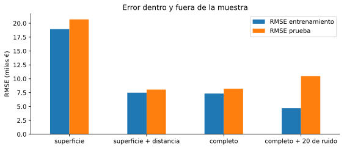

# 6.3 Selección de variables

> Versión web, con demos interactivas: <https://alberpro.com/nebrija-mpan/topics/06-regresion-lineal-multiple/seleccion/>

> ℹ️ **Lo que necesitas antes**
>
> El modelo de regresión múltiple y la interpretación de sus coeficientes de la página [El modelo de regresión múltiple](modelo.md), y qué es la multicolinealidad, de la página [Multicolinealidad](multicolinealidad.md). De la regresión simple, el [coeficiente $R^2$](../05-regresion-lineal-simple/ajuste.md#bondad-de-ajuste-el-coeficiente-r2) y el [contraste t de la pendiente](../05-regresion-lineal-simple/ajuste.md#es-real-la-relación-inferencia-sobre-la-pendiente). Del [contraste de hipótesis](../04-contraste-hipotesis/index.md), la hipótesis nula, el estadístico y el p-valor.

## Qué variables meter en el modelo

Seguimos con las 15 viviendas de las páginas anteriores: para cada una conocemos su precio (en miles de €), su superficie (m²), su antigüedad (años) y su distancia al centro (km). Una agencia inmobiliaria quiere un modelo para tasar viviendas, y la primera decisión es qué variables usar. Hay varias opciones razonables:

- **solo la superficie**, la variable más relacionada con el precio ($r = 0.94$);
- **superficie y distancia**, porque la ubicación es lo segundo que mira cualquier comprador;
- **el modelo completo**, con las tres variables, porque "más información no puede hacer daño".

Las tres se pueden ajustar en un segundo, y todas dan un $R^2$ alto. ¿Cuál elegimos? La pregunta no es trivial. Una variable de más complica la interpretación, hace los coeficientes inestables cuando está correlacionada con otra (en estas viviendas, antigüedad y distancia tienen $r = -0.989$) y puede empeorar las predicciones con viviendas nuevas. Una variable de menos deja fuera un efecto real y sesga los coeficientes de las que quedan. Esta página reúne las herramientas para decidir: contrastes sobre los coeficientes y sobre el modelo, medidas que penalizan la complejidad, el conocimiento del negocio y la evaluación con datos que el modelo no ha visto.

## ¿Aporta cada variable? El contraste t de cada coeficiente

En regresión simple, el contraste t de la pendiente respondía a la pregunta "¿hay relación lineal entre $X$ e $Y$?". En regresión múltiple hay un contraste t para cada coeficiente, y la pregunta cambia de forma importante: ahora es "¿aporta esta variable algo **además de las otras que ya están en el modelo**?".

> 📘 **Definición: contraste t de un coeficiente**
>
> En el modelo $Y = \beta_0 + \beta_1 X_1 + \cdots + \beta_p X_p + \varepsilon$, con $p$ predictores y $n$ observaciones, para cada coeficiente $\beta_j$ se contrasta
>
> - $H_0: \beta_j = 0$ (manteniendo fijas las demás variables, $X_j$ no cambia el valor esperado de $Y$);
> - $H_1: \beta_j \neq 0$;
>
> con el estadístico
> $$t = \frac{\hat{\beta}_j}{SE(\hat{\beta}_j)},$$
> que, si se cumplen las suposiciones del modelo y $H_0$ es cierta, sigue una distribución $t$ de Student con $n - p - 1$ grados de libertad. Los $p + 1$ grados de libertad que se pierden son los de los $p + 1$ coeficientes estimados (los $p$ coeficientes más el intercepto).
>
> El **intervalo de confianza** al $(1 - \alpha)$ de $\beta_j$ es
> $$\hat{\beta}_j \pm t_{n-p-1,\, 1-\alpha/2} \cdot SE(\hat{\beta}_j).$$

El error estándar $SE(\hat{\beta}_j)$ lo calcula el programa; ya no tiene una fórmula tan sencilla como en regresión simple. Lo que sí se mantiene es la intuición: el coeficiente es más preciso cuanto menos ruido hay (residuos pequeños), cuantos más datos hay y cuanto más varía $X_j$. Y aparece un factor nuevo: el coeficiente es **menos** preciso cuanto más correlacionada está $X_j$ con las otras variables del modelo, porque entonces los datos apenas tienen información sobre el efecto de $X_j$ por separado. Es el factor de inflación de la varianza de la página de [multicolinealidad](multicolinealidad.md).

> ✏️ **Ejemplo resuelto: los contrastes t del modelo completo y del de superficie y distancia**
>
> El modelo completo, ajustado con las 15 viviendas, da estos coeficientes (los grados de libertad son $15 - 3 - 1 = 11$, y el cuantil 0.975 de la $t$ con 11 grados de libertad es 2.201):
>
> | Variable | $\hat{\beta}_j$ | $SE$ | $t$ | p-valor | IC 95 % |
> |---|---|---|---|---|---|
> | superficie | 2.669 | 0.188 | 14.23 | < 0.001 | [2.26, 3.08] |
> | antigüedad | 2.021 | 1.897 | 1.07 | 0.310 | [−2.16, 6.20] |
> | distancia | −5.012 | 7.248 | −0.69 | 0.504 | [−20.97, 10.94] |
>
> Leído a la ligera, diría que ni la antigüedad ni la distancia influyen en el precio. Pero cada contraste pregunta si la variable aporta algo **teniendo ya la otra**, y como antigüedad y distancia se mueven casi a la vez ($r = -0.989$), lo que aporta una lo aporta también la otra. Los errores estándar están inflados (el de la distancia es 7.2, cinco veces el que tendrá en el modelo siguiente) y los intervalos son tan anchos que incluyen efectos negativos, nulos y positivos.
>
> Si quitamos la antigüedad y ajustamos el modelo de superficie y distancia (ahora con $15 - 2 - 1 = 12$ grados de libertad y cuantil 2.179):
>
> | Variable | $\hat{\beta}_j$ | $SE$ | $t$ | p-valor | IC 95 % |
> |---|---|---|---|---|---|
> | superficie | 2.671 | 0.189 | 14.16 | < 0.001 | [2.26, 3.08] |
> | distancia | −12.588 | 1.398 | −9.01 | < 0.001 | [−15.63, −9.54] |
>
> El intervalo de la distancia, a mano: $-12.588 \pm 2.179 \cdot 1.398 = -12.588 \pm 3.046 = [-15.63,\ -9.54]$. Para dos viviendas con la misma superficie, cada kilómetro más lejos del centro se asocia con entre 9 500 € y 15 600 € menos de precio. El coeficiente de la superficie apenas cambia entre los dos modelos (2.67 en ambos): la superficie está poco correlacionada con las otras dos variables y su efecto se estima igual de bien con o sin ellas.

La lección es que **un p-valor grande en regresión múltiple no dice que la variable no tenga relación con $Y$**. Dice que, con las otras variables en el modelo, los datos no permiten distinguir su efecto de cero. Por eso no se deben quitar varias variables a la vez porque todas tengan p-valores grandes: puede que cada una sobre si está la otra, pero no las dos.

## ¿Aporta algo el modelo? El contraste F global

Los contrastes t miran las variables de una en una. Antes de eso conviene responder a una pregunta más básica: ¿el modelo en su conjunto explica algo, o es todo ruido?

> 📘 **Definición: contraste F global**
>
> El contraste F global compara el modelo con $p$ predictores con el modelo sin ninguno (el que predice siempre la media $\bar{y}$):
>
> - $H_0: \beta_1 = \beta_2 = \cdots = \beta_p = 0$ (ninguna variable tiene relación con $Y$);
> - $H_1$: al menos un $\beta_j$ es distinto de cero.
>
> El estadístico es
> $$F = \frac{(SS_\text{tot} - SS_\text{res}) / p}{SS_\text{res} / (n - p - 1)} = \frac{R^2 / p}{(1 - R^2) / (n - p - 1)},$$
> donde $SS_\text{tot} = \sum_i (y_i - \bar{y})^2$ es la variabilidad total de $Y$ y $SS_\text{res} = \sum_i e_i^2$ la suma de los residuos al cuadrado. Bajo $H_0$ sigue una distribución $F$ con $p$ y $n - p - 1$ grados de libertad. En statsmodels aparece como `F-statistic` y su p-valor como `Prob (F-statistic)`.

El numerador es la variabilidad explicada por cada variable del modelo y el denominador, la variabilidad que queda sin explicar por cada grado de libertad: es la varianza residual $s^2$. Si las variables no aportan nada, los dos son del mismo orden y $F$ ronda 1. Si el modelo explica mucho, $F$ es grande.

> ✏️ **Ejemplo resuelto: el contraste F del modelo completo**
>
> La variabilidad total de los precios es $SS_\text{tot} = 28\,263.3$ y el modelo completo deja $SS_\text{res} = 378.3$. Con $p = 3$ y $n = 15$,
> $$F = \frac{(28\,263.3 - 378.3) / 3}{378.3 / 11} = \frac{9\,295.0}{34.39} = 270.3,$$
> con un p-valor de $1.4 \times 10^{-10}$. El modelo explica claramente parte del precio. No es sorprendente: con la superficie sola ya se explicaba el 88.5 %.

El caso interesante es el contrario al de los contrastes t: **un F global muy significativo con todos los t individuales no significativos**. Es la señal típica de multicolinealidad: las variables, juntas, explican mucho, pero no se puede saber cuál de ellas lo hace. En el modelo completo de las viviendas pasa a medias: la superficie es claramente significativa, y la antigüedad y la distancia no lo son por separado.

### Comparar dos modelos anidados: el contraste F parcial

La misma idea sirve para preguntar si un **grupo** de variables aporta algo. Dos modelos están **anidados** cuando uno contiene todas las variables del otro y alguna más. El contraste F parcial compara la reducción de $SS_\text{res}$ al añadir las $q$ variables nuevas con la varianza residual del modelo grande:
$$F = \frac{(SS_\text{res, pequeño} - SS_\text{res, grande}) / q}{SS_\text{res, grande} / (n - p - 1)},$$
donde $p$ es el número de predictores del modelo grande. Bajo $H_0$ (los $q$ coeficientes nuevos son cero), sigue una $F$ con $q$ y $n - p - 1$ grados de libertad. En statsmodels se calcula con `sm.stats.anova_lm(pequeño, grande)`.

> ✏️ **Ejemplo resuelto: ¿importa la ubicación?**
>
> El modelo de solo superficie deja $SS_\text{res} = 3\,238.0$ y el completo, $378.3$. Al añadir antigüedad y distancia ($q = 2$),
> $$F = \frac{(3\,238.0 - 378.3) / 2}{378.3 / 11} = \frac{1\,429.9}{34.39} = 41.6,$$
> con p-valor $7 \times 10^{-6}$. Juntas, la antigüedad y la distancia aportan mucho, aunque ninguna lo hacía por separado en los contrastes t del modelo completo. Los datos dicen con claridad que **la ubicación importa**; lo que no pueden decir es si la medida correcta de la ubicación es la distancia o la antigüedad.
>
> En cambio, añadir la antigüedad al modelo de superficie y distancia ($q = 1$) da $F = 1.13$ y p-valor 0.31: no aporta nada que no aporte ya la distancia. Cuando se añade una sola variable, este $F$ es el cuadrado de su $t$ en el modelo grande ($1.065^2 = 1.13$).

## Por qué $R^2$ siempre sube: el $R^2$ ajustado

Parece natural elegir el modelo con el $R^2$ más alto. El problema es que, al añadir una variable, el $R^2$ **nunca baja**, sea útil o no. Mínimos cuadrados elige los coeficientes que hacen $SS_\text{res}$ lo más pequeño posible; con una variable más, siempre puede ponerle coeficiente cero y quedarse como estaba, así que el nuevo $SS_\text{res}$ es igual o menor. Y casi nunca es exactamente igual: hasta una variable de puro ruido está algo correlacionada con los residuos por azar, y mínimos cuadrados aprovecha esa correlación.

Para comprobarlo, añadimos al modelo de superficie y distancia una columna de números aleatorios, sin ninguna relación con las viviendas. El $R^2$ sube de 0.9852 a 0.9859. Según el $R^2$, el modelo "mejora" con una variable inventada.

> 📘 **Definición: $R^2$ ajustado**
>
> El **$R^2$ ajustado** corrige el $R^2$ por el número de predictores $p$:
> $$R^2_\text{aj} = 1 - (1 - R^2) \, \frac{n - 1}{n - p - 1} = 1 - \frac{SS_\text{res} / (n - p - 1)}{SS_\text{tot} / (n - 1)}.$$
> Compara la varianza residual $s^2$ con la varianza de $Y$, en vez de las sumas de cuadrados. Siempre es menor que $R^2$, puede ser negativo, y solo sube al añadir una variable si esta reduce $SS_\text{res}$ lo suficiente para compensar el grado de libertad que consume.

El factor $(n - 1)/(n - p - 1)$ es la penalización: cada variable nueva aumenta $p$, hace el factor más grande y empuja el $R^2_\text{aj}$ hacia abajo. Con muchos datos y pocas variables, el factor es casi 1 y los dos $R^2$ casi coinciden. Con 15 viviendas, la diferencia ya se nota.

> ✏️ **Ejemplo resuelto: $R^2$ ajustado con una variable de ruido**
>
> El modelo de superficie y distancia tiene $R^2 = 0.98524$, con $n = 15$ y $p = 2$:
> $$R^2_\text{aj} = 1 - (1 - 0.98524) \cdot \frac{14}{12} = 1 - 0.01476 \cdot 1.1667 = 0.9828.$$
> Al añadir la variable de ruido, $R^2 = 0.98592$ y $p = 3$:
> $$R^2_\text{aj} = 1 - (1 - 0.98592) \cdot \frac{14}{11} = 1 - 0.01408 \cdot 1.2727 = 0.9821.$$
> El $R^2$ sube, pero el $R^2$ ajustado baja: la variable de ruido no compensa lo que cuesta. El contraste t lo confirma: su p-valor es 0.48.

## AIC y BIC: ajuste penalizado por complejidad

El $R^2$ ajustado es una forma de penalizar la complejidad, pero hay otras dos medidas muy usadas que aparecen en el `summary()` de statsmodels: el **AIC** (criterio de información de Akaike) y el **BIC** (criterio de información bayesiano). Las dos siguen la misma idea: un término que mide lo mal que ajusta el modelo más un término que crece con el número de coeficientes.

> 📘 **Definición: AIC y BIC**
>
> Para un modelo de regresión lineal con $k$ coeficientes estimados (los $p$ predictores más el intercepto, $k = p + 1$), salvo una constante que es la misma para todos los modelos ajustados con los mismos datos,
> $$\text{AIC} = n \ln\!\left(\frac{SS_\text{res}}{n}\right) + 2k, \qquad \text{BIC} = n \ln\!\left(\frac{SS_\text{res}}{n}\right) + k \ln n.$$
> **Cuanto más bajo, mejor.** Solo se comparan modelos ajustados con **los mismos datos y la misma variable respuesta** (no se puede comparar el AIC de un modelo del precio con el de un modelo del logaritmo del precio). Su valor absoluto no significa nada; solo importan las diferencias.

El primer término baja cuando el modelo ajusta mejor; el segundo sube con cada coeficiente. El BIC penaliza cada coeficiente con $\ln n$ en vez de con 2, y $\ln n > 2$ en cuanto $n \ge 8$, así que tiende a preferir modelos más pequeños que el AIC. Una regla práctica habitual: diferencias de AIC menores que 2 no permiten preferir un modelo a otro; diferencias de más de 10 son claras.

> ✏️ **Ejemplo resuelto: comparar los modelos de las viviendas**
>
> Esta es la tabla de los tres candidatos, más un cuarto que usa la antigüedad en lugar de la distancia:
>
> | Modelo | $k$ | $R^2$ | $R^2_\text{aj}$ | $s$ (miles €) | AIC | BIC |
> |---|---|---|---|---|---|---|
> | superficie | 2 | 0.885 | 0.877 | 15.78 | 127.2 | 128.6 |
> | superficie + distancia | 3 | 0.985 | 0.983 | 5.90 | 98.5 | 100.6 |
> | superficie + antigüedad | 3 | 0.986 | 0.984 | 5.74 | 97.6 | 99.7 |
> | completo | 4 | 0.987 | 0.983 | 5.86 | 99.0 | 101.8 |
>
> 1. **Superficie sola** queda descartada por todas las medidas. Su AIC es unos 29 puntos más alto que el de los demás, y su error típico es casi el triple: se equivoca en unos 16 000 € frente a unos 6 000 €.
> 2. **Los otros tres están empatados.** Las diferencias de AIC entre ellos son menores que 2 (98.5, 97.6 y 99.0) y los $R^2$ ajustados coinciden hasta la tercera decimal. El $R^2$ del modelo completo es el más alto, como siempre, pero ni su $R^2$ ajustado ni su AIC ni su BIC lo prefieren.
> 3. **Las medidas no tienen por qué coincidir.** El AIC y el BIC prefieren, por muy poco, superficie y antigüedad; el $R^2$ ajustado pone el modelo completo (0.9830) por delante del de superficie y distancia (0.9828). Son diferencias en la cuarta decimal, que cambiarían con una vivienda más o menos.
>
> Comprobación del AIC a mano: la diferencia entre superficie y distancia y superficie sola es $15 \ln(417.3 / 3238.0) + 2 \cdot (3 - 2) = 15 \cdot (-2.049) + 2 = -28.7$, la misma que en la tabla ($98.5 - 127.2$).

Cuando las medidas estadísticas empatan, el criterio para elegir tiene que venir de otro sitio.

## El conocimiento del negocio

Con los datos solos, el mejor modelo sería superficie y antigüedad. Su coeficiente de la antigüedad es $+3.31$: cada año más de antigüedad se asocia con 3 300 € **más** de precio. Cualquiera que conozca el mercado desconfiaría: una vivienda no se revaloriza por hacerse vieja; si acaso, al contrario, porque necesita reformas. Lo que ocurre es que en esta ciudad las viviendas antiguas están en el centro y las nuevas en las afueras ($r = -0.989$ entre antigüedad y distancia). La antigüedad funciona como un indicador de la ubicación, y su coeficiente positivo recoge el efecto de estar cerca del centro.

Para tasar viviendas de esta ciudad, mientras se siga cumpliendo que las antiguas están en el centro, los dos modelos predicen casi igual. La diferencia aparece cuando no se cumple. Una vivienda nueva en pleno centro sería, para el modelo de la antigüedad, una vivienda "de las afueras" y saldría tasada muy por debajo de su valor; el modelo de la distancia la tasaría bien, porque usa la variable que de verdad explica el precio. Por eso elegimos **superficie y distancia**:

- tiene un mecanismo creíble (los compradores pagan por estar cerca del centro);
- sus coeficientes tienen el signo esperado y se interpretan directamente;
- es tan bueno como los otros según todas las medidas estadísticas;
- es más sencillo que el completo y sus coeficientes son estables (en el completo, la distancia tenía un error estándar cinco veces mayor).

Hay que ser honesto sobre lo que esto **no** demuestra. Con 15 viviendas en las que antigüedad y distancia van juntas, los datos no pueden separar sus efectos. Es posible que la antigüedad tenga un efecto propio (negativo, por ejemplo) y que el coeficiente de la distancia esté absorbiendo una parte. Para saberlo harían falta viviendas en las que las dos variables no vayan juntas: viviendas nuevas en el centro y antiguas en las afueras.

## Cómo elegir un modelo

Las herramientas anteriores se combinan en un procedimiento razonable:

1. **Parte del conocimiento del problema.** Antes de mirar ningún p-valor, haz una lista de las variables que, por lo que se sabe del negocio, deberían influir en $Y$, y del signo que esperas en cada una. Esa lista define los modelos candidatos, que deberían ser pocos.
2. **Ajusta los candidatos y compáralos** con el $R^2$ ajustado, el AIC o el BIC, y con contrastes F parciales cuando estén anidados. No uses el $R^2$ para comparar modelos con distinto número de variables.
3. **Revisa los coeficientes** de cada candidato: ¿tienen el signo esperado?, ¿son estables o cambian mucho al quitar otra variable?, ¿hay variables muy correlacionadas entre sí (ver [multicolinealidad](multicolinealidad.md))?
4. **Ante un empate, elige el modelo más sencillo** y el que tenga una interpretación creíble.
5. **Comprueba las suposiciones** del modelo elegido con el [diagnóstico](diagnostico.md) antes de fiarte de sus p-valores e intervalos.
6. **Si el objetivo es predecir, evalúa el modelo con datos que no ha visto**, como se explica a continuación.

### El riesgo de buscar p-valores pequeños

Lo que no se debe hacer es lo contrario: probar muchas combinaciones de variables y quedarse con la que da p-valores pequeños. Con un nivel de significación del 5 %, una de cada veinte variables sin ninguna relación con $Y$ sale significativa por azar. Si se prueban 40 variables candidatas, cabe esperar unas dos "significativas" que no significan nada. Esto se llama **p-hacking**, y los p-valores e intervalos del modelo final dejan de valer, porque se calcularon como si ese modelo se hubiera decidido antes de ver los datos.

Los procedimientos automáticos de **selección paso a paso** (*stepwise*), que añaden o quitan variables una a una según su p-valor o el AIC, tienen el mismo problema, hecho por una máquina. Además, ante dos variables muy correlacionadas eligen una casi al azar: con las viviendas, una selección por AIC se quedaría con la antigüedad en vez de con la distancia, por una diferencia de 0.8 puntos que no significa nada. Pueden servir para explorar, pero el modelo final lo decide el analista, y si hay que estimar su capacidad de predecir, se hace con datos nuevos.

## Evaluar fuera de la muestra: entrenamiento y prueba

Todas las medidas anteriores se calculan con los mismos datos con los que se ajustó el modelo. Esos datos dan una imagen optimista: el modelo ha visto esas viviendas y se ha adaptado a ellas, incluido su ruido. Lo que interesa a la agencia es cuánto se equivocará con las viviendas que lleguen **mañana**. Un modelo con demasiadas variables para los datos disponibles aprende las particularidades de la muestra en lugar de la relación general: es el **sobreajuste** (*overfitting*). Ajusta muy bien los datos que ha visto y predice mal los nuevos.

La forma directa de medirlo es reservar una parte de los datos. Se ajusta el modelo con el **conjunto de entrenamiento** y se mide su error con el **conjunto de prueba**, que el modelo no ha visto.

> 📘 **Definición: RMSE dentro y fuera de la muestra**
>
> La **raíz del error cuadrático medio** (RMSE, *root mean squared error*) de un modelo sobre un conjunto de $m$ observaciones es
> $$\text{RMSE} = \sqrt{\frac{1}{m} \sum_{i=1}^{m} (y_i - \hat{y}_i)^2},$$
> en las unidades de $Y$. Calculado con el conjunto de entrenamiento mide el error **dentro de la muestra**; calculado con el de prueba, el error **fuera de la muestra**, que es la estimación honesta de cuánto se equivocará el modelo con datos nuevos.

Con 15 viviendas no tiene sentido partir los datos: quedarían 10 para ajustar y 5 para evaluar, y el resultado dependería de qué 5 viviendas tocaran en la prueba. Para ver la idea usamos un conjunto **simulado** de 120 viviendas, generado con una semilla fija y con la misma estructura que el nuestro: el precio depende de la superficie y de la distancia, y la antigüedad está muy correlacionada con la distancia pero no influye en el precio por sí misma. Para que el sobreajuste se vea, ajustamos con solo 36 viviendas (el 30 %) y evaluamos con las 84 restantes, y añadimos un cuarto modelo con las tres variables y 20 columnas de ruido.

> ✏️ **Ejemplo resuelto: error dentro y fuera de la muestra**
>
> Los resultados (el código está en la sección "En Python"):
>
> | Modelo | $R^2$ | $R^2_\text{aj}$ | RMSE entrenamiento | RMSE prueba |
> |---|---|---|---|---|
> | superficie | 0.618 | 0.607 | 18.94 | 20.70 |
> | superficie + distancia | 0.940 | 0.937 | 7.50 | 8.06 |
> | completo | 0.943 | 0.937 | 7.33 | 8.18 |
> | completo + 20 de ruido | 0.977 | 0.931 | 4.70 | 10.47 |
>
> - El modelo con ruido tiene el mejor $R^2$ y el menor error de entrenamiento (4 700 €), pero el peor error de prueba entre los tres modelos con la distancia (10 470 €): ha memorizado el ruido de las 36 viviendas de entrenamiento. Su $R^2$ ajustado ya avisaba: es el más bajo de los tres.
> - El modelo completo tiene menos error de entrenamiento que el de superficie y distancia, pero algo más de error de prueba: la antigüedad no aporta nada nuevo, solo variabilidad.
> - Superficie sola se equivoca mucho dentro y fuera de la muestra: le falta una variable importante (**infraajuste**).
> - En todos los modelos el error de prueba es mayor que el de entrenamiento. Es lo normal: el error de entrenamiento siempre es optimista.

Con datos reales hay que partir al azar, con una semilla fija para poder repetirlo, y no tocar el conjunto de prueba hasta el final: si se usa para elegir entre muchos modelos, se acaba sobreajustando también a él. Con pocos datos se usa la **validación cruzada**, que repite la partición varias veces y promedia el error.

> ⚠️ **Errores frecuentes**
>
> - **Elegir el modelo con el $R^2$ más alto.** El $R^2$ siempre sube al añadir variables. Para comparar modelos con distinto número de variables, usa el $R^2$ ajustado, el AIC, el BIC o el error con datos de prueba.
> - **Quitar una variable porque su p-valor es grande** sin mirar si está correlacionada con otra del modelo. Y, peor aún, quitar varias a la vez por el mismo motivo.
> - **Leer un coeficiente no significativo como "no influye".** Dice que, con las demás variables en el modelo, los datos no distinguen su efecto de cero. Mira el intervalo: si es muy ancho, los datos simplemente no saben.
> - **Probar combinaciones hasta encontrar p-valores pequeños**, a mano o con *stepwise*, e informar de esos p-valores como si el modelo se hubiera decidido antes.
> - **Comparar AIC de modelos ajustados con datos distintos** (por ejemplo, después de eliminar filas con valores faltantes en una variable) o con distinta variable respuesta.
> - **Elegir solo por la estadística** cuando los modelos están empatados. El conocimiento del negocio decide qué variable tiene un efecto creíble.
> - **Evaluar la capacidad de predecir con los mismos datos del ajuste.** El error de entrenamiento siempre es optimista.

## En Python

Ajuste de los cuatro modelos y tabla para compararlos:

```python
import numpy as np
import pandas as pd
import matplotlib.pyplot as plt
import statsmodels.api as sm
import statsmodels.formula.api as smf

casas = pd.DataFrame({
    "superficie": [75, 90, 100, 85, 95, 70, 110, 80, 88, 92, 78, 105, 82, 96, 89],   # m²
    "antiguedad": [19, 17, 22, 17, 8, 5, 22, 12, 15, 19, 5, 21, 11, 15, 12],        # años
    "distancia": [2.0, 3.0, 1.5, 2.5, 5.0, 6.0, 1.0, 4.0, 3.5, 2.2, 5.5, 1.8, 4.5, 3.2, 3.8],  # km al centro
    "precio": [211, 250, 293, 238, 229, 157, 320, 197, 234, 247, 176, 295, 194, 251, 223],  # miles €
})

formulas = {
    "superficie": "precio ~ superficie",
    "superficie + distancia": "precio ~ superficie + distancia",
    "superficie + antigüedad": "precio ~ superficie + antiguedad",
    "completo": "precio ~ superficie + antiguedad + distancia",
}
modelos = {nombre: smf.ols(f, data=casas).fit() for nombre, f in formulas.items()}

comparacion = pd.DataFrame({
    nombre: {
        "k": len(m.params),
        "R²": m.rsquared,
        "R² ajustado": m.rsquared_adj,
        "s": np.sqrt(m.mse_resid),
        "AIC": m.aic,
        "BIC": m.bic,
        "F": m.fvalue,
        "p-valor F": m.f_pvalue,
    }
    for nombre, m in modelos.items()
}).T.round(4)
comparacion["p-valor F"] = [f"{m.f_pvalue:.1e}" for m in modelos.values()]
comparacion
```

```text
                           k      R²  R² ajustado        s       AIC       BIC         F p-valor F
superficie               2.0  0.8854       0.8766  15.7822  127.1881  128.6042  100.4722   1.8e-07
superficie + distancia   3.0  0.9852       0.9828   5.8969   98.4537  100.5778  400.3969   1.0e-11
superficie + antigüedad  3.0  0.9860       0.9837   5.7352   97.6196   99.7438  423.6329   7.4e-12
completo                 4.0  0.9866       0.9830   5.8641   98.9815  101.8137  270.2966   1.4e-10
```

Coeficientes, contrastes t e intervalos de confianza del modelo completo y del elegido:

```python
print(modelos["completo"].summary().tables[1])
```

```text
==============================================================================
                 coef    std err          t      P>|t|      [0.025      0.975]
------------------------------------------------------------------------------
Intercept    -16.3259     54.995     -0.297      0.772    -137.368     104.717
superficie     2.6692      0.188     14.228      0.000       2.256       3.082
antiguedad     2.0208      1.897      1.065      0.310      -2.155       6.197
distancia     -5.0115      7.248     -0.691      0.504     -20.965      10.942
==============================================================================
```

```python
print(modelos["superficie + distancia"].summary().tables[1])
```

```text
==============================================================================
                 coef    std err          t      P>|t|      [0.025      0.975]
------------------------------------------------------------------------------
Intercept     38.1993     20.197      1.891      0.083      -5.806      82.205
superficie     2.6705      0.189     14.157      0.000       2.259       3.082
distancia    -12.5881      1.398     -9.007      0.000     -15.633      -9.543
==============================================================================
```

Contrastes F parciales entre modelos anidados: ¿aportan algo antigüedad y distancia juntas sobre la superficie?, ¿aporta la antigüedad sobre superficie y distancia?

```python
print(sm.stats.anova_lm(modelos["superficie"], modelos["completo"]).round(6))
```

```text
   df_resid        ssr  df_diff    ss_diff        F      Pr(>F)
0      13.0  3238.0025      0.0        NaN      NaN         NaN
1      11.0   378.2704      2.0  2859.7321  41.5801  7.0000e-06
```

```python
print(sm.stats.anova_lm(modelos["superficie + distancia"], modelos["completo"]).round(6))
```

```text
   df_resid       ssr  df_diff  ss_diff       F  Pr(>F)
0      12.0  417.2768      0.0      NaN     NaN     NaN
1      11.0  378.2704      1.0  39.0064  1.1343  0.3097
```

Una variable de ruido sube el $R^2$ pero baja el $R^2$ ajustado y sube el AIC:

```python
rng = np.random.default_rng(1)
casas_ruido = casas.assign(ruido=rng.normal(size=len(casas)))
con_ruido = smf.ols("precio ~ superficie + distancia + ruido", data=casas_ruido).fit()
sin_ruido = modelos["superficie + distancia"]
print(f"R²:          {sin_ruido.rsquared:.4f} -> {con_ruido.rsquared:.4f}")
```

```text
R²:          0.9852 -> 0.9859
```

```python
print(f"R² ajustado: {sin_ruido.rsquared_adj:.4f} -> {con_ruido.rsquared_adj:.4f}")
```

```text
R² ajustado: 0.9828 -> 0.9821
```

```python
print(f"AIC:         {sin_ruido.aic:.2f} -> {con_ruido.aic:.2f}")
```

```text
AIC:         98.45 -> 99.74
```

```python
print(f"p-valor del ruido: {con_ruido.pvalues['ruido']:.2f}")
```

```text
p-valor del ruido: 0.48
```

Entrenamiento y prueba con 120 viviendas simuladas (36 para ajustar, 84 para evaluar):

```python
rng = np.random.default_rng(42)
n = 120
sup = rng.normal(90, 12, n).round()
dist = rng.uniform(1, 6, n).round(1)
ant = (27 - 4 * dist + rng.normal(0, 1.5, n)).round()      # antigüedad muy correlacionada con la distancia
precio = 40 + 2.7 * sup - 12.5 * dist + rng.normal(0, 8, n)  # la antigüedad no influye
sim = pd.DataFrame({"superficie": sup, "antiguedad": ant, "distancia": dist, "precio": precio})
for j in range(1, 21):
    sim[f"x{j}"] = rng.normal(size=n)                        # 20 columnas de ruido

entrenamiento = sim.sample(frac=0.3, random_state=1)
prueba = sim.drop(entrenamiento.index)

ruido = " + ".join(f"x{j}" for j in range(1, 21))
candidatos = {
    "superficie": "precio ~ superficie",
    "superficie + distancia": "precio ~ superficie + distancia",
    "completo": "precio ~ superficie + antiguedad + distancia",
    "completo + 20 de ruido": "precio ~ superficie + antiguedad + distancia + " + ruido,
}
filas = {}
for nombre, f in candidatos.items():
    m = smf.ols(f, data=entrenamiento).fit()
    rmse_ent = np.sqrt(np.mean(m.resid**2))
    rmse_prueba = np.sqrt(np.mean((prueba["precio"] - m.predict(prueba)) ** 2))
    filas[nombre] = {"R²": m.rsquared, "R² ajustado": m.rsquared_adj,
                     "RMSE entrenamiento": rmse_ent, "RMSE prueba": rmse_prueba}
resultados = pd.DataFrame(filas).T
print(resultados.round(3))
```

```text
                           R²  R² ajustado  RMSE entrenamiento  RMSE prueba
superficie              0.618        0.607              18.942       20.704
superficie + distancia  0.940        0.937               7.497        8.060
completo                0.943        0.937               7.333        8.181
completo + 20 de ruido  0.977        0.931               4.701       10.472
```

```python
resultados[["RMSE entrenamiento", "RMSE prueba"]].plot.bar(figsize=(8, 3.5), rot=0)
plt.ylabel("RMSE (miles €)")
plt.title("Error dentro y fuera de la muestra")
plt.tight_layout()
plt.show()
```



> ✅ **Lo esencial**
>
> - En regresión múltiple, el **contraste t** de cada coeficiente pregunta si la variable aporta algo **además de las demás**, con $n - p - 1$ grados de libertad. Un p-valor grande no significa que la variable no tenga relación con $Y$, sobre todo si está correlacionada con otra del modelo.
> - El **contraste F global** comprueba si el modelo explica algo; el **F parcial** compara modelos anidados y permite contrastar un grupo de variables a la vez. En las viviendas, la ubicación (antigüedad y distancia juntas) es claramente significativa aunque ninguna lo sea por separado en el modelo completo.
> - El **$R^2$ siempre sube** al añadir variables, incluso de ruido. Para comparar modelos de distinto tamaño se usan el **$R^2$ ajustado**, $1 - (1 - R^2)(n - 1)/(n - p - 1)$, el **AIC** y el **BIC** (cuanto más bajos, mejor; diferencias menores que 2 no cuentan).
> - Cuando la estadística empata, decide el **conocimiento del negocio**: en las viviendas, superficie y distancia, porque la distancia tiene un efecto creíble y la antigüedad solo la sustituye. Probar combinaciones hasta encontrar p-valores pequeños (*p-hacking*, *stepwise*) invalida los p-valores del modelo final.
> - Para predecir, el error que importa es el de **datos nuevos**: el RMSE en un conjunto de prueba. Un modelo con demasiadas variables **sobreajusta**: menos error de entrenamiento y más error de prueba.

## Ejercicios

**1.** Con 30 observaciones, el modelo A tiene 2 predictores y $R^2 = 0.60$, y el modelo B tiene 6 predictores y $R^2 = 0.63$. Calcula el $R^2$ ajustado de cada uno. ¿Cuál prefieres?

<details>
<summary>✅ <b>Solución</b></summary>

Modelo A: $R^2_\text{aj} = 1 - 0.40 \cdot \frac{29}{30 - 2 - 1} = 1 - 0.40 \cdot \frac{29}{27} = 1 - 0.430 = 0.570$.

Modelo B: $R^2_\text{aj} = 1 - 0.37 \cdot \frac{29}{30 - 6 - 1} = 1 - 0.37 \cdot \frac{29}{23} = 1 - 0.467 = 0.533$.

El modelo B explica un 3 % más de la variabilidad, pero lo consigue con cuatro variables más, y con 30 observaciones esa mejora no compensa. Según el $R^2$ ajustado, el modelo A es mejor: más sencillo y con menor varianza residual.

</details>

**2.** Un modelo con $p = 3$ predictores ajustado con $n = 40$ observaciones tiene $R^2 = 0.30$. Calcula el estadístico F global. ¿Es significativo al 5 %? (El cuantil 0.95 de la $F$ con 3 y 36 grados de libertad es 2.87.)

<details>
<summary>✅ <b>Solución</b></summary>

$$F = \frac{R^2 / p}{(1 - R^2) / (n - p - 1)} = \frac{0.30 / 3}{0.70 / 36} = \frac{0.100}{0.0194} = 5.14.$$
Como $5.14 > 2.87$, se rechaza $H_0$ al 5 %: al menos una de las tres variables tiene relación con $Y$. El p-valor es 0.005 (en Python, `stats.f.sf(5.14, 3, 36)`). Un $R^2$ de 0.30 explica poco, pero con 40 datos basta para descartar que el modelo sea puro ruido.

</details>

**3.** En el modelo completo de las viviendas, el coeficiente de la distancia es $-5.0$ con p-valor 0.50. Un compañero concluye: "la distancia al centro no influye en el precio, la quitamos". ¿Qué le dirías? ¿Qué contraste propondrías?

<details>
<summary>✅ <b>Solución</b></summary>

El contraste t del modelo completo pregunta si la distancia aporta algo **teniendo ya la antigüedad**, y las dos variables están casi perfectamente correlacionadas ($r = -0.989$). Lo que aporta la distancia ya lo aporta la antigüedad, y por eso su p-valor es grande y su intervalo, $[-20.97,\ 10.94]$, enorme: los datos no saben cuánto vale el coeficiente, no dicen que sea cero.

De hecho, sin la antigüedad, la distancia tiene coeficiente $-12.59$ con p-valor menor que 0.001. Para saber si la ubicación importa hay que contrastar las dos variables juntas con un F parcial frente al modelo de solo superficie: $F = 41.6$, p-valor $7 \times 10^{-6}$. La ubicación importa mucho; lo que hay que decidir es con qué variable medirla, y eso lo decide el conocimiento del mercado, no el p-valor.

</details>

**4.** Con 50 observaciones, un modelo con $k = 3$ coeficientes tiene $SS_\text{res} = 1\,200$ y otro, con $k = 5$ coeficientes (las mismas variables y dos más), tiene $SS_\text{res} = 1\,150$. Calcula la diferencia de AIC y de BIC entre los dos. ¿Cuál prefieres?

<details>
<summary>✅ <b>Solución</b></summary>

La constante es la misma para los dos modelos, así que basta con calcular las diferencias (grande menos pequeño):
$$\Delta\text{AIC} = 50 \ln\!\left(\frac{1\,150}{1\,200}\right) + 2 \cdot (5 - 3) = 50 \cdot (-0.0426) + 4 = -2.13 + 4 = 1.87,$$
$$\Delta\text{BIC} = -2.13 + (5 - 3) \ln 50 = -2.13 + 7.82 = 5.70.$$
Los dos criterios son más altos en el modelo grande, así que los dos prefieren el pequeño. Las dos variables nuevas reducen $SS_\text{res}$ un 4 %, demasiado poco para lo que cuestan. Según el AIC la diferencia es menor que 2 y apenas cuenta; según el BIC, que penaliza más cada coeficiente, es más clara. Ante la duda, el modelo más sencillo.

</details>

**5.** Un analista tiene datos de 60 tiendas y 30 variables candidatas para explicar las ventas. Prueba todos los modelos de hasta tres variables y presenta el que tiene los p-valores más pequeños: "el color de la fachada influye en las ventas (p = 0.01)". ¿Qué problemas tiene este análisis? ¿Cómo lo harías?

<details>
<summary>✅ <b>Solución</b></summary>

- **Comparaciones múltiples.** Con 30 variables sin relación con las ventas, al 5 % cabe esperar $30 \cdot 0.05 = 1.5$ significativas por azar. Al probar miles de combinaciones, encontrar algún p-valor de 0.01 es casi seguro aunque nada influya.
- **Los p-valores no valen.** Están calculados como si el modelo se hubiera elegido antes de ver los datos. Al elegirlo precisamente por tener p-valores pequeños, son demasiado optimistas.
- **Falta un mecanismo.** No hay ninguna razón de negocio para que el color de la fachada influya; sin ella, lo más probable es que sea ruido.

Cómo hacerlo: decidir antes, con el conocimiento del negocio, unas pocas variables candidatas y el signo esperado de cada una; comparar pocos modelos con $R^2$ ajustado, AIC o BIC; y, si el objetivo es predecir, comprobar el modelo elegido con un conjunto de prueba que no se haya usado para elegirlo. Si el color de la fachada sigue pareciendo importante, tratarlo como una hipótesis para comprobar con datos nuevos, no como una conclusión.

</details>

**6.** Dos modelos para predecir el precio de alquiler, ajustados con los mismos datos de entrenamiento, dan estos errores (en €/mes): el modelo A, con 4 variables, RMSE de entrenamiento 120 y de prueba 128; el modelo B, con 25 variables, RMSE de entrenamiento 85 y de prueba 160. ¿Cuál elegirías y qué le pasa al otro?

<details>
<summary>✅ <b>Solución</b></summary>

El modelo A. Lo que importa para predecir alquileres nuevos es el error de prueba, y el de A (128 €) es menor que el de B (160 €). Además, en A el error de prueba es solo algo mayor que el de entrenamiento, como es normal.

El modelo B **sobreajusta**: con 25 variables se ha adaptado a las particularidades de los datos de entrenamiento (de ahí su error de entrenamiento de 85 €), y esas particularidades no se repiten en los datos nuevos. La diferencia entre su error de entrenamiento y el de prueba (75 €) es la señal típica. Si se mirara solo el error de entrenamiento o el $R^2$, se elegiría el modelo equivocado.

</details>

[← Multicolinealidad](multicolinealidad.md) [Siguiente: Diagnóstico del modelo →](diagnostico.md)
