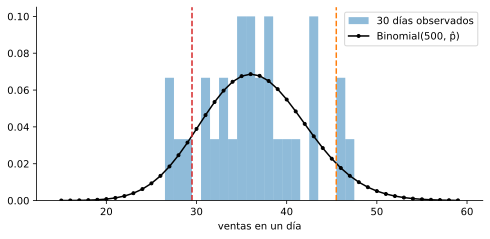

# 1. Estimación: de los datos al modelo

> Versión web, con demos interactivas: <https://alberpro.com/nebrija-mpan/topics/inferencia/estimacion/>

> ℹ️ **Antes de empezar**
>
> Esta página usa la **media** y la **varianza** de una distribución ([variables aleatorias](../variables-aleatorias/variables.md#media-y-varianza-de-una-distribución)), la **función de distribución** para calcular probabilidades de rangos, y las distribuciones **Bernoulli** y **binomial** ([distribuciones](../variables-aleatorias/distribuciones.md)).

En el tema anterior describimos variables aleatorias con su distribución, pero hicimos trampa: casi siempre **dábamos** los parámetros. "Entran de media 4 clientes por hora", "el 5 % de las visitas acaba en compra". En la vida real nadie nos dice esos números. El director comercial no sabe qué probabilidad tiene un cliente de comprar: tiene el registro de ventas de las últimas semanas. Esta página da el paso de los datos al modelo: distinguir lo que **queremos saber** (la población) de lo que **podemos calcular** (la muestra), estimar los parámetros con los datos y usar el modelo estimado para tomar decisiones.

**El caso que recorre el tema.** Una tienda online envía cada día un email promocional a **500 clientes**, y cada cliente que lo recibe compra o no compra. Cada venta deja un margen de **15 €**, y la campaña cuesta **450 € al día**, así que hacen falta al menos $450/15 = 30$ ventas para cubrir costes. El almacén puede preparar **como máximo 45 pedidos al día**. Marketing quiere saber qué proporción de clientes compra, cuántas ventas esperar y con qué probabilidad un día perderemos dinero o saturaremos el almacén.

Esta página y la [siguiente](variabilidad.md) siguen el cuaderno de la sesión, que puedes ejecutar en Colab. Allí los datos se simulan sin semilla, así que cada ejecución da resultados distintos de los de esta página:

**Cuaderno de la sesión: ventas de una campaña de email** &nbsp; [](https://colab.research.google.com/github/ami232/nebrija-mpan/blob/main/topics/inferencia/notebook.ipynb) &nbsp; [descargar .ipynb](notebook.ipynb)

## Población y muestra

Lo que tenemos son **datos**: una **muestra** $x_1, \ldots, x_n$ de una **población** mucho mayor (los clientes de este mes frente a todos los clientes, presentes y futuros). La distribución de la población existe, con su media $\mu$ y su varianza $\sigma^2$, pero **no la conocemos**. Con la muestra calculamos cantidades que la imitan:

| | Población (desconocida) | Muestra (calculable) |
|---|---|---|
| Media | $\mu = \mathbb{E}[X]$ | $\bar{x} = \dfrac{1}{n}\displaystyle\sum_{i=1}^{n} x_i$ |
| Desviación típica | $\sigma$ | $s = \sqrt{\dfrac{1}{n - 1}\displaystyle\sum_{i=1}^{n} (x_i - \bar{x})^2}$ |
| Proporción | $p$ | $\hat{p} = $ proporción de unos en la muestra |

La convención de notación es útil: **letras griegas** ($\mu$, $\sigma$, $p$) para los parámetros de la población y **letras latinas o con acento circunflejo** ($\bar{x}$, $s$, $\hat{p}$) para lo que calculamos con datos. El acento circunflejo recuerda que son **estimaciones**: con otra muestra saldrían otros números.

La desviación típica de la muestra se suele calcular dividiendo entre $n - 1$ y no entre $n$. El motivo es que los datos siempre están, en conjunto, algo más cerca de su propia media $\bar{x}$ que de la verdadera $\mu$, y dividir entre $n$ subestimaría ligeramente la dispersión. Con muestras grandes, la diferencia es despreciable.

> ⚠️ **Cada herramienta usa una convención**
>
> - **pandas:** `serie.var()` y `serie.std()` dividen entre **n − 1** (`ddof=1`).
> - **NumPy:** `np.var(x)` y `np.std(x)` dividen entre **n** (`ddof=0`).
>
> Si dos personas obtienen desviaciones típicas distintas con los mismos datos, casi siempre es esto.

## El modelo de la campaña

Antes de estimar nada hay que decidir **qué distribución** describe los datos. Cada cliente compra o no compra, así que lo modelamos con una [Bernoulli](../variables-aleatorias/distribuciones.md#bernoulli-un-sí-o-un-no): $Y_i = 1$ si el cliente $i$ compra, con probabilidad $p$. Las ventas de un día son la suma de los 500 resultados y, si los clientes son independientes y todos tienen la misma $p$, siguen una [binomial](../variables-aleatorias/distribuciones.md#binomial-contar-éxitos):

$$X = Y_1 + Y_2 + \cdots + Y_{500} \sim \text{Binomial}(500,\ p)$$

Conviene escribir las **suposiciones** explícitamente, porque si fallan, fallan todos los cálculos que vienen después:

- **Independencia:** la decisión de un cliente no influye en la de otro.
- **Misma distribución:** todos los clientes, todos los días, tienen la misma probabilidad de compra $p$.

El modelo tiene un único parámetro desconocido, $p$. Si lo conociéramos, la binomial respondería a todas las preguntas de marketing. El problema es estimarlo.

## Estimar los parámetros: máxima verosimilitud

¿Qué valor de $p$ elegimos? La idea de la **máxima verosimilitud** es elegir el valor que hace **más probables los datos que hemos observado**. Un ejemplo pequeño lo muestra. Supón que de 10 clientes compran 2. Si la probabilidad de compra fuera $p$, la probabilidad de observar esa secuencia concreta sería $p^2 (1 - p)^8$. Probemos varios valores:

| $p$ | 0.1 | 0.2 | 0.3 | 0.5 |
|---|---|---|---|---|
| $p^2(1 - p)^8$ | 0.00430 | **0.00671** | 0.00519 | 0.00098 |

Con $p = 0.5$, ver solo 2 compras de 10 sería muy raro. Con $p = 0.1$ también es poco probable, porque esperaríamos solo una. El valor que mejor explica los datos es $p = 0.2$, que es justo la proporción observada, $2/10$.

> 📘 **Definición: estimador de máxima verosimilitud**
>
> La **verosimilitud** $L(\theta)$ de un valor del parámetro $\theta$ es la probabilidad (o la densidad) de los datos observados si el parámetro valiera $\theta$. El **estimador de máxima verosimilitud** (EMV) $\hat{\theta}$ es el valor de $\theta$ que hace máxima $L(\theta)$.

Encontrar ese máximo es un problema de cálculo que no vamos a hacer: para los modelos del curso, el resultado es conocido y lo damos hecho.

| Modelo | Parámetro | Estimador de máxima verosimilitud |
|---|---|---|
| Bernoulli$(p)$ | $p$ | $\hat{p} = \bar{x}$, la proporción de unos |
| Binomial$(n, p)$, con $n$ conocido | $p$ | $\hat{p} = \bar{x}/n$: éxitos totales entre intentos totales |
| Poisson$(\lambda)$ | $\lambda$ | $\hat{\lambda} = \bar{x}$ |
| Normal$(\mu, \sigma^2)$ | $\mu$, $\sigma$ | $\hat{\mu} = \bar{x}$, $\quad \hat{\sigma} = \sqrt{\frac{1}{n}\sum (x_i - \bar{x})^2}$ |
| Uniforme$(a, b)$, discreta o continua | $a$, $b$ | $\hat{a} = \min x_i$, $\quad \hat{b} = \max x_i$ |

Casi todos los estimadores son la **media muestral**, y tiene sentido: en esas distribuciones, el parámetro es la media o se obtiene directamente de ella. La excepción es la uniforme, porque lo único que sabemos de sus extremos es que ningún dato puede quedar fuera de ellos. El estimador de $\sigma$ divide entre $n$; en la práctica se usa casi siempre $s$, que divide entre $n - 1$, y con muestras de cierto tamaño ambos coinciden en la práctica.

## La campaña: estimar p

Simulamos 30 días de campaña. Para simular hay que elegir un valor "real" de $p$, que en la vida real no conocemos: imagina que está escrito en un sobre cerrado. Lo usamos para generar los datos y, al final, para ver cuánto nos hemos equivocado.

```python
import numpy as np
import pandas as pd
import matplotlib.pyplot as plt
from scipy import stats

clientes_dia = 500    # emails al día: la n de la binomial
margen_venta = 15     # € por venta
coste_dia = 450       # € por día de campaña
capacidad = 45        # pedidos que el almacén prepara al día
equilibrio = 30       # ventas necesarias para cubrir costes: 450 / 15

p_real = 0.07         # el sobre cerrado: en la práctica no lo conocemos
rng = np.random.default_rng(2)
compras = rng.binomial(n=1, p=p_real, size=(30, clientes_dia))   # una Bernoulli por cliente y día
ventas = pd.Series(compras.sum(axis=1), index=range(1, 31), name="ventas")
ventas.head()
```

```text
1    32
2    41
3    47
4    27
5    38
Name: ventas, dtype: int64
```

Cada fila de `compras` es un día y cada columna un cliente. Lo que suele llegar a marketing es el resumen diario, la serie `ventas`. Según la tabla, el estimador de $p$ es la proporción de compras: el total de ventas entre el total de emails, que es lo mismo que la media de los ceros y unos.

```python
p_hat = compras.mean()                   # = ventas.sum() / (30 * 500)
print(f"ventas totales: {ventas.sum()} de {compras.size} emails")
```

```text
ventas totales: 1094 de 15000 emails
```

```python
print(f"p estimada: {p_hat:.4f}   p real: {p_real}   error: {p_hat - p_real:+.4f}")
```

```text
p estimada: 0.0729   p real: 0.07   error: +0.0029
```

La estimación, $\hat{p} \approx 0.0729$, se queda cerca del valor real, pero no lo clava. En la vida real no podríamos abrir el sobre, así que no sabríamos cuánto nos hemos equivocado. Cuantificar ese error, sin conocer $p$, es el objetivo de la [siguiente página](variabilidad.md).

## Usar el modelo estimado para decidir

Con $\hat{p}$ tenemos un modelo para las ventas de un día cualquiera, $X \sim \text{Binomial}(500,\ \hat{p})$, y con la [función de distribución](../variables-aleatorias/variables.md#la-función-de-distribución-una-herramienta-para-todo) respondemos a cualquier pregunta sobre rangos. En una variable discreta hay que cuidar los extremos: "menos de 30" es "29 o menos".

| Pregunta | Fórmula | En Python |
|---|---|---|
| exactamente 35 ventas | $f(35)$ | `pmf(35)` |
| perder dinero: menos de 30 ventas | $P(X \le 29) = F(29)$ | `cdf(29)` |
| saturar el almacén: más de 45 | $P(X > 45) = 1 - F(45)$ | `sf(45)` |
| día normal: entre 30 y 45 | $F(45) - F(29)$ | `cdf(45) - cdf(29)` |

```python
modelo = stats.binom(n=clientes_dia, p=p_hat)

p_perdidas = modelo.cdf(equilibrio - 1)
p_saturacion = modelo.sf(capacidad)
p_normal = modelo.cdf(capacidad) - modelo.cdf(equilibrio - 1)

print(f"ventas esperadas: {modelo.mean():.1f}, desviación típica: {modelo.std():.1f}")
```

```text
ventas esperadas: 36.5, desviación típica: 5.8
```

```python
print(f"P(X = 35)       = {modelo.pmf(35):.4f}")
```

```text
P(X = 35)       = 0.0675
```

```python
print(f"P(pérdidas)     = {p_perdidas:.4f}")
```

```text
P(pérdidas)     = 0.1130
```

```python
print(f"P(saturación)   = {p_saturacion:.4f}")
```

```text
P(saturación)   = 0.0638
```

```python
print(f"P(día normal)   = {p_normal:.4f}")
```

```text
P(día normal)   = 0.8232
```

```python
print(f"días con pérdidas al mes: {30 * p_perdidas:.1f}")
```

```text
días con pérdidas al mes: 3.4
```

```python
print(f"beneficio medio al día:   {margen_venta * modelo.mean() - coste_dia:.0f} €")
```

```text
beneficio medio al día:   97 €
```

El modelo espera unas 36.5 ventas al día. Aun así, tener exactamente 35 solo ocurre un 7 % de los días: con tantos valores posibles, cada uno por separado es poco probable, y por eso en negocio se pregunta casi siempre por rangos. Un día de cada nueve, aproximadamente, la campaña pierde dinero (unos 3.4 días al mes), y un 6 % de los días se satura el almacén. En promedio, la campaña deja unos 97 € al día.

### ¿Se parece el modelo a los datos?

Un modelo estimado siempre da números, aunque las suposiciones no se cumplan. Por eso hay que compararlo con los datos:

```python
k = np.arange(15, 60)
plt.figure(figsize=(8, 3.5))
plt.hist(ventas, bins=np.arange(14.5, 60.5, 1), density=True, alpha=0.5, label="30 días observados")
plt.plot(k, modelo.pmf(k), "o-", color="black", markersize=3, label="Binomial(500, p̂)")
plt.axvline(equilibrio - 0.5, color="tab:red", linestyle="--")
plt.axvline(capacidad + 0.5, color="tab:orange", linestyle="--")
plt.xlabel("ventas en un día")
plt.legend()
plt.show()
```



```python
pd.DataFrame(
    {
        "modelo": [p_perdidas, p_normal, p_saturacion],
        "observado (30 días)": [
            (ventas < equilibrio).mean(),
            ventas.between(equilibrio, capacidad).mean(),
            (ventas > capacidad).mean(),
        ],
    },
    index=["pérdidas (< 30)", "normal (30-45)", "saturación (> 45)"],
).round(3)
```

```text
                   modelo  observado (30 días)
pérdidas (< 30)     0.113                0.133
normal (30-45)      0.823                0.767
saturación (> 45)   0.064                0.100
```

Las columnas no coinciden exactamente, y no deben: la columna observada se basa en solo 30 días y es muy irregular. El modelo aprovecha mucho mejor la información, porque usa los 15 000 emails para estimar $p$ y deduce de ahí la distribución completa. Lo importante es que no haya discrepancias sistemáticas. Otra comprobación rápida es la dispersión: la varianza de las ventas diarias observadas es 30.7, y la del modelo, $500\,\hat{p}(1 - \hat{p}) \approx 33.8$. Son compatibles. Si los datos variaran mucho más que el modelo, sería una señal de que $p$ cambia de un día a otro. Es justo lo que pasa en el paso 6 de la [práctica guiada](practica.md#paso-6-revisar-las-suposiciones).

> ⛔ **Errores frecuentes**
>
> - **Confundir la estimación con el parámetro.** $\hat{p} = 0.0729$ es una estimación de $p$, no $p$. Con otros 30 días saldría otro número.
> - **Mezclar $n$ y $n - 1$** entre herramientas sin darse cuenta.
> - **Estimar sin comprobar el modelo.** El estimador siempre da un número, aunque la distribución supuesta no encaje. Compara el modelo con los datos: el histograma frente a la PMF, la varianza observada frente a la del modelo.
> - **Olvidar los extremos en una discreta:** "menos de 30" es `cdf(29)`, no `cdf(30)`.

> ✅ **Lo esencial**
>
> - Los parámetros de la **población** ($\mu$, $\sigma$, $p$) son desconocidos. Con una **muestra** calculamos estimaciones ($\bar{x}$, $s$, $\hat{p}$) que los imitan.
> - Antes de estimar hay que elegir un **modelo** y escribir sus **suposiciones**.
> - El **estimador de máxima verosimilitud** es el valor del parámetro que hace más probables los datos observados. Para Bernoulli, binomial, Poisson y normal es la media muestral (dividida entre $n$ en la binomial); para la uniforme, el mínimo y el máximo.
> - Con el modelo estimado se responden preguntas de negocio sobre rangos con la función de distribución.
> - Una estimación tiene **incertidumbre**: con otra muestra saldría otra. Medirla es el objetivo de la [siguiente página](variabilidad.md).

## Ejercicios

**1.** Con la muestra 4, 8, 6, 2, calcula la desviación típica dividiendo entre $n$ y entre $n - 1$. ¿Qué daría `np.std` y qué daría `pd.Series.std`?

<details>
<summary>✅ <b>Solución</b></summary>

$\bar{x} = 5$. Las desviaciones son $-1, 3, 1, -3$, y sus cuadrados suman $1 + 9 + 1 + 9 = 20$. Dividiendo entre $n = 4$ sale una varianza de 5 y una desviación típica de $\sqrt{5} \approx$ **2.24**, que es lo que da `np.std(x)`. Dividiendo entre $n - 1 = 3$ sale $\sqrt{6.67} \approx$ **2.58**, que es lo que da `pd.Series(x).std()`. Con solo 4 datos la diferencia es notable.

</details>

**2.** De 5 clientes, compra 1. Calcula la verosimilitud $p(1 - p)^4$ para $p = 0.1$, $0.2$ y $0.5$. ¿Cuál es la más alta? ¿Coincide con lo que dice la tabla de estimadores?

<details>
<summary>✅ <b>Solución</b></summary>

$L(0.1) = 0.1 \cdot 0.9^4 \approx 0.0656$, $L(0.2) = 0.2 \cdot 0.8^4 \approx 0.0819$ y $L(0.5) = 0.5 \cdot 0.5^4 \approx 0.0312$. La más alta es la de $p = 0.2$, y coincide con el estimador de la tabla: la proporción observada, $\hat{p} = 1/5 = 0.2$.

</details>

**3.** Ocho entregas tardaron 46, 51, 49, 55, 44, 50, 47 y 53 horas. Suponiendo un modelo normal, estima $\mu$ y $\sigma$ (con $n$ y con $n - 1$) y la probabilidad de que una entrega supere las 56 horas.

<details>
<summary>✅ <b>Solución</b></summary>

$\hat{\mu} = \bar{x} = 395/8 = 49.375$ h. El estimador de máxima verosimilitud de $\sigma$, que divide entre $n$, da $\hat{\sigma} \approx 3.43$ h, y $s$, que divide entre $n - 1$, da 3.66 h.

Con $s$: $P(X > 56) = $ `stats.norm(49.375, 3.66).sf(56)` $\approx 0.035$. Con $\hat{\sigma}$ sale 0.027. Con solo 8 datos, la elección entre $n$ y $n - 1$ cambia apreciablemente la probabilidad de la cola. Las dos estimaciones son además bastante inseguras: la [siguiente página](variabilidad.md) explica cuánto.

</details>

**4.** Una tienda envía 200 emails al día. Durante 5 días vendió 12, 9, 15, 10 y 14 unidades. Con un modelo binomial, estima $p$ y la probabilidad de un día con 15 ventas o más.

<details>
<summary>✅ <b>Solución</b></summary>

Éxitos totales entre intentos totales: $\hat{p} = 60/1000 = 0.06$, que es la media diaria, 12, dividida entre $n = 200$.

"15 o más" es lo contrario de "14 o menos": $P(X \ge 15) = $ `stats.binom(200, 0.06).sf(14)` $\approx 0.222$. Más o menos un día de cada cinco.

</details>

**5.** *(Más difícil)* Durante seis días, un proveedor llegó a las 9:40, 11:15, 10:05, 12:30, 9:10 y 11:50. Modela la hora de llegada como una uniforme continua. (a) Estima $a$ y $b$. (b) Con el modelo estimado, ¿qué probabilidad hay de que llegue antes de las 10:00? (c) ¿Crees que el estimador tiende a quedarse corto o a pasarse con la anchura del intervalo? ¿Por qué?

<details>
<summary>✅ <b>Solución</b></summary>

(a) $\hat{a} = \min = $ 9:10 y $\hat{b} = \max = $ 12:30: un intervalo de 200 minutos.

(b) De 9:10 a 10:00 hay 50 minutos de los 200: $50/200 = 0.25$.

(c) **Se queda corto.** El intervalo real contiene todas las llegadas posibles, y las seis observadas están dentro de él, así que el mínimo observado nunca es menor que $a$ ni el máximo mayor que $b$. Con pocos datos, lo más probable es que el proveedor pueda llegar algo antes de las 9:10 o algo después de las 12:30.

</details>

[← Volver al tema](index.md) [Siguiente: Cuánto se equivoca una estimación →](variabilidad.md)
