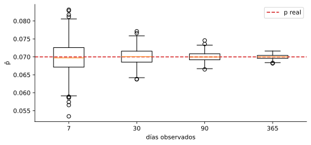
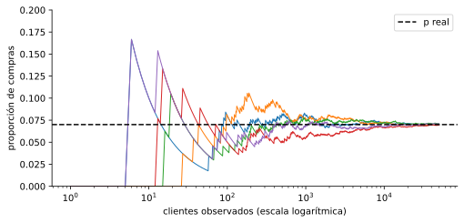
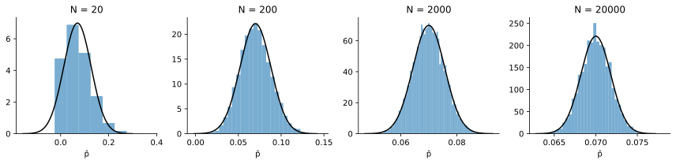

# 2. Cuánto se equivoca una estimación

> Versión web, con demos interactivas: <https://alberpro.com/nebrija-mpan/topics/inferencia/variabilidad/>

> ℹ️ **Antes de empezar**
>
> Esta página continúa el caso de la campaña de email de la [página 1](estimacion.md): el modelo $\text{Binomial}(500, p)$ y la estimación $\hat{p}$. Usa también la [media y la varianza](../variables-aleatorias/variables.md#media-y-varianza-de-una-distribución) de una distribución y la [distribución normal](../variables-aleatorias/distribuciones.md#normal-la-campana-de-gauss).

En la página anterior estimamos la probabilidad de compra con 30 días de campaña y obtuvimos $\hat{p} \approx 0.0729$, cuando el valor real era 0.07. Pudimos medir el error porque los datos eran simulados y conocíamos $p$. En la vida real no lo conocemos, así que la pregunta es: **¿cuánto puede equivocarse una estimación, sin saber el valor real?** Esta página responde en tres pasos. Primero vemos, simulando, que una estimación cambia de una muestra a otra. Después medimos cuánto, con el **error estándar**. Por último, la **ley de los grandes números** y el **teorema del límite central** describen cómo se comporta la estimación cuando hay muchos datos.

## Otra muestra, otro resultado

Si la campaña hubiera durado **otros** 30 días, los datos habrían sido distintos, y también $\hat{p}$ y todas las probabilidades calculadas con él. Para verlo, metemos el análisis de la página 1 en una función y lo repetimos 10 veces:

```python
import numpy as np
import pandas as pd
import matplotlib.pyplot as plt
from scipy import stats

clientes_dia, equilibrio, capacidad = 500, 30, 45
p_real = 0.07
rng = np.random.default_rng(3)

def analizar_campana(dias):
    # Simula una campaña de `dias` días y devuelve las estimaciones
    compras = rng.binomial(n=1, p=p_real, size=(dias, clientes_dia))
    p_hat = compras.mean()
    modelo = stats.binom(n=clientes_dia, p=p_hat)
    return {
        "p̂": p_hat,
        "P(pérdidas)": modelo.cdf(equilibrio - 1),
        "P(saturación)": modelo.sf(capacidad),
    }

repeticiones = pd.DataFrame([analizar_campana(dias=30) for _ in range(10)])
repeticiones.round(4)
```

```text
       p̂  P(pérdidas)  P(saturación)
0  0.0697       0.1736         0.0349
1  0.0714       0.1396         0.0483
2  0.0701       0.1649         0.0378
3  0.0701       0.1663         0.0373
4  0.0671       0.2393         0.0197
5  0.0697       0.1736         0.0349
6  0.0703       0.1621         0.0389
7  0.0683       0.2063         0.0261
8  0.0713       0.1421         0.0471
9  0.0725       0.1206         0.0588
```

Las estimaciones de $p$ se mueven poco, entre 0.067 y 0.073, pero las probabilidades de negocio se mueven mucho más: la de perder dinero va del 12 % al 24 %, y la de saturar el almacén se triplica de una repetición a otra. Un cambio pequeño en $\hat{p}$ desplaza toda la distribución de las ventas y cambia mucho la probabilidad de los valores extremos.

La conclusión es el cambio de perspectiva clave de este tema: **una estimación es una variable aleatoria**. Depende de qué datos nos hayan tocado y, si repitiéramos el estudio, saldría otra. Por tanto tiene su propia distribución, que se llama **distribución muestral**. Si tu jefe pregunta "¿cuál es la probabilidad de perder dinero un día?", no basta con dar un número: hay que decir también cuánto podría variar.

## Más datos, menos variación

¿Ayuda observar más días? Repetimos la estimación 1000 veces para campañas de una semana, un mes, tres meses y un año. No hay que confundir dos tamaños: la $n = 500$ de la binomial (emails por día) no cambia. Lo que crece es el **tamaño de la muestra**, el total de clientes observados $N = \text{días} \times 500$.

```python
duraciones = [7, 30, 90, 365]
estimaciones = {}
for d in duraciones:
    N = d * clientes_dia
    # el total de compras de N clientes es una Binomial(N, p): simulamos 1000 campañas
    estimaciones[d] = rng.binomial(n=N, p=p_real, size=1000) / N

plt.figure(figsize=(8, 3.5))
plt.boxplot([estimaciones[d] for d in duraciones], tick_labels=[str(d) for d in duraciones])
plt.axhline(p_real, color="tab:red", linestyle="--", label="p real")
plt.xlabel("días observados")
plt.ylabel("p̂")
plt.legend()
plt.show()
```



```python
pd.DataFrame(
    {
        "clientes (N)": [d * clientes_dia for d in duraciones],
        "media de p̂": [estimaciones[d].mean() for d in duraciones],
        "desv. típica de p̂": [estimaciones[d].std() for d in duraciones],
        "√(p(1−p)/N)": [np.sqrt(p_real * (1 - p_real) / (d * clientes_dia)) for d in duraciones],
    },
    index=pd.Index(duraciones, name="días"),
).round(4)
```

```text
      clientes (N)  media de p̂  desv. típica de p̂  √(p(1−p)/N)
días                                                            
7             3500       0.0699              0.0043       0.0043
30           15000       0.0700              0.0022       0.0021
90           45000       0.0700              0.0012       0.0012
365         182500       0.0700              0.0006       0.0006
```

Hay dos regularidades. Con cualquier duración, las estimaciones están **centradas en el valor real**: la media de los $\hat{p}$ es 0.070. El estimador no se equivoca sistemáticamente ni hacia arriba ni hacia abajo. Y al aumentar la muestra la **dispersión baja**, pero no en proporción: de 7 a 30 días los datos se multiplican por 4 y la desviación típica solo se divide entre 2. La última columna da la fórmula exacta de esa dispersión, que deducimos a continuación.

## El error estándar

La proporción $\hat{p}$ es la media de los ceros y unos $Y_1, \ldots, Y_N$. Para saber cómo varía una media necesitamos dos propiedades de la esperanza y la varianza:

- **Una constante sale de la esperanza tal cual y de la varianza al cuadrado:** $\mathbb{E}[aX] = a\,\mathbb{E}[X]$ y $\mathbb{V}[aX] = a^2\,\mathbb{V}[X]$. Si pasas de euros a céntimos, la media se multiplica por 100 y la varianza, que está en unidades al cuadrado, por 10 000.
- **Al sumar, las esperanzas se suman siempre, y las varianzas se suman si las variables son independientes:** $\mathbb{E}[X + Y] = \mathbb{E}[X] + \mathbb{E}[Y]$, y $\mathbb{V}[X + Y] = \mathbb{V}[X] + \mathbb{V}[Y]$ si $X$ e $Y$ son independientes.

Si $X_1, \ldots, X_n$ son independientes, con media $\mu$ y varianza $\sigma^2$, la media muestral $\bar{X} = \frac{1}{n}(X_1 + \cdots + X_n)$ cumple, aplicando las dos propiedades,

$$\mathbb{E}[\bar{X}] = \frac{1}{n} \cdot n\mu = \mu \qquad\qquad \mathbb{V}[\bar{X}] = \frac{1}{n^2} \cdot n\sigma^2 = \frac{\sigma^2}{n}$$

> 📘 **Definición: error estándar**
>
> El **error estándar** (*standard error*, SE) de un estimador es su desviación típica. Para la media muestral:
>
> $$\text{SE}(\bar{X}) = \frac{\sigma}{\sqrt{n}} \qquad\qquad \text{y, como no conocemos } \sigma, \text{ lo estimamos con } \frac{s}{\sqrt{n}}$$
>
> Para una proporción, que es la media de ceros y unos de una Bernoulli, con $\sigma^2 = p(1 - p)$:
>
> $$\text{SE}(\hat{p}) = \sqrt{\frac{p(1 - p)}{n}} \;\approx\; \sqrt{\frac{\hat{p}(1 - \hat{p})}{n}}$$

Es la última columna de la tabla anterior, que coincide con la dispersión simulada. Con los 15 000 clientes de un mes, $\text{SE} = \sqrt{0.07 \cdot 0.93 / 15\,000} \approx 0.0021$. Lo importante es que el error estándar se puede **estimar con una sola muestra**, sustituyendo $p$ por $\hat{p}$, sin repetir la campaña ni conocer el valor real.

El resultado tiene dos consecuencias importantes.

**La media muestral es insesgada.** $\mathbb{E}[\bar{X}] = \mu$: en promedio, la estimación acierta. Una muestra concreta se desvía, pero no hay un error sistemático, siempre que la muestra sea **aleatoria**. Si solo se mide a los clientes que abren el email, la fórmula sigue dando un número, pero estima otra cosa (veremos este problema en el [tema de sesgos](../sesgos/index.md)).

**La precisión crece con la raíz de $n$, no con $n$.** Para reducir el error a la mitad hay que **cuadruplicar** la muestra, y para dividirlo entre 10, multiplicarla por 100. Por eso las encuestas rara vez superan unos pocos miles de personas: a partir de ahí, cada punto de precisión cuesta muchísimo.

> ⚠️ **Desviación típica frente a error estándar**
>
> Son dos cosas distintas que se confunden a menudo:
>
> - $\sigma$ (o $s$) mide cuánto varían los **individuos**: un cliente, o un día, de otro.
> - $\sigma/\sqrt{n}$ mide cuánto variaría la **estimación**: la media de una muestra de otra.
>
> Con más datos, $s$ no disminuye (los clientes no se vuelven más parecidos), pero el error estándar sí.

## La ley de los grandes números

Lo que acabamos de ver tiene nombre: el error estándar tiende a cero al crecer $n$, así que la media muestral acaba pegada a la media real.

> 📘 **Ley de los grandes números**
>
> Si $X_1, X_2, \ldots$ son independientes y tienen la misma distribución, con media $\mu$, la media muestral $\bar{X}_n$ se acerca cada vez más a $\mu$ a medida que $n$ crece.

En la campaña, $\mu = p$: la proporción de compras observada se acerca a la probabilidad real de compra cuantos más clientes observamos. Es lo que justifica estimar probabilidades con frecuencias, y lo que hace funcionar a los seguros o a los casinos: cada cliente es impredecible, pero el promedio de cientos de miles no lo es. Para verlo, seguimos 5 campañas cliente a cliente y calculamos la proporción de compras acumulada tras cada email:

```python
N_max = 50_000
N = np.arange(1, N_max + 1)
plt.figure(figsize=(8, 3.5))
for _ in range(5):
    y = rng.binomial(n=1, p=p_real, size=N_max)
    plt.plot(N, y.cumsum() / N, linewidth=1)
plt.axhline(p_real, color="black", linestyle="--", label="p real")
plt.xscale("log")
plt.ylim(0, 0.2)
plt.xlabel("clientes observados (escala logarítmica)")
plt.ylabel("proporción de compras")
plt.legend()
plt.show()
```



Al principio, con pocos clientes, la proporción da saltos enormes: tras el primer cliente vale 0 o 1. Al acumular clientes, las cinco trayectorias se pegan a $p$.

> ⚠️ **Lo que la ley no dice**
>
> No dice que después de una racha de días malos "toque" una racha buena para compensar. Cada cliente sigue siendo independiente de los anteriores. La media se acerca a $p$ porque los datos nuevos **diluyen** las rachas, no porque las compensen.

## El teorema del límite central

La ley de los grandes números dice **hacia dónde** va $\hat{p}$, y el error estándar, **cuánto** se dispersa con una muestra finita. Para calcular probabilidades nos falta la **forma** de esa dispersión: si repitiéramos la campaña muchas veces, ¿qué forma tendría el histograma de los $\hat{p}$? La respuesta es uno de los resultados más importantes de la estadística.

> 📘 **Teorema del límite central (TLC)**
>
> Si $X_1, \ldots, X_n$ son **independientes**, con la **misma distribución** de media $\mu$ y varianza $\sigma^2$ **finita**, entonces, para $n$ suficientemente grande:
>
> $$\bar{X} \approx N\!\left(\mu,\ \frac{\sigma^2}{n}\right) \qquad\Longleftrightarrow\qquad Z = \frac{\bar{X} - \mu}{\sigma / \sqrt{n}} \approx N(0, 1)$$
>
> **sea cual sea la distribución de las $X_i$.**

Lo sorprendente es la última frase. Cada $Y_i$ de la campaña es un 0 o un 1, que no se parece en nada a una campana. Y aun así, la **media** de muchos de ellos tiene forma de campana: para una Bernoulli, $\mu = p$ y $\sigma^2 = p(1 - p)$, así que el TLC dice que $\hat{p} \approx N\big(p,\ p(1 - p)/N\big)$. Comprobémoslo simulando 10 000 campañas con distinto número de clientes $N$:

```python
tamanos = [20, 200, 2000, 20_000]
fig, axes = plt.subplots(1, len(tamanos), figsize=(12, 3))
for ax, N in zip(axes, tamanos):
    p_hats = rng.binomial(n=N, p=p_real, size=10_000) / N
    se = np.sqrt(p_real * (1 - p_real) / N)
    # con N pequeño, p̂ solo toma valores k/N: un intervalo por cada valor posible
    bins = np.arange(p_hats.min() - 0.5 / N, p_hats.max() + 1 / N, 1 / N) if N <= 2000 else 40
    ax.hist(p_hats, bins=bins, density=True, alpha=0.6)
    x = np.linspace(p_real - 4 * se, p_real + 4 * se, 300)
    ax.plot(x, stats.norm.pdf(x, loc=p_real, scale=se), color="black")
    ax.set_title(f"N = {N}")
    ax.set_xlabel("p̂")
plt.tight_layout()
plt.show()
```



Con $N = 20$ el histograma es asimétrico y muy irregular: con $p = 0.07$, lo más frecuente es que haya 0, 1 o 2 compras, y la normal predice valores negativos de $\hat{p}$, que son imposibles. Con $N = 200$ ya se parece a una campana, y a partir de ahí la aproximación es excelente. Al promediar, los valores altos y bajos se compensan y quedan muchas pequeñas fluctuaciones sumadas, que es la situación en la que aparece la normal. Por eso la normal es tan omnipresente, y por eso podemos hacer inferencia sobre medias **sin saber cuál es la distribución de los datos**.

Comprueba en la demo cómo la distribución de la media pasa de ser la población original ($n = 1$) a una campana al aumentar $n$, incluso con poblaciones muy asimétricas:

▶️ [Demo interactiva: tlc](https://alberpro.com/nebrija-mpan/topics/inferencia/demo_tlc.html) (en la web)

**¿Qué es «$n$ suficientemente grande»?** Depende de lo asimétrica que sea la población. Con poblaciones aproximadamente simétricas, $n \approx 10$ ya basta. La regla práctica habitual es $n \ge 30$. Para proporciones se pide que haya bastantes éxitos y fracasos esperados: $np \ge 5$ y $n(1 - p) \ge 5$. Con $N = 20$ y $p = 0.07$, $Np = 1.4$, y por eso la campana no encajaba. Si la población tiene una cola muy larga, como los importes con unos pocos clientes enormes, puede hacer falta bastante más.

> ⚠️ **Lo que el TLC **no** dice**
>
> - **No dice que los datos se vuelvan normales.** Cada cliente sigue siendo un 0 o un 1, tengas 30 o 30 000. Lo que se vuelve normal es la **media**.
> - **No arregla una muestra sesgada.** Si las observaciones no son independientes o no representan a la población, el TLC no ayuda.

> ✏️ **Ejemplo resuelto: ¿cuánto puede desviarse un mes?**
>
> Con $p = 0.07$ y los 15 000 clientes de un mes, ¿qué probabilidad hay de que la proporción observada se desvíe del valor real en más de medio punto, $|\hat{p} - p| > 0.005$?
>
> 1. **Error estándar:** $\sqrt{0.07 \cdot 0.93 / 15\,000} \approx 0.00208$.
> 2. **Tipificar:** medio punto son $0.005 / 0.00208 \approx 2.40$ errores estándar.
> 3. **Probabilidad con la normal**, en las dos colas: $P(|Z| > 2.40) = 2 \cdot P(Z > 2.40) \approx 0.016$.
>
> Solo un 1.6 % de los meses se desviaría tanto. Con un mes de datos, la estimación de $p$ es fiable hasta el medio punto, aunque cada cliente sea completamente impredecible.

## El TLC explica la forma de la binomial

Las ventas de un día son una **suma** de 500 Bernoullis independientes, y una suma es la media multiplicada por 500. Por eso el TLC dice que la binomial también es aproximadamente normal, con su misma media y varianza:

$$\text{Binomial}(n, p) \approx N\big(np,\ np(1 - p)\big) \qquad \text{si } np \ge 5 \text{ y } n(1 - p) \ge 5.$$

La condición pide que haya suficientes éxitos y fracasos esperados para que la campana no quede "aplastada" contra el 0 o contra $n$. Puedes verlo en el [explorador de distribuciones](../variables-aleatorias/distribuciones.md#qué-distribución-uso), con la opción *Mostrar aproximación normal* de la binomial.

**La corrección de continuidad.** La binomial reparte la probabilidad en barras de anchura 1 centradas en los enteros; la normal la reparte de forma continua. La barra del valor 29 ocupa el intervalo de 28.5 a 29.5, así que "29 o menos" en la binomial corresponde a "hasta 29.5" en la normal:

$$P(X \le k) \approx P(Y \le k + 0.5), \qquad P(X \ge k) \approx P(Y \ge k - 0.5).$$

Repetimos con la normal el cálculo de la página 1, la probabilidad de perder dinero con $\hat{p} = 0.0729$:

```python
p_hat = 0.0729
mu = clientes_dia * p_hat
sigma = np.sqrt(clientes_dia * p_hat * (1 - p_hat))
print(f"Binomial exacta:       {stats.binom.cdf(29, clientes_dia, p_hat):.4f}")
```

```text
Binomial exacta:       0.1135
```

```python
print(f"Normal sin corrección: {stats.norm.cdf(29, mu, sigma):.4f}")
```

```text
Normal sin corrección: 0.1000
```

```python
print(f"Normal con corrección: {stats.norm.cdf(29.5, mu, sigma):.4f}")
```

```text
Normal con corrección: 0.1159
```

Con la corrección, la aproximación se queda muy cerca del valor exacto; sin ella, el riesgo se subestima en más de un punto. Hoy Python calcula la binomial exacta sin problemas, así que la aproximación no es necesaria para calcular. Su importancia es otra: es la base de los [intervalos de confianza para proporciones](intervalos.md) de la página siguiente.

> ⛔ **Errores frecuentes**
>
> - **Confundir $s$ con $s/\sqrt{n}$**: la dispersión de los individuos con la de la estimación.
> - **Pensar que el TLC hace normales los datos.** Solo la media (o la suma) es aproximadamente normal.
> - **Esperar que doblar la muestra divida el error a la mitad.** Hace falta cuadruplicarla.
> - **Creer que la ley de los grandes números "compensa" las rachas.** Las diluye.
> - **Olvidar las condiciones** del TLC: observaciones independientes y $n$ suficiente, sobre todo para proporciones pequeñas.

> ✅ **Lo esencial**
>
> - Toda estimación calculada con una muestra es una **variable aleatoria**: cambiaría con otra muestra. Su distribución es la **distribución muestral**.
> - La media muestral es **insesgada** y su **error estándar** es $\sigma/\sqrt{n}$, que se estima con una sola muestra. La precisión crece con la raíz del tamaño de muestra.
> - **Ley de los grandes números:** la media muestral se acerca a la media real al crecer $n$.
> - **Teorema del límite central:** la media de muchas observaciones independientes es aproximadamente normal, **sea cual sea** la distribución de los datos. Por eso la binomial se parece a una normal cuando $np$ y $n(1 - p)$ superan 5.
> - Las probabilidades de negocio de las colas son mucho más sensibles a la estimación que la propia estimación.

## Ejercicios

**1.** Los importes de los pedidos tienen una desviación típica de 40 €. ¿Cuál es el error estándar de la media con 100 pedidos? ¿Y con 400? ¿Cuántos pedidos harían falta para un error estándar de 1 €?

<details>
<summary>✅ <b>Solución</b></summary>

$40/\sqrt{100} = 4$ € y $40/\sqrt{400} = 2$ €: cuadruplicar la muestra reduce el error a la mitad. Para un error estándar de 1 € hace falta $40/\sqrt{n} = 1$, es decir, $n = 1600$ pedidos.

</details>

**2.** En una ruleta, ha salido rojo 8 veces seguidas. Un jugador dice: "por la ley de los grandes números, ahora tiene que salir negro, para que la proporción se acerque al 50 %". ¿Tiene razón?

<details>
<summary>✅ <b>Solución</b></summary>

No. Cada tirada es independiente de las anteriores, así que la probabilidad de negro en la siguiente es la misma de siempre. La ley de los grandes números no necesita compensar la racha: en 10 000 tiradas más, 8 rojos de diferencia pesan un 0.08 %, y la proporción se acerca al valor real porque la racha se **diluye** entre muchos datos nuevos.

</details>

**3.** El número de artículos por pedido tiene media 2.06 y desviación típica 1.12 (es la distribución de los pedidos de [variables aleatorias](../variables-aleatorias/variables.md#media-y-varianza-de-una-distribución)). Mañana llegarán 100 pedidos independientes. ¿Cuántos artículos en total esperas y con qué desviación típica? ¿Qué probabilidad hay de necesitar más de 225 artículos?

<details>
<summary>✅ <b>Solución</b></summary>

El total es una suma de 100 variables independientes, así que su media es $100 \cdot 2.06 = 206$ artículos y su varianza $100 \cdot 1.12^2 \approx 125.4$, con desviación típica $\sqrt{125.4} \approx 11.2$ artículos. Fíjate en que la desviación típica del total es solo 10 veces la de un pedido, no 100.

Por el TLC el total es aproximadamente normal: $P(T > 225) \approx P\left(Z > \frac{225 - 206}{11.2}\right) = P(Z > 1.70) \approx 0.045$. Con 225 artículos preparados, faltaría material uno de cada 22 días.

</details>

**4.** Una landing recibe 400 visitas y cada una convierte con probabilidad 0.3. Calcula $P(X \le 110)$ con la aproximación normal, con y sin corrección de continuidad, y compara con el valor exacto. ¿Se cumple la condición para aproximar?

<details>
<summary>✅ <b>Solución</b></summary>

La condición se cumple con holgura: $np = 120$ y $n(1 - p) = 280$. La normal aproximada es $N(120, 84)$, con $\sigma = \sqrt{400 \cdot 0.3 \cdot 0.7} \approx 9.17$.

- **Con corrección:** $P(Y \le 110.5) = P\left(Z \le \frac{110.5 - 120}{9.17}\right) = P(Z \le -1.04) \approx 0.150$.
- **Sin corrección:** $P(Y \le 110) \approx 0.138$.
- **Exacto:** `stats.binom.cdf(110, 400, 0.3)` $\approx 0.150$.

Con corrección de continuidad la aproximación coincide con el valor exacto hasta la tercera cifra; sin ella, el error es de más de un punto porcentual.

</details>

**5.** *(Más difícil)* En la campaña, con $p = 0.07$, marketing quiere estimar $p$ con un error estándar de 0.001 como mucho. ¿Cuántos clientes hay que observar? ¿Cuántos días de campaña son?

<details>
<summary>✅ <b>Solución</b></summary>

Hay que despejar $N$ en $\sqrt{0.07 \cdot 0.93 / N} \le 0.001$: $N \ge 0.07 \cdot 0.93 / 0.001^2 = 65\,100$ clientes. A 500 emails al día, son $65\,100 / 500 = 130.2$, es decir, **131 días**: algo más de cuatro meses. Pasar del error estándar de un mes (0.0021) a 0.001 exige multiplicar los datos por más de 4.

</details>

[← Estimación](estimacion.md) [Siguiente: Intervalos de confianza →](intervalos.md)
